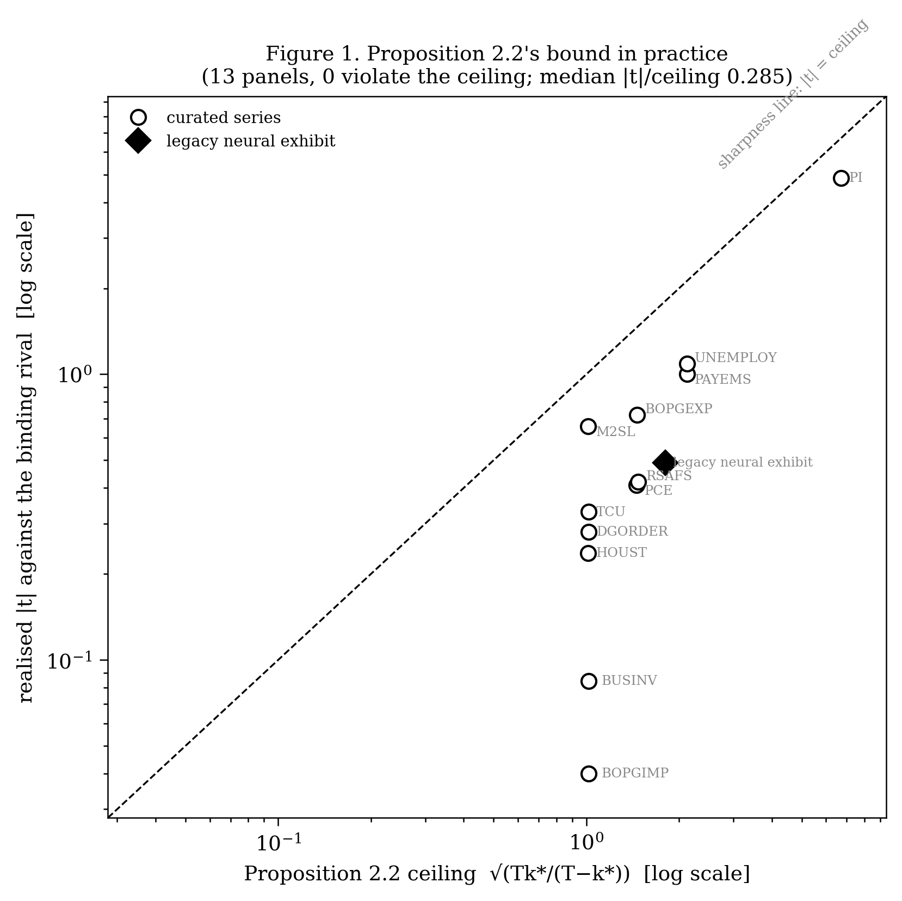
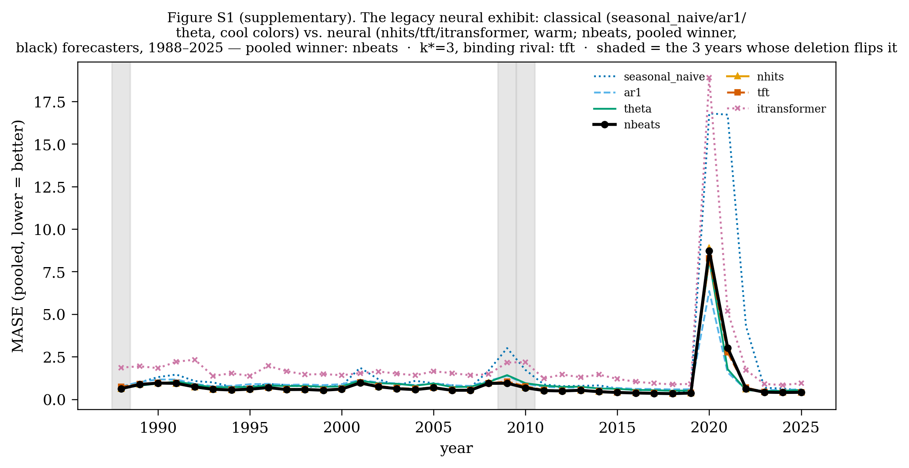
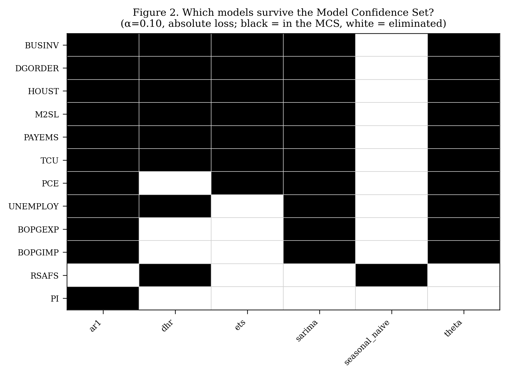
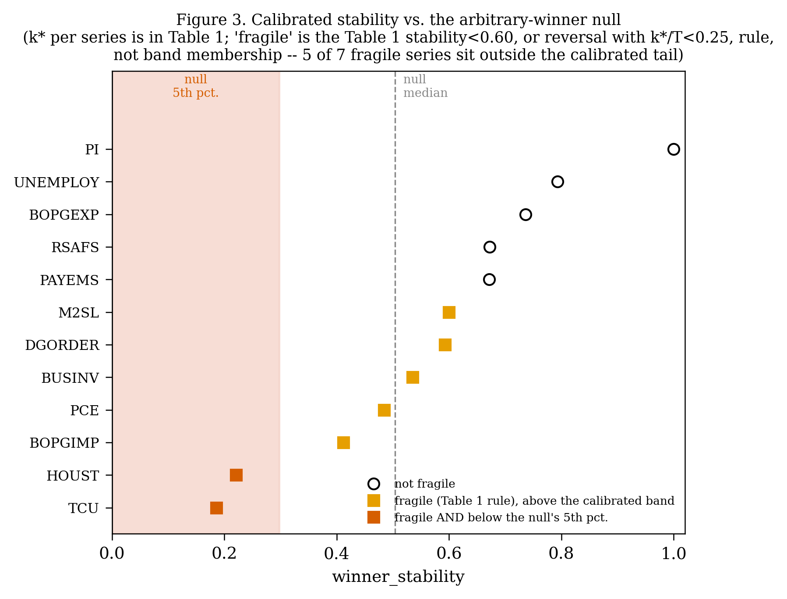
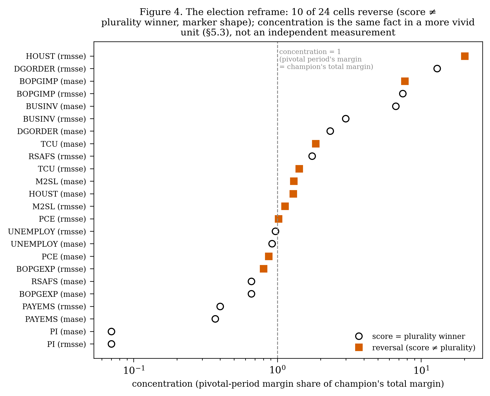
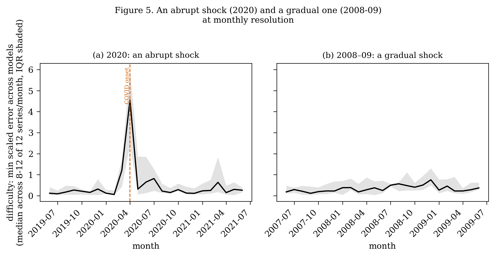
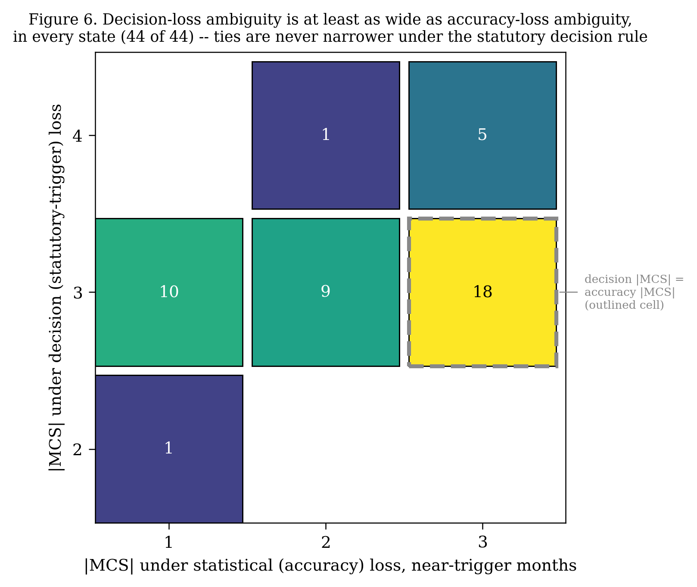

# When the Best Forecasting Model Is a Tie: Pricing Model Choice Against Data Revision in the Extended Benefits Trigger

**Sudhanshu Rai**
Independent Researcher · [ORCID 0009-0001-2447-0336](https://orcid.org/0009-0001-2447-0336) ·
me@sudhanshurai.org

---

## Abstract

Leaderboards crown a single "best" model. We introduce the decision breakdown point (k\*): the fewest periods whose removal flips the pooled winner, with a block-bootstrap null. On real-time U.S. official statistics, 11 of 12 series have multiple models statistically tied for best among six candidates at α=0.10 (invariant across the annual-resolution tuning grid); a revised-data sweep ties 56 of 74 at the same α. Projected, counterfactually, through a statutory rule (the Extended Benefits trigger), it flips in 29 single months across 24 of 50 jurisdictions; 93% are knife-edge, and on the real-time record from mid-2007, data revision moves a comparable call roughly 3 to 4 times more often like-for-like, 10 to 11 times if all nine input months are revised. A control (M4) shows selection can be unambiguous; a companion note applies it to a public leaderboard, with mixed results. k\* and its calibrated null ship as an open-source tool.

---

## 1. Introduction

Among close forecasting models scored on a few dozen evaluation periods, a leaderboard's "best" is usually a statistical tie; we measure how few periods that crown rests on, and what the tie costs when the whole tied set is carried through a real statutory rule and priced against the rule's own data revision — a bounded, second-order channel on the full record, measured rather than assumed. When a public agency, a firm, or a researcher selects "the best forecasting model" from a pool of candidates, the
selection is almost always read directly off a leaderboard: rank models by pooled out-of-sample accuracy and take
the top one. This practice implicitly assumes the ranking is a stable fact about the world rather than a fragile
artifact of the particular evaluation window that happened to be observed. We ask, directly: how much of a
leaderboard's #1 position rests on genuine, broad-based superiority, and how much rests on a small number of unusual
periods? The stakes are concrete. Which statistically tied model a forecaster happens to use shifts the month in
which a real state's unemployment-insurance Extended Benefits period for laid-off workers starts or ends, in 29
months across 24 of 50 jurisdictions, and ordinary data revision moves a comparable call roughly 3 to 4 times more often (84 versus 24 to 26 state-months — the model channel on the real-time window from mid-2007, against 29 on the full statutory window from 1993)
(Section 7, a counterfactual built on the actual statutory trigger).

We answer this with a new diagnostic object, the **decision breakdown point** (k\*), applied to real-time U.S.
official statistics — a domain that is simultaneously high-stakes (labor-market and consumption series that feed
policy decisions), publicly reproducible (vintaged data via ALFRED, the St. Louis Fed's ArchivaL version of FRED,
Federal Reserve Economic Data), and shock-prone (recessions, a pandemic). We
make one contribution — the transport of a statistically tied set through a real statutory rule, priced against the rule's own data revision (Section 7) — built on a diagnostic, k\* (AMIP's exact drop-count on a pairwise margin, Section 8), paired with a calibrated block-bootstrap null whose home-panel reading is no excess fragility beyond chance (Section 5.4). We present the components, with the findings that motivate them, in the order the paper builds them rather than in order of importance: the transport is the paper's principal contribution (Sections 8 and 10 are explicit about this ordering).

**The diagnostic and its calibrated null — a component, not the contribution.** k\* is AMIP's exact drop-count on a pairwise margin (Section 8); we formalize it as an exact, efficiently computable object (Section 2) and position it precisely against the
closest prior art — the Approximate Maximum Influence Perturbation (AMIP; Giordano, Meager & Broderick 2026) — being
explicit about what is and is not new (Section 8), given how closely the two methods relate on this specific
target. We also show the instrument carries out-of-sample information: a first-half winner from a fragile panel
persists into the second half far less often than one from a robust panel (Section 2.2, Appendix Section 13.5).

**Finding — non-separability is the norm, not the exception.** We show non-separability is the norm rather than the exception at these sample sizes: 11 of 12
curated (real-time) series, and, on a broader revised-data sweep, 56 of 74, have a statistically tied Model
Confidence Set (Section 4). We
stress-test that result against the underlying test's tuning parameters in three ways. The curated-panel count is
exactly invariant, at annual resolution, across block length, resample count, and significance level. The population-sweep count is
comparably stable across block length and resample count, but materially sensitive to significance level (60/74 at
α=0.05 to 39/74 at α=0.25 — Section 4.1). Most materially of all, scoring the population sweep on each series'
McCracken-Ng stationarity transform rather than untransformed levels lowers non-identification further, from 50 of
63 to 31 of 63 on the comparable subset — a 19-series movement, on the same order as this paper's own α-sensitivity check (Section 4.1).
We scope this deliberately. Section 3.1 measures
how similar the candidate models are (median pairwise loss correlation 0.987; median best-vs-runner-up gap 0.93%),
and Appendix Section 13.2 shows that mean set size narrows only partly, and not uniformly, when the same series
are scored at monthly resolution. The reading the
evidence best supports is that these sets are wide because the models are close together relative to the
available information — the situation a forecaster comparing reasonable specifications actually faces, and a
likely contributor rather than a fully isolated cause (Section 3.1, Section 4.3) — not that
the models are equally good in population.

**A negative result, not a contribution.** Model selection on a multi-period panel is formally an election, and the "official" pooled winner is a *score-voting* winner that can diverge from a *plurality* winner; calibrated against two nulls, that divergence and its companions sit at or below chance, and under the null that respects the models' serial dependence no statistic departs from chance in either direction (Section 5).

**The contribution — what fragility costs.** We give a general recipe for pricing a statistical tie in
decision units — carry the whole tied set, not a point pick, through the decision rule, count the calls that depend
on which member is used, and benchmark that count against the instability the rule's own inputs already carry — and
apply it to a real statutory rule (Section 7): the choice
among statistically tied models flips the Extended Benefits trigger indicator in 29 single months across 24 of 50
eligible jurisdictions — 93% knife-edge (the tied models' trigger values within 0.3 percentage points), with genuine, non-knife-edge divergence in two states — and, on the real-time window (mid-2007 onward, every month with an initial release for every state), ordinary data revision moves a comparable call roughly 3 to 4 times more often like-for-like (revising only the one leg of the trigger the model touches), and 10 to 11 times more often if every leg is revised. The implemented rule's two-prior-year arithmetic is verified against the Department of Labor's own published trigger notices (Section 7). The exercise is a counterfactual — the statute reads published data,
not forecasts — and the channel it measures is real and, on the full record, second-order. Both the diagnostic and its calibrated null are
released as an open-source, installable tool a reader can run directly on their own data, publicly named and
released in Section 12.

Alongside these, we offer one purely descriptive exhibit rather than a further contribution (Section 6):
the single most common pivotal period behind the concentration results above is the abrupt, single-month April-2020
COVID shock, not the widely cited but gradual 2008-09 recession. We are explicit that this is a description of
what two episodes look like at monthly resolution, not a measured mechanism — the curated panel shows no association
between shock-proneness and MCS size, and a population-scale check's one nominally significant joint fit proves to be a raw-scale artifact of the proxies (Section 4.3), so we do not claim shock abruptness explains the fragility documented above.

We show a control where selection *is* possible rather than universally fragile (Section 9): the M4 competition has
a unique, Pareto-dominant champion, and we also run k\* and `winner_stability` (the share of block-bootstrap
resamples in which the same model still wins) directly on the real 61-submission
panel — k\*=101 of 100,000 series, `winner_stability`=1.0 across 2,000 resamples, both pointing toward
identification. We do not compute a Model Confidence Set for M4, and we do not calibrate a chance null at this
panel's scale; within that scope, the control establishes that the fragility we document is not a universal property of leaderboards
(Section 9 states the scope of that control). A companion note
applies the same instrument to a public machine-learning leaderboard and returns a third, differentiated verdict:
comparatively identified by its crowding measure, yet flippable by a single task deletion.

**Relation to prior work.** A reader mainly interested in the paper's own results, not its positioning
against adjacent literatures, can skip directly to Section 2. The paper draws on seven literatures within the broader field of
economic and statistical forecasting (Elliott & Timmermann's 2008 survey of that field), and we position it precisely
against each rather than claim a single, larger novelty. First, robust statistics and finite-sample robustness
metrics (Hampel; Donoho & Huber's breakdown point; Walsh's 2014 clinical Fragility Index; and closest of all,
Giordano, Meager & Broderick's 2026 AMIP) ask variants of "how little data would need to change to flip a
conclusion" — we differentiate k\* from this cluster carefully in Section 8, since this is the closest lineage and
so the one most in need of a precise boundary, stated explicitly rather than only implied. Second, the forecast-evaluation literature
(Diebold & Mariano 1995, and Diebold's own 2015 retrospective on the caution that test's use warrants two decades
on; Hansen, Lunde & Nason's 2011 Model Confidence Set, which we build directly on top of;
Giacomini & White 2006; White's 2000 Reality Check; Hansen's 2005 Superior Predictive Ability test) provides the
standard machinery for asking whether models are statistically distinguishable — k\* answers the complementary
question of how fragile a declared verdict is, not whether one exists. Third, the real-time/vintage-data literature
(Croushore & Stark 2001; Croushore 2011) underlies the honesty standard we hold ourselves to throughout, and
motivates the real-time-vintage complement in Section 7. Fourth, the evaluation-multiverse and meta-science
literature (Dehghani et al.'s Benchmark Lottery; Simonsohn's specification-curve framework; Silberzahn, Uhlmann et
al.'s many-analysts studies) motivates treating aggregation-rule choice itself as an axis of fragility. Fifth,
Section 5's election reframe makes that precise using the vocabulary of computational social choice (control
by deleting voters, Bartholdi, Tovey & Trick 1992, in the destructive variant of Hemaspaandra, Hemaspaandra & Rothe
2007; the related but distinct margin-of-victory concept, Xia
2012; Bartholdi, Tovey & Trick's 1989 manipulation-complexity result and Faliszewski, Hemaspaandra & Hemaspaandra's
2010 survey of election-manipulation complexity more broadly) — a less crowded lineage that differentiates k\*
from a purely robust-statistics framing.

Sixth, and most salient for how a reader will first react, the forecast-combination literature (Bates & Granger 1969;
Timmermann 2006; the "forecast combination puzzle," Stock & Watson 2004, Smith & Wallis 2009) was founded on
precisely the fact we measure — that no single model is reliably best — and answers it by *averaging* rather than
*selecting*. We are careful not to re-derive that half-century-old motivation: our contribution is not the
observation that selection is fragile but its *measurement*. k\* and the Model Confidence Set quantify how fragile
a declared verdict is and where the fragility lives, and they *transport that measurement to a statutory decision*
(Section 7). We add one further point: combination *discloses* the non-identification rather than dissolving it,
since a combined forecast still embeds an implicit, unexamined weighting whose own fragility the same diagnostic
can score.

Seventh, the model-selection-stability literature in general statistical learning (Breiman's 1996 diagnosis of
instability in model selection; Meinshausen & Bühlmann's 2010 stability selection; Yu's 2013 stability principle)
asks a structurally similar question to `winner_stability` — is a selected model (or variable set) stable under
resampling of the data — in a different setting: a general estimation/variable-selection problem, typically with
many candidate variables and an implicit or explicit regularization path, rather than a small number of
pre-specified forecast models compared on a dependent, vintaged, real-time panel. We differ by scoring a *pooled
comparison among named models*, not a selection *procedure*'s stability in the abstract, and by pairing that score
with an exact worst-case count (k\*) alongside the resampling frequency, plus the transport to a real decision cost
(Section 7) that literature does not attempt.

Having positioned the contribution, we now turn from context to formal definition: Section 2 defines k\* precisely.

---

## 2. The instrument: k\*, a decision breakdown point

In plain terms, k\* asks a simple question: if you deleted a model's very best periods — the ones
responsible for its #1 ranking — how many would you have to remove before some other model took the lead?
A small number means the ranking rests on a handful of unusual periods; a large number means the winner is
broadly, robustly ahead. The rest of this section formalizes that question and verifies the formalization's
properties.

We illustrate and verify the instrument's properties throughout this section on this paper's own data — twelve
real-time U.S. macroeconomic series and a neural-vs-classical forecast comparison we call the legacy neural exhibit,
both introduced in Section 3.

Let a panel of per-period losses `L_{i,t}` be observed for `i=1,...,K` models over `t=1,...,T` periods, with weights
`w_t` (e.g., observation counts). The pooled winner is `a = argmin_i Σ_t w_t L_{i,t}`. For any rival `b`, define the
period-level margin contribution `c_t = w_t (L_{b,t} - L_{a,t})`; the net margin `M = Σ_t c_t > 0` is why `a` beats
`b` pooled.

**Definition (decision breakdown point).** `k*(a,b)` is the minimum number of periods that must be removed for the
pooled comparison to flip from `a` to `b`. Because `M` is additive in the fixed weights, removing the periods with
the largest positive `c_t` first is guaranteed to reach a non-positive running margin in the fewest possible removals
— an exact, `O(T log T)` greedy algorithm, not an approximation or heuristic search. We verify this against
exhaustive brute-force search across 700 randomized trials (300 pairwise, 400 multi-opponent), confirming exact
agreement in every case.

The paper's headline object extends this to the full decision: `k* = min_b k*(a,b)`, the fewest periods whose
removal unseats `a` against its *most dangerous* rival, among all `K-1` rivals.

**The calibrated null.** k\* alone is descriptive, not inferential — a small k\* could arise from genuine broad
support concentrated unevenly, or from a small sample where nothing can be said with confidence. We pair k\* with
`winner_stability`: resample periods via a circular block bootstrap (Künsch, 1989; Politis & Romano, 1992
— respecting within-period dependence, block length round(T^(1/3)) — 3 for this panel's median T=33; Table 1's column is the mean over 20 seeds of 1,500 resamples each, and the legacy exhibit of Section 3.6 uses 5,000 per seed) and report
the fraction of resamples in which the same model still wins. A `winner_stability` near 1 indicates a robust winner;
near 0 indicates a coin flip. Table 1 also reports a fixed, uncalibrated **Fragile** screening flag, defined beside that table in Section 4.

**2.2 A sharp bound linking k\* to conventional inference.** k\* is a descriptive, combinatorial object — it says
nothing on its own about statistical significance. It turns out to bound significance directly. For a pair `(a,b)`
with margin contributions `c_t` as above, let `c_bar = T⁻¹Σc_t` denote the mean contribution and `s` its *population*
standard deviation, and define the i.i.d.-studentized statistic `t = √T · c_bar / s`.

**Proposition 2.2.** *If the champion `a` beats rival `b` with pairwise breakdown point `k*(a,b) = k`, then
`|t| ≤ √(Tk/(T−k))`, and this bound is sharp.*

*Proof.* A four-line Cauchy-Schwarz argument, including the sharpness/attainment argument establishing that the bound
is tight; deferred in full to Appendix A to keep this section's applied narrative uninterrupted.

Two things this bound is *not*. First, it is derived for the population-sd statistic, not the Bessel-corrected
(sample-sd) statistic a Diebold-Mariano comparison reports — since `s_pop = s_samp·√((T−1)/T)`, the corresponding
statistic obeys the companion bound `|t_samp| ≤ √((T−1)k/(T−k))` immediately, by the same substitution, but we do
not claim the population-sd bound directly for it, and we do not claim either form for the HAC-corrected statistic
a serially dependent setting would require — that extension is checked empirically below, not derived. Second,
`k*` is the *minimum* pairwise breakdown point over all rivals, while this proposition bounds *one specific pair* —
the rival that sets `k*`, which we call the *binding* rival. It says nothing about rivals the champion beats more
comfortably, whose own pairwise breakdown point can be far larger; reading the bound as applying to every rival
uniformly is the single most tempting misreading of this result.

Verified directly on this paper's own panels (12 curated series plus the legacy neural exhibit, §2.3): the realized
i.i.d.-studentized `|t|` against the binding rival never exceeds Proposition 2.2's ceiling in any of the 13 panels
(0 panels). The median realized `|t|` is 0.285 of its own ceiling — i.e., the typical panel consumes under a
third of the bound and sits well inside it, not against it (Figure 1). (We report the ratio rather than calling it
"slack": a *higher* value here means *less* room, so the word would invert the reading.) The HAC-corrected statistic — for which the bound is not derived — also never exceeds
the i.i.d. ceiling on these panels (0 panels as well), which is empirical reassurance at the panel sizes
studied here, not a proof, and we do not claim more than that. Across the same panels, `k*` correlates with the
realized `|t|` at Spearman ρ=0.842 — a strong but not mechanical relationship. This is a cost to this paper's
own framing: a reader could substitute the more familiar studentized margin for `k*` in many cases and reach a
similar qualitative read. What the margin cannot supply is *which* periods carry the verdict — the deletion set
k\* names (Section 3.6's 1988, 2009, and 2010) — which is why we report both.
The bound is also not vacuous at these sample sizes: 9 of the 13 panels have a small raw `k* ≤ 3` — used here to
illustrate Proposition 2.2's own per-pair claim, not this paper's separate k\*/T-normalized Fragile rule (Table 1)
— *and* a champion significant at the five-percent level against at least one (non-binding) rival; in five of those nine the only such rival is the seasonal-naive reference (Section 3.1), so the configuration is shown cleanly by the remaining four. This is exactly the configuration that would be
wrongly ruled out if a reader conflated the per-pair bound with a per-champion bound.

**Does a small k\* predict anything a practitioner would care about?** We check directly rather than leave the
instrument's practical value asserted. Splitting each of 86 panels (the 12 curated series plus the 74-series
FRED-MD sweep) into a first and second half by evaluation year, a first-half winner from a more fragile panel
with first-half k\* ≤ 1 persists as the second-half winner **27%** of the time (10 of 37), versus **67%** (33 of 49) when k\* > 1, i.e., for a less fragile
first half — a real, statistically significant relationship (Spearman ρ=0.37, p<0.001, n=86) that clears
|ρ|≥0.3, the bar Section 4.3 sets for a predictive regularity. We still do not promote it to a demonstrated regularity: it rests
on one honest split at one split point, not a result checked across multiple split points or
cross-validated. We report
this as honest, scoped evidence that k\* carries genuine information about winner persistence, not as a
validated forecasting tool (full derivation: Appendix Section 13.5).

*Every panel (log-log axes) sits inside the sharpness line `|t| = ceiling`; labeled points are the
curated series and the legacy neural exhibit (§2.3, §3.6).*

**2.3 A worked example.** The legacy neural exhibit (§3.6; a seven-model classical-vs-neural tier scored over the
full 1988–2025 window) makes the
distinction concrete. Its champion has k\* = 3
against its binding rival — a small breakdown point: at T=38 this makes Proposition 2.2's ceiling 1.805, already
below the two-sided five-percent critical value of 1.96, so no significant advantage against this rival is even
possible. The realized
statistic against that binding rival is `t_binding` = **0.490**, far inside the ceiling: this champion cannot exhibit,
and does not exhibit, a significant advantage over the rival that actually determines its fragility. Yet the *same*
champion reaches `t_max` = **4.743** against its least dangerous rival, and shows a significant advantage (|t| > 1.96)
against 3 of its 6 rivals overall — a champion can look decisively significant in aggregate while being
statistically indistinguishable from the one rival whose proximity is what makes the pooled verdict fragile. This
is precisely the gap a bare significance claim, unpaired with k\*, would miss.

**2.4 What to report next to a top-1.** Before reporting a single "best" model, compute k\* and `winner_stability` alongside the point estimate, and read `winner_stability` against the exchangeable null's 5th percentile at your own (K, T) (Section 5.4; the released tool of Section 12 computes both); when the Model Confidence Set is not a singleton, report the tied set rather than its first member. Two further practices depend on evidence in Sections 4.4 and 7 and are stated with it in Section 11.

## 3. Data

The paper draws on five publicly available data sources, each serving a specific section, and on the frozen inputs described in Section 3.6. Every result is scored by `reproduce.py` from cached copies of those sources; the FRED/ALFRED and leaderboard caches are pinned and never re-fetched during a run (Section 3.6). (The analysis code was developed with AI assistance under the author's direction; the disclosure is in Section 12.)

**3.1 The curated panel (Sections 4-6).** Twelve economically distinct U.S. official statistics series, each
with genuine ALFRED real-time point-in-time vintages (not revised data): nonfarm payrolls (PAYEMS), household
unemployment level (UNEMPLOY), housing starts (HOUST), retail & food sales (RSAFS), durable-goods orders (DGORDER),
industrial capacity utilization (TCU), personal consumption (PCE), personal income
(PI), goods exports and imports (BOPGEXP, BOPGIMP), M2 money stock (M2SL), and total business inventories (BUSINV).
Consumer sentiment (UMCSENT) was considered and excluded from the
panel entirely (not merely redacted) because its raw levels carry a confirmed University of Michigan redistribution
restriction that the other series' source agencies do not impose. We state its status precisely: it was
ruled out on licensing before the pre-committed screen was applied and does not appear in the screening manifest
at all, so there is no record of it passing or failing that criterion, and the thirteenth slot in the screened universe below
belongs to TTLCONS. We disclose this rather than work around it,
since the alternative (a licensed-data redaction step applied to only one series) was judged less transparent than
simply not including it.

The 13-candidate universe itself was chosen, before any validity screening, on one
further pre-committed principle: at most a small number of series per major economic domain (labor,
housing, consumption, manufacturing, industrial capacity, income, trade, money supply, business
inventories, and construction spending — ten domains covering the 13 series, with labor, consumption, and
trade each contributing two: household unemployment alongside nonfarm payrolls, personal consumption
alongside retail sales, and exports alongside imports), rather than many highly correlated series from the
same domain, which would understate how varied the panel's non-identification result is by
pseudo-replicating one domain many times over. Each candidate then had to pass a pre-committed validity screen,
written into the fetch script and logged in a manifest at fetch time: ALFRED vintages reaching back to at least
2007-06-01 (so that the 2008 recession is reconstructable in real time), and a rebasing check — the ratio of the
first-published to the latest-vintage value for 2005-01 had to sit within 15% of parity, which screens out rebased
index series in favor of natural-unit levels. The one candidate that failed and was dropped is total construction
spending (TTLCONS), whose vintages begin only in 2011. The earliest available vintage per series ranges from 1955
(nonfarm payrolls) to 2001 (retail & food sales), and per-series annual evaluation length ranges from 25 to 36 years.

Evaluation runs from 1990, or from the first origin at which a series' vintages exist (as late as 2001 for RSAFS),
through 2025, under a real-time rolling-origin protocol we state precisely rather than leave to the reader's
assumption. The origins are the first day of every month. At each origin, the series as it was known on that date
is reconstructed from the vintage archive (for each month, the value with the latest release date on or before the
origin; a month that a later vintage removed stays removed); each model is fit from scratch on that entire as-of
history — an EXPANDING window, all history available as of that origin, with no fixed-length truncation — in
logarithms (log1p), and produces a one-step-ahead (h=1) forecast of the month after the last month in the as-of
series, mapped back to levels. Two consequences of this rule are worth stating. First, the as-of rule is inclusive,
so a month whose data is first published on an origin date is already part of that origin's history and is never
itself a forecast target; the scored months in a year are therefore not always twelve, which is why some interior
series-years are short (Section 5 discloses the count). Second, if two consecutive origins see the same latest
month (a delayed release), only the later origin's forecast of that target is kept. Truth is the latest-vintage
(fully revised) value of the target month. The candidate pool is a six-model classical tier: a first-order
autoregression on first differences with an intercept, i.e., with drift (AR1); Holt-Winters exponential smoothing
with a fixed additive trend and additive seasonality (labeled ETS throughout; the fixed form, not the automatic
model selection of Hyndman, Koehler, Snyder & Grose 2002); the Theta method (Assimakopoulos & Nikolopoulos 2000);
seasonal ARIMA (SARIMA), whose non-seasonal and seasonal autoregressive and moving-average orders and constant are
chosen by AIC over a small grid (no differencing; the constant carries the drift), with the order re-selected every
12 origins and the parameters refit at every origin; seasonal-naive (the value twelve months before the target);
and dynamic harmonic regression (DHR), Fourier seasonal terms with ARIMA errors whose differencing order is set by
a KPSS test. Every model's parameters are re-estimated at every origin; the only state carried across origins is
SARIMA's order between its re-selections.

One methods note, disclosed here rather than left implicit: the scale denominator for MASE (mean absolute
scaled error) and RMSSE (root mean squared scaled error) — the seasonal-naive
error used to normalize each model's loss — is computed from the fully revised series rather than the real-time-as-of
panel. For a target year it is the mean absolute (for MASE) or mean squared (for RMSSE) twelve-month difference of
the revised series over all months before that year, excluding any difference with either end in 2020-03 through
2021-12, so that the pandemic months inflate no later year's scale. This denominator is a shared constant across
all models being compared on a series in a given year, so it cannot favor one model over another, but it means the
pipeline is not real-time end-to-end in the most literal sense. A purist real-time scale would only add noise to the
normalization, not remove any bias, so we keep the current approach and disclose it. Each (series, model, year) cell
that feeds Table 1 and every downstream statistic is the plain arithmetic mean of that year's monthly scaled
errors for MASE, and the square root of that year's mean scaled *squared* error for RMSSE — the root taken
once, per year, after averaging, never averaged across already-rooted monthly values.

**How similar are the candidate models?** This question decides how Section 4's non-identification finding should be read, so
we answer it with numbers rather than leaving it to the reader. The six candidates are *not* six independent
approaches. Their annual loss series are highly correlated: across every series and every pair of the five
non-seasonal-naive models, the median pairwise correlation is **0.987**, and the least similar any two substantive
candidates ever are is **0.885**. The differences the Model Confidence Set is asked to detect are correspondingly
small: the median pooled gap between the best and runner-up model is **0.93%** of the best model's own mean loss,
below 1% on **6 of 12** series, ranging from **0.05%** to **10.46%** (the underlying per-model accuracy
numbers these figures are computed from are given directly in Appendix Section 13.6, Table R). This similarity is a likely contributor to
Section 4's non-identification result, not the whole story: Section 4.3 attempts to quantify a sharper link (via
the studentized gap rather than the raw correlation discussed here) and finds that it does not hold
up at n=12 but does at population scale, in the direction bandit theory predicts; here we claim only
the qualitative reading. Personal Income, for instance, is nonetheless cleanly identified — despite being
comparably correlated with its own rivals and at the same 36-observation length as five of the other eleven
series. And seasonal-naive is
a deliberately weak
reference rather than a rival — the curated series are pre-seasonally-adjusted by their source agencies, so a
12-month seasonal-naive forecast on a trending, deseasonalized level is mis-specified by construction. It has the
worst pooled loss on **11 of 12** series (up to **7.44×** the best model's) and is eliminated from the Model
Confidence Set on **11 of 12**. The twelfth is RSAFS (retail & food sales), where seasonal-naive is instead
the pooled *winner*, by a **10.46%** margin over the runner-up — the panel's single largest best-vs-runner-up
gap, and larger than the mis-specification argument above would predict. RSAFS is the correctly adjusted FRED
series (not an unadjusted variant pulled by mistake — we checked); the most likely explanation is that
retail sales' seasonal factors evolve within a year in a way official seasonal adjustment does not fully
remove, particularly across the COVID-era consumption shock inside this panel's window, leaving a
12-month-lag anchor competitive with the fitted alternatives on this one series. We flag this as an honest
anomaly rather than a confirmed mechanism, and note it because RSAFS also carries disproportionate weight
elsewhere in this paper (one of three series whose own 2020-2021 drop is unusual against its own placebo draws,
and the one of those three whose drop moves the headline non-identification count from 11
to 10, Appendix Section 13.3; and the one series where the equal-weight combination beats the best single
model, Section 4.4).

Two consequences follow. First, the tied sets this paper reports are composed almost entirely
of the five near-collinear candidates: the one structurally different model in the pool is correctly eliminated
nearly everywhere, which is evidence the instrument discriminates when there is something to discriminate.
Second, and less comfortably, "these models are statistically tied" is therefore a statement about a pool of
similar specifications, not a general claim about model selection. We do not read our result as "model selection
is not identified" in the abstract; we read it as **models this similar are not separable at the sample sizes real
forecast evaluations have** — 25 to 36 annual observations here. That is a narrower claim, and it is also the
situation a forecaster choosing among several reasonable specifications is actually in, which is why we think it
is the useful one. A reader who wants the broader claim should regard this paper as evidence for it only to the
extent that they accept this pool as representative.

**3.2 The FRED-MD population sweep (Section 4).** A larger, less curated set of macroeconomic series in the spirit of
the McCracken-Ng FRED-MD panel (McCracken & Ng, 2016) — not the literal ~127-series FRED-MD file itself, but a comparably grouped 76-code
pull of latest-vintage data via the FRED API, made once and cached (Section 3.6). Three series the grouping would otherwise
include are left out of the 76 for the licensing reason disclosed in
Section 3.1: UMCSENT, and (found by a later systematic license sweep) AAA and BAA, Moody's corporate bond yields,
which carry an explicit Moody's copyright notice prohibiting redistribution without prior written consent. Two of the
76 candidates (quarterly trade series masquerading in the monthly candidate list) are never scorable at monthly
frequency and drop out, leaving the reported 74. This
population sweep asks the same question of a larger, less curated series universe; it is a companion result
rather than a controlled test of series selection. It is scored under a faster four-model tier (seasonal-naive, AR1, ETS,
Theta — a deliberate subset of the curated panel's six, traded for speed at population scale), using the identical
Model Confidence Set procedure as the curated panel (the same code, α=0.10, and the same bootstrap settings), and
excluding pandemic-era twelve-month differences (either end in 2020-03 through 2021-12) from the scoring scale
the same way. Its evaluation protocol is coarser than the curated panel's: for each evaluation year from 2000
onward, every model is fit once on all months before that year and forecasts the whole year as a multi-step path,
scored as one annual MASE (and RMSSE) cell; the last evaluation year, 2026, is a partial year, since the cache
ends at 2026-07. The sweep therefore differs from
the curated panel in five respects at once, not only the two most visible ones: revised (latest-vintage) rather
than real-time ALFRED data, a four-model rather than six-model candidate tier, a 2000 rather than 1990 start, an
annual-refit multi-step-path protocol rather than the curated panel's monthly-refit one-step-ahead design, and
level-space rather than log-space model implementations. So its agreement with the curated count is
reassurance that the finding is not confined to twelve hand-picked series, not an attribution of the curated
result to series selection specifically — a comparison that moved five things at once cannot isolate which one
drove the agreement.

**3.3 The state unemployment-rate panel (Section 7).** Revised (not real-time-vintaged) monthly seasonally adjusted
unemployment rates for all 51 states/D.C. from FRED, pulled once and cached, running from 1976-01 to 2026-05, used to
project non-identification through the Extended Benefits statutory trigger. For each state, every model produces a
one-step-ahead nowcast of each month, refit each month on all months strictly before it (an expanding window, as in
Section 3.1); the first 15 years of each state's history are training only, so nowcasts and tie sets begin in 1991.
This is explicitly a revised-data, pseudo-out-of-sample exercise, not a real-time one. An ALFRED archive of the
states' initial releases exists as well, but it covers every state only from 2007-06 — too short a window for the
headline result — so revised data carries the headline for tractability, and the real-time comparison on that
archive, 2007-06 through 2026-05, is reported separately (Section 7, "Honesty on data vintage"). This panel's design
differs from the curated panel's in two further respects we state explicitly rather than let a reader assume parity:
the candidate tier here is four models (seasonal-naive, AR1, ETS, Theta — the same faster tier Section 3.2's
population sweep uses, not the curated panel's six), fit in levels; and the tied set for each state is a Model
Confidence Set at α=0.10 on that state's annual-mean raw, unscaled absolute nowcast error over its full post-1991
record, rather than the MASE scale Table 1 and Section 5 use, since a scaled-error denominator is not a natural fit
for a level (percentage-point) trigger comparison. That nearly every state ends with a tied set of two or more
models (Section 7) therefore reflects, at least in part, this different design (a smaller candidate set and a
different loss), not only a different amount of available data.

**3.4 National UNRATE with genuine ALFRED vintages (Section 7).** The national unemployment rate, with 797 distinct
point-in-time ALFRED vintages spanning 1960-03 to 2026-07 — used for the real-time-honest complement to 3.3 (the
Sahm rule and the 2012-14 Federal Reserve forward-guidance threshold). Here each month's nowcast is fit on the
vintage current the day before that month's first release and is scored against the first-release value, whereas
the curated panel (3.1) scores against fully revised (latest-vintage) truth. Both are legitimate,
individually disclosed real-time-forecasting conventions, but they are not the same convention, since the two
exercises answer different questions (3.1: how would each model's real-time forecast have compared to what actually
happened, on the record as we know it today; 3.4: how would each model's real-time forecast have compared to what
was reported at the time).

**3.5 The M4 competition archive (Section 9).** All 61 real, publicly archived M4 competition (Makridakis, Spiliotis
& Assimakopoulos 2020) point-forecast submissions, downloaded from the competition's public repository and cached,
re-scored under four standard scale-free accuracy metrics — symmetric mean absolute
percentage error (sMAPE), mean absolute percentage error (MAPE), MASE, RMSSE. The re-scored sMAPE and MASE of the
winning submission match the organizers' published values, a check made by hand rather than enforced by the
pipeline. Provenance note: unlike UMCSENT (Section 3.1), we did
not find a confirmed, explicit license governing redistribution of the individual submission files themselves (as
distinct from the competition's own published results); they are used here as widely cited academic benchmark data,
consistent with the M4 competition's own stated research purpose, but we disclose the absence of a confirmed license
rather than assert one that was not independently verified.

**3.6 The frozen inputs.** Four artifacts are pinned rather than regenerated on each `reproduce.py` run: (i)
neural-network predictions (retained only for the legacy neural exhibit's supporting material, below), generated on a
GPU cloud instance; their raw per-model prediction files were SHA-verified at a one-time folder migration, and the
SHA-256 of the scoreboard the exhibit reads is recorded in REPRODUCE.md; (ii) the 12-series curated-panel classical-tier predictions (`breadth_distinct_predictions.csv`)
underlying Sections 4-6 — produced locally by the walk-forward of Section 3.1 from the ALFRED caches, and kept fixed
so that every analysis pass built on top of it scores the same evaluation lineage; regenerating it is not a
`reproduce.py` stage, its SHA-256 is recorded in REPRODUCE.md, and a regeneration from the caches on 2026-09-19
reproduced the shipped file byte-for-byte; (iii) the fetched external data caches (the FRED/ALFRED point-in-time
vintages, the revised state and FRED-MD panels, and the Hugging Face Open LLM Leaderboard snapshot the companion note
uses), pinned so re-scoring is deterministic offline — and, unlike the static competition data in Section 3.5,
genuinely NOT reproducible by re-fetching: FRED and ALFRED continue to revise and add vintages over time, so a fresh
pull today would return different point-in-time data than what these results were computed from; and (iv) a
real-time-vs-revised window contrast for the legacy neural exhibit, with no active producer script of its own,
retained from an earlier analysis pass. None of the four is hash-checked on a run: `reproduce.py` verifies per-stage
output *freshness* (mtime) and refuses to start if the main fetched-data caches are missing, but does not verify the frozen inputs'
content; their protection is that they are git-tracked (any change is a visible diff) and that no current pipeline
stage writes to them. All downstream scoring, statistics, and figures are CPU-deterministic and regenerate from
these four inputs via `reproduce.py`. Provenance, stated once: the ALFRED vintage caches were pulled on 2026-06-30
and 2026-07-01 (observations through 2026-04 or 2026-05 depending on the series' release lag, vintages through
2026-06; the later `pulled_at` stamps in `lineage.json` and the screening manifest record a no-op re-run of the
fetch scripts that fetched nothing, not a new pull), the revised state unemployment-rate panel and the national
UNRATE vintage archive on 2026-07-02, the FRED-MD panel on 2026-08-29, and the Open LLM Leaderboard snapshot on
2026-09-15. October 2025 was never published for the household-survey and consumer-price series (a federal shutdown), so the
household unemployment level in the curated panel, the state and national unemployment rates, and the survey- and
CPI-based series in the FRED-MD sweep carry a one-month hole there. The hole is handled differently by pipeline,
and we state how. In the curated panel and in the two unemployment-rate exercises it is never a scored target and
never a trigger leg: the curated walk-forward simply skips it, and the state and national nowcasts' training arrays
bridge it by a one-month forward-fill of the September value. The FRED-MD sweep instead bridges it by linear
interpolation in the 11 of the 74 series that carry it, and the interpolated month is then scored as one of 2025's
twelve target months for those series. Masking the filled months changes no confidence set in the sweep and no
2026 trigger call or state tie set in the state exercise (a read-only check recorded in `paper/external_facts.json`). The
software environment behind every reported number is pinned in the repository's
`requirements-lock.txt` (Python 3.13.15, numpy 2.4.4, pandas 2.3.3, scipy 1.17.1, statsmodels 0.14.6, arch 8.0.0). See
REPRODUCE.md for the current runtime, which has grown materially past this project's original ~26-minute estimate
as later robustness/sensitivity stages were added and is not restated here to avoid a stale number in the
manuscript itself.

**The legacy neural exhibit (supporting material, not a headline result).** Applying the same instrument to the frozen
neural-network predictions described above (frozen input (i)), N-BEATS (`nbeats`) is the pooled winner over the full 1988-2025 window among the seven-model tier (AR1, iTransformer (Liu et al. 2024),
N-BEATS (Oreshkin, Carpov, Chapados & Bengio 2020), N-HiTS (`nhits`; Challu et al. 2023), seasonal-naive, TFT (Lim,
Arık, Loeff & Pfister 2021), Theta), with `k*` = **3**: deleting three years (1988, 2009, and 2010) flips the
pooled verdict to its binding rival, TFT. Concentration against TFT — the same statistic Table 1 reports per
curated series, the share of the margin contributed by the single most influential year — is **0.39**. A formal
Model Confidence Set at the conventional α=0.10
corroborates this: it cannot narrow the seven-model field to a singleton either, leaving three models tied —
`nbeats`, `nhits`, and `tft` (two, `nbeats` and `tft`, at the stricter α=0.25). `winner_stability` = **0.670**
(averaged over 20 independent bootstrap seeds, matching the treatment the null below already receives — a
single seed alone gives 0.662), read against a calibrated null at this
exhibit's own dimensions (K=7, T=38) of median 0.472, 5th percentile 0.277, and 95th percentile 0.804 (both
tails reported, matching the companion note's own N4 disclosure) — comfortably above the noise floor,
unlike the more mixed picture on the curated panel. Since Section 5.4 shows the curated panel's own null moves
under empirically estimated AR(1) dependence, we check this exhibit's null the same way: the legacy neural exhibit's own 21 pairwise
loss differentials have a pooled median lag-1 autocorrelation of **0.44** (higher than the curated panel's 0.25; the
seven loss *levels* give 0.21, a figure the argmin-invariant statistic cannot see — Section 5.4 explains why the
differential is the relevant basis), which raises the null's 5th percentile from 0.277 to **0.307** (median 0.472
to **0.538**). The observed 0.670 clears this recalibrated threshold with a comfortable margin (0.36, against 0.39 under the i.i.d. null). A window-vs-basis check disentangles two things that move
together in the frozen exhibit: on the identical revised-basis record, AR1 ranks 5 of 7 over the full 1988-2025
window but 1 of 6 restricted to the exhibit's own short window (2011-2025; the exhibit carries six of the seven
models, without iTransformer) — a rank that rests on 2020 alone (drop that year and it returns to 5), because a
15-year equal-weight mean gives the pandemic year more than twice the weight a 38-year mean does. This isolates the WINDOW,
not the real-time-vs-revised forecast basis, as what drives this rank inversion (Figure S1).

*Classical models (seasonal_naive/ar1/theta) in
cool colors, neural models (nhits/tft/itransformer) in warm colors; the pooled winner (nbeats) is
shown in black.*

With the data described, we turn to the curated panel's headline result: how often, and how robustly, does that
panel fail to identify a single best model at all?

## 4. Non-separability is the norm at these sample sizes

For eleven of the twelve series studied here, there is no single "best" model in any statistically
meaningful sense: several candidates are tied, and a leaderboard's declared #1 is one defensible pick among
several, not a fact about the data. Formally: against the close-substitute candidate pool established in
Section 3.1 — the Model Confidence Set (MCS) is the set of candidate models that a sequence of bootstrap equal-accuracy tests cannot reject as worse than the best; a singleton means one model is statistically separable from every rival, and a larger set is the tied set — using Hansen, Lunde & Nason's (2011) Model Confidence Set at α=0.10 (moving-block bootstrap, block length 3, B=2,000 resamples, seed 0 — the full tuning grid is swept in Appendix Section 13.1), **11 of 12 curated series are non-identified**
(`|MCS| > 1`; multiple models statistically indistinguishable from the best); only Personal Income is a clean,
single-model winner. On the 74-series FRED-MD sweep, **56 of 74 (76%) are non-identified** on untransformed levels (54-58 across
the bootstrap-tuning grid at this significance level; Appendix Section 13.1), and 31 of 63 (a lower bound, Section 4.1) on the McCracken-Ng stationarity transform, for the 63 of the 64 series with a published code (the 64th, NONBORRES, fails the sweep's fixed relative-magnitude outlier screen after transformation).
Table 1 gives the full per-series breakdown; Figure 2 shows which specific models make up each
series' MCS, and Figure 3 plots the same table's `winner_stability` column against its calibrated
null (Section 5.4). **A note on terminology before the table:** "non-identified" here is shorthand
for `|MCS| > 1` at this test, sample size, and α — a statement about what this sample can distinguish,
not a claim of population-level econometric non-identification in Manski's (2003) sense (which would assert no
amount of data could separate the models, and which the data cannot support); "non-separable" is used interchangeably
as its plain-English gloss. We say this here, not only in the surrounding prose, because a reader who
skims the section header and this table's own `|MCS|` column is the reader most likely to walk away
with the stronger reading.

| Series | \|MCS\| | Winner | T | k* | Concentration | winner_stability | Reversal | Fragile |
|---|---|---|---|---|---|---|---|---|
| PI | 1 | ar1 | 36 | 20 | 0.07 | 1.00 | no | no |
| RSAFS | 2 | seasonal_naive | 25 | 2 | 0.66 | 0.67 | no | no |
| BOPGEXP | 3 | ar1 | 30 | 2 | 0.66 | 0.74 | no | no |
| BOPGIMP | 3 | sarima | 30 | 1 | 7.70 | 0.41 | yes | yes |
| PCE | 4 | ets | 36 | 2 | 0.87 | 0.48 | yes | yes |
| UNEMPLOY | 4 | sarima | 36 | 4 | 0.92 | 0.79 | no | no |
| BUSINV | 5 | ets | 30 | 1 | 6.65 | 0.54 | no | yes |
| DGORDER | 5 | ets | 27 | 1 | 2.33 | 0.59 | no | yes |
| HOUST | 5 | theta | 36 | 1 | 1.29 | 0.22 | yes | yes |
| M2SL | 5 | ar1 | 36 | 1 | 1.30 | 0.60 | yes | yes |
| PAYEMS | 5 | ar1 | 36 | 4 | 0.37 | 0.67 | no | no |
| TCU | 5 | ar1 | 30 | 1 | 1.85 | 0.19 | yes | yes |

**Table 1.** The identification panel: all 12 curated series, sorted by |MCS| (Model Confidence Set
size, α=0.10, absolute loss). 11 of 12 series have |MCS| > 1 (non-identified). k\* is the decision breakdown point for the pooled winner against its
most dangerous rival, over T evaluation years — read it against T, not as a bare count. Concentration is the largest single period's margin contribution divided by the
champion's total net margin, defined in full in Section 5.3. `winner_stability` is the share of block-bootstrap
resamples in which the same model still wins pooled, read against the calibrated null introduced in Section 5.4. Reversal is
Section 5's score-vs-plurality disagreement. Fragile (= `winner_stability` < 0.60 OR (Reversal AND
k\*/T < 0.25)) is a separate, fixed, uncalibrated rule defined in the paragraph following this table; both columns feeding it are shown so
every verdict is verifiable directly from this table (`winner_stability` is printed at two decimals while the rule is evaluated on the unrounded value, so a printed 0.60 can sit on either side of the cut). All columns use equal-year weighting
(w_t = 1), the convention used throughout the paper; Section 5 reports the observation-count-weighted
robustness arm.

Table 1 and Figure 3 also report a binary **Fragile** flag: a fixed, uncalibrated rule (`winner_stability < 0.60`, or a reversal against the plurality winner — Section 5 — combined with `k*/T < 0.25`), *not* a test against the calibrated null of Section 5.4. The two are genuinely different claims, distinguished explicitly wherever both appear (e.g., Figure 3) — the fixed cut sits above the calibrated null's own median, so it is not, on its own, evidence a series is more fragile than an arbitrary winner would be. The gap this produces is large enough to state plainly rather than leave to a caveat: Table 1's fixed rule flags **7 of 12** series Fragile, while the calibrated null (Section 5.4) flags only **3 of 24** (series × metric) cells — **2** distinct series, TCU and HOUST — below its own fifth percentile, a count close to the 1.2 cells chance alone would produce at this threshold (Section 5.4). The fixed rule is a screening cut, deliberately more sensitive than the calibrated test; Table 1 reports it because a practitioner can apply it without simulating a null (the released tool's `screen` field, in v1.0.3, is a looser rule without the reversal conjunction and must not be read as this column), and Figure 3 shows which of its flags survive calibration. A reader who takes only the Fragile column at face value will overstate how many series this evidence actually distinguishes from an arbitrary winner; the calibrated figure bounds rather than demonstrates the paper's fragility claims.

*Rows are the 12 curated series, sorted by |MCS| descending (most models tied at top, Personal Income's single
survivor at bottom) — the opposite sort direction from Table 1's ascending order, not a literal row-by-row
reversal of it; columns are the six candidate models (ar1, dhr,
ets, sarima, seasonal_naive, theta, defined in Section 3.1).*

*Marker shape is the fixed Fragile rule (defined below Table 1); marker color is calibrated-band membership —
vermilion only for series inside the shaded band; the two do not always agree (see the paragraph below Table 1) — 5 of the
7 series flagged fragile by the fixed rule sit outside the calibrated null's own tail.*

**4.1 Robustness of the non-identification spine.** The 11/12 curated count is **exactly invariant** — zero
movement — across every bootstrap-tuning configuration tested: block length, resample count, and significance level
(a 30-cell grid, each cell run over ten seeds), the circular resampling scheme (`circular=True`), 50 Monte Carlo
seeds at the default configuration, and a sweep of α down to 0.001, at which Personal Income is still the sole
identified series (Appendix Section 13.1). It is corroborated by an
independently coded implementation (the `arch` Python package) run on all 12 curated and all 74 population-sweep series: with bootstrap
scheme and elimination rule matched, `arch` returns the identical surviving set — the same models, not merely the
same count — on every series in both panels (12 of 12 and 74 of 74, detailed below); at its own
stationary-bootstrap default and elimination rule it matches on **10 of 12** curated series and on **65 of 74**
population-sweep series. On the curated panel, both disagreements (BOPGEXP, BUSINV) leave the binary identified/non-identified classification
unchanged in either implementation. On the population sweep the 9 disagreements are not all benign this way: **5** of the 74
series (CPIMEDSL, M1SL, TOTALSL, USCONS, WPSFD49207) flip between identified and non-identified depending on which
implementation scores them — the bound on the 56/74 headline's implementation
sensitivity, on top of the tuning and significance-level sensitivity reported below. That bound is a
bound on two implementations run under different settings, not on the test itself: giving `arch` the same
moving-block bootstrap scheme we use resolves BUSINV and three of the five population flips (exact match on
**11 of 12** curated and **71 of 74** population series), and matching its elimination rule as well resolves
the rest (**12 of 12** and **74 of 74**), so with both matched no series flips classification at all. Our elimination rule drops the model with the highest raw mean loss; HLN pair T_max with e_max and T_R with e_R, both studentized, and ours is neither. Implemented here, HLN's e_R matches an independent implementation (`arch`) on 12 of 12 curated and 74 of 74 population series and gives 11 of 12 and 59 of 74 non-identified (against our 56 of 74): the surviving set changes on 1 curated and 3 population series, always wider, so the raw rule is the conservative choice and both are reported (Appendix Section 13.1). The 74-series population-sweep count is materially more sensitive
to specification than the curated count is: across significance levels alone it moves from **60 of 74 at α=0.05**
to **39 of 74 at the loosest α=0.25** (both three-seed means at the default block length and resample count) — a 21-series range around the headline 56/74 at α=0.10 — though the
direction is mechanical (|MCS| is non-increasing in α by construction, so monotonicity itself is not evidence of
robustness).

**The specification that moves this result most.** The population sweep is scored on *untransformed
levels*. Applying each series' published McCracken-Ng transformation code — the stationarity transform that
defines the FRED-MD panel, and which Section 3.2 invokes by name — lowers non-identification from **50 of 63 to 31
of 63** on the same 63 series. That is a 19-series movement, on the same order as the 21-series range across α documented above. We report it with a caveat: part of the drop is mechanical,
because the log-difference transform can turn a trending level series into a near-white-noise target on which one
candidate (theta) tends to degenerate toward a near-constant forecast and so separates from the pool on absolute loss, regardless of whether non-stationarity was inflating the
levels count. We therefore read 31/63 as a lower bound rather than a clean counterfactual — but the accurate summary
is that the population-sweep count depends materially on this specification choice. There
is also a validity question beyond effect size: the block bootstrap underlying |MCS| assumes weak dependence, an
assumption untransformed, non-stationary level series may strain in ways the stationary McCracken-Ng transform is
specifically designed to avoid — so scoring on levels is not merely a different, defensible convention producing a
different count, but a choice whose statistical validity is less well grounded than the transformed alternative,
one more reason (beyond the raw count moving) to read the levels-based headline count cautiously. The same validity question is untested on the curated panel's own headline count: published McCracken-Ng codes exist for only 5 of the 12 curated series, so a like-for-like re-test is not straightforward, and we cannot rule out that the curated 11/12 figure would likewise move under a stationarity transform (Section 10, fourth limitation).

**Why annual, not monthly, is the headline resolution.** The annual unit is a convention this paper
commits to elsewhere, not merely a stylistic default: Section 5's election reframe treats each evaluation
year as one voter, so a monthly headline would need a different, non-comparable score-vs-plurality
construction built around monthly periods instead. Proposition 2.2's own bound (Appendix A) is
periodicity-agnostic — its proof holds for any T equally weighted periods — so it does not by itself require
the annual choice; the reason to keep annual as the headline is consistency with the election reframe's
per-year-voter convention. Monthly resolution is therefore reported as a robustness check, not adopted as the
headline — not because it looks less favorable. We also verify the curated count is not an artifact of annual aggregation or of the 2020 shock (Section 6).
Re-running the identical MCS on native monthly loss matrices (292–431 monthly observations per series, roughly
11.4× the annual count) leaves non-identification overwhelming at every bootstrap block length tested, though the
exact count is block-dependent: **11 of 12 at longer blocks**, **10 of 12 at shorter ones**, with Personal Income
identified throughout and BOPGEXP the lone swing series, identified only at the shortest block lengths. Mean |MCS| — the average number of surviving models, a
less lossy summary than the binary count — falls with the extra data at short blocks but rises again at long ones,
so a sample-size reading is not uniformly supported across the sweep; read together with the model-set similarity
documented in Section 3.1, the picture we think the evidence supports is that these confidence sets are wide
because the models are close together relative to the information available — a likely contributor rather than a
fully isolated cause, since Section 4.3's own direct attempt to quantify that link does not hold up at n=12, though
it does on the 74-series population panel — not because
they are equally good in population. Dropping each series' own COVID years (2020–2021) lowers the count only marginally, from 11 of 12 to
**10 of 12**; a placebo test against equal-sized sets of randomly dropped non-COVID years confirms this is mostly
an ordinary sample-size effect for most of the panel, though for **3 series** the COVID-year removal is more
extreme than essentially any equal-sized random year-drop — specific to the 2020-2021 block for these three
rather than to the pandemic as such, since the placebo draws its years at random rather than as a contiguous block, while the real deletion
removes an adjacent pair (Appendix Section 13.3) — and one of those three is what moves the headline count
from 11 to 10. (Full monthly-resolution sweep, mean-|MCS| comparison, and COVID placebo-test derivation, including
which series is the exception and why: Appendix Sections 13.2–13.3.) One more sensitivity check, on the loss
function itself rather than the bootstrap tuning: Table 1 reports the MASE-based (absolute-loss) MCS; scoring
the identical curated panel under RMSSE instead (the paper's other stated loss function, already computed for
every cell Section 5 uses) gives the same **11 of 12** non-identified.

**4.2 Is this just low power?** A natural objection is that non-identification reflects insufficient statistical power rather than a genuine
near-tie. A dedicated power simulation shows the test has a near-zero rate of *collapsing to a single model* on a
null panel (0.96%, detailed below) but modest (43%; 63% conditional on the planted edge actually making the focal
model the pooled best, the reading the full power curve below argues is the right one) power to detect a true
5%-sized accuracy edge at these sample sizes (5% of the panel's grand mean loss; the unit is spelled out with the power curve below), because
year-to-year loss variance swamps a few-percent mean edge — the simulation plants the edge on each series' own real
per-year loss panel, so the noise it must overcome is the full real per-year dispersion, not a single year's (e.g., 2020's; Section 6) contribution to it. This caveat is real, and we do
not lean on a "well-powered negative" framing to carry the claim. The complementary direction — is the test
*under*-rejecting, manufacturing wide sets rather than detecting genuine ties? — is measured separately, and the
answer runs the other way: on exactly null panels (K=6, T=30, i.i.d. Gaussian losses, no true edge of any kind; B=800 resamples per panel), the empirical rate at which
the range test eliminates *any* model at the nominal α=0.10 is **0.265**, roughly 2.6× oversized (one bootstrap seed is shared across the null panels; re-seeding moves the estimate by about its stated standard error, so read the multiple as roughly 2.5 to 2.6). That i.i.d. figure understates the operating size: on exactly null panels whose loss series carry the panel's own pooled lag-1 autocorrelation of 0.25 as an AR(1) (Section 5.4), the same rejection rate is **0.367**, and at the dimensions of Section 7's state tie-set test (K=4, T=35) it is 0.179 under i.i.d. losses and 0.307 under the AR(1). The direction is unchanged — the test eliminates too readily, so every confidence set is, if anything, too small — but the size to carry in mind is the dependence-matched one. These are two
different events, and measured under different elimination rules: the size figure uses this paper's own headline
raw-elimination rule, while the power figures use Hansen-Lunde-Nason's studentized e_max rule instead. The
switch to studentized is deliberate — it is the methodologically standard rule. Section 4.1's rule-sensitivity check covers HLN's other rule, e_R, where the surviving set moves on one curated and three population series, always toward a
wider set, and the paper's binary identification counts are unchanged (11 of 12 and 56 of
74 are the lower of the two rules' readings); the e_max rule's effect on the real panels is not reported here, and the check has not been extended to the legacy neural exhibit. So the size and power figures are not directly comparable numbers under one common rule, which adds to the collapsing-vs-eliminating distinction above (the size event itself — the first-stage rejection — is decided before any elimination rule is consulted). A third-party `arch` implementation of the same
range statistic gives 0.335 on the same design, the same order of magnitude and direction though not numerically
identical; the two implementations differ in their bootstrap scheme (`arch`'s default is a *stationary* bootstrap
with geometric-random block lengths, ours a fixed-length moving-block by default), which is the likelier source
of the gap. **We test that directly.** The 0.335 `arch` figure is measured on a separate set of 600 null panels, not the 2,000 behind 0.265, and
each rate carries Monte Carlo standard error on the order of a percentage point, so the raw gap to our own
moving-block and circular figures (`circular=True` — a block-structure alternative to moving-block, not a
literal reproduction of `arch`'s own stationary default; see Section 2's own note on why `winner_stability`
already defaults to circular resampling) conflates the implementation difference with sampling noise from
different panel draws. Re-running `arch` on our own 2,000 null panels with its resampling scheme matched to
ours — moving-block against moving-block, circular against circular — closes nearly all of it: the
like-for-like gap is **0.002** for the moving-block scheme (0.267 against our 0.265) and **0.0025** for
circular (0.283 against our 0.2805), both within
Monte Carlo noise (Appendix Section 13.1). Block structure is accordingly most of the discrepancy, not a
partial contributor to it. The distortion is also
structurally a finite-sample property rather than an implementation artifact: holding the paper's own K=6,
T=30, block=3 configuration and moving one dimension at a time, empirical size falls to about **0.112** at four
times the panel length (T=400), and rises to **0.420** at double the block length (block=6) and to about **0.399**
at K=10 models — each cell separated from the headline by roughly 9 to 13 binomial standard errors (which, as noted, omit the shared-seed component), moving in exactly the
direction finite-sample Model Confidence Set theory predicts.

This is the less favorable-sounding number, but the direction it implies supports rather than undermines the
paper's argument, and
the argument is exact rather than intuitive. In this procedure neither the elimination order nor the sequence of
p-values depends on α: the nested survivor sets and their p-values are computed first, and α only determines where
the sequence stops. |MCS| is therefore non-increasing in α **by construction**. Correcting an oversized test means
using a smaller nominal α to attain the intended level, which weakly *enlarges* every confidence set. The
non-identification count is therefore a **lower bound**, and correcting the size distortion could only push 11 of
12 higher, not lower. The discriminant evidence we do offer against the power objection is weaker but genuine: Personal Income *is* cleanly
identified at the same 36-observation length as five of the eleven series that are not (Section 3.1), and 18 of 74
FRED-MD series are identified at comparable sample sizes. We do not read this as ruling the power explanation
out: a test with 43% power against a 5% edge would identify a comparable share of a panel in which every series carried such an edge, and
18/74 = 24% sits squarely inside our own power curve's 2%-to-5%-edge range, so the data cited is close to
what "power alone is binding" predicts. What it does show is that identification is attainable at these
sample sizes — the open question is where each series sits relative to the test's detection threshold, not
whether the threshold is reachable at all. Section 4.3 frames that question via best-arm-identification
theory, but its own direct attempt to quantify the gap-identifiability link does not hold up at n=12 and is clear
only at population scale (Section 4.3), so on the curated panel we leave the power and heterogeneity explanations
as jointly consistent with this evidence, not separated by it.

**The full power curve.** The 43% figure above is one point on a six-level sweep of injected edge sizes (0%, 2%,
5%, 10%, 30%, 50% additive advantage on one model, each expressed as a share of the panel's grand mean loss over all six candidates and all years — a larger unit than the best model's own mean loss used in Section 3.1, so each label understates the edge relative to the best model — `n_trials = 72` focal-model trials per level — one per model per
panel, swept deterministically). Unconditional detection rises from 1% at a 0% edge — not a specificity check: the panel is uncentered and has a genuine best model, so these are trials where the focal model happens to be the real best, and the false-discovery rate is measured on a true null below —
through 21% (2%), 43% (5%), 65% (10%), 78% (30%), to 79% (50%) — plateauing well short of 100%, because at every
edge size a share of trials never puts the focal model in front to begin with, and a test cannot detect an edge that
did not win. Restricted to only the trials where the planted edge actually made the focal model the pooled best (the
conditional power a well-powered claim should really be read against), detection is markedly higher throughout: 8% (0% edge, 12 of 72
qualifying trials), 43% (2%, 35 of 72), 63% (5%, 49 of 72), 85% (10%, 55 of 72), 92% (30%, 61 of 72), 93% (50%, 61
of 72). Two validity
gates on the harness itself, not results in their own right: a positive control (93.4% detection at a deliberately
large 30% edge planted on one model of an otherwise-null i.i.d. panel) confirms the harness can find an edge it is given, and a genuine
null (2000 i.i.d. K=6, T=30 panels with no planted edge at all, averaged over 5 independent seeds rather than one —
a single seed at this budget ran as high as 1.25%, so we do not quote a single-seed figure)
yields a false-discovery rate of **0.96%**, confirming it does not manufacture one. This power simulation uses
HLN's studentized elimination rule throughout (Section 4.1 explains why); re-running the same null-panel check
under the paper's own headline RAW elimination rule instead gives a closely comparable **1.02%** false-discovery
rate, so the specificity figure does not depend materially on
which of the two rules is used. (The released artifact also carries a superseded multiplicative-edge construction of this simulation; no figure from it is quoted.)

**4.3 A conceptual explanation, not a new law.** Reframing model selection as a fixed-confidence best-arm-identification problem (a pure-exploration multi-armed
bandit) gives a qualitative explanation for why non-identification is the norm here: identifiability should track
the *studentized gap* between the best model and its closest rival and the aggregate sample complexity, not
shock-proneness directly — which is why a shock-proneness predictor (the surprise-concentration index, used below only as a contrast) was never expected to
work. We point to the established fixed-confidence bandit literature (Garivier & Kaufmann 2016) for the underlying
theory rather than claim a new result, and we present what follows as an explanatory frame, not a demonstrated
regularity: it is not a fitted law we are proposing to test further here.

We did attempt a direct quantification, and report it precisely because it does not hold up, not because it does.
For each series, let tᵢ be the paired t-statistic of rival i's per-year loss against the best model's; the *studentized gap* is the smallest tᵢ (the closest rival), and the aggregate sample complexity is
`H = Σ 1/tᵢ²` over all rivals — the two quantities bandit theory says should track identifiability. Both are functions of the same per-year loss panel that |MCS| is computed from, so any correlation between them is largely definitional to begin with. Across the
12 curated series, the gap and |MCS| correlate at Spearman ρ=-0.36 (p=0.25); the complexity proxy H and |MCS|
correlate at ρ=+0.34 (p=0.28) — compared to ρ=-0.33 (p=0.30) for shock-proneness (the surprise-concentration index: the share of the panel's above-median irreducible per-year loss — the per-year minimum across models, in excess of its median — that the single hardest year contributes), shown as a contrast rather than as a mechanism. At n=12 neither correlation
reaches conventional significance, gap and H are near-identical quantities (ρ=-0.99 to each other, so this is one
relationship, not two independent confirmations), and the correlation is carried largely by the single
identified series, Personal Income, whose gap is far larger than any other series': excluding it, the gap-|MCS|
correlation falls from ρ=-0.36 to ρ=-0.15 (p=0.65, a 57% relative drop) and the H-|MCS| correlation from ρ=+0.34 to
ρ=+0.12 (p=0.73, a 65% relative drop) — an even stronger caveat than a leverage share alone would convey. On the
74-series population panel, where the sample is large enough to pin such a correlation down, the same gap-|MCS|
Spearman correlation is ρ=-0.59 (p ≈ 2×10⁻⁸, n=74) — the population-scale counterpart of the association the
curated panel is too small to show, subject to the same definitional caveat, and reported as a companion reading in the direction bandit theory
predicts, not as the fitted law this subsection's heading disclaims. The
genuine, non-circular content of this subsection is therefore the qualitative point stated above, not the
curated-panel correlation attempt.

**A population-scale companion check.** The curated panel's n=12 limits any single correlation's power; a
population panel supplies more independent variation to ask the same kind of question. Three non-circular
shock-proneness proxies, computed from each raw series rather than from any model's losses — break-abruptness, the excess kurtosis of the series' first differences, and the dispersion of those first differences relative to their median absolute size (`abrupt`/`kurt`/`vol`; the
surprise-concentration index used above is computed from the model losses, hence circular here, and excluded) —
are tested against identifiability across all 74 FRED-MD series. Individually, none of the three proxies
correlates meaningfully with identifiability: the largest of nine Spearman |ρ| values, across all three proxies
against the studentized gap and both loss-arm |MCS| counts, is **0.070**. But the three are not equally
uninformative taken jointly: a standardized OLS regression on |MCS_abs| — this paper's headline identifiability
measure — returns **R²=0.231**, an effect that clears formal significance (F-test p<0.001; a 5,000-draw
permutation test agrees, p=0.0006) even after a Bonferroni correction across the three DVs tested here (p=0.001
and p=0.0018 respectively, both still below 0.05). The same joint regression on the studentized gap (R²=0.087,
p=0.092) does not reach significance even uncorrected; on the sweep's RMSSE arm (its `MCS_sq` column; R²=0.111, p=0.040) it
clears nominal significance uncorrected but not after the same Bonferroni correction (p=0.120).
That significance does not survive scrutiny of the specification, and we do not read it as evidence of a population-scale relationship: the three proxies are heavy-tailed on their raw scale and two of them (`abrupt` and `vol`) are correlated at 0.91 with opposite-sign coefficients in the fit — a suppression pair — and the same regression on log- or rank-transformed proxies explains almost none of the variance (a read-only check recorded in `paper/external_facts.json`). The joint fit is a raw-scale artifact of the proxies, not a finding; the qualitative point made throughout this section — that shock-proneness is not shown to predict non-identification — stands at both scales.

**4.4 Equal-weight combination benchmark.** A natural response to non-identification is to stop selecting and simply average. On the curated panel, an
equal-weight combination of the six single models' point forecasts, scored on the same scale as the singles, beats the single **best** model (chosen with hindsight — an
oracle comparison that favors the singles) on just 1 of 12 series, and beats the single **median** model — the
decision-relevant comparison, since a forecaster who must commit in advance faces a typical model, not the
oracle-best one — on only 1 of 12 as well. Ranked among all seven candidates (the six singles plus the combination
itself), the combination's median rank is 6 of 7, and it lands at exactly rank 6 on 11 of the 12 series — a
near-degenerate distribution, not a typical middling performer. The reason is a single outlier: seasonal-naive is
the worst of the six single models on 11 of 12 series, by a ratio to the best single ranging from 1.7× to 7.4× its
pooled loss, and an equal-weight mean cannot down-weight it. Combining and selecting are not a close call to
overturn either: the median `k*` between the combination and the best single model, across series, is 12 years —
far higher than the k\* of every non-identified series in Table 1 (1–4 years; only Personal Income's 20 exceeds it).
This survives the calibration the rest of the paper applies: the median `winner_stability` for the same two-way
contest is 0.999 against an exchangeable K=2 null computed at each series' own T (null median 0.76, fifth
percentile 0.53), and every series but RSAFS sits above its own null's fifth percentile.

Two further checks, both disciplined against overreading a favorable-looking exception. First, entering the
combination as a seventh candidate in its own Model Confidence Set run (a separate run, at the same settings as Table 1; it does not alter the
frozen six-model pool behind this paper's headline non-identification count) shows it survives as statistically
tied on 5 of 12 series — better than being outright eliminated everywhere, but far from a robust win. Second, on the
one series where the combination genuinely beats the best single model (RSAFS), its own `winner_stability` is
0.519 against that same series' own exchangeable K=2 null 5th percentile of 0.527 (both averaged over independent seeds) — the verdict is **fragile** in Section 5.4's calibrated-null sense (0.519 against a null 5th percentile of 0.527, the pipeline's own three-way verdict with both 20-seed bands in hand), by a margin no larger than the observed 20-seed band (0.510 to 0.527) — so we report the verdict and its slimness together, and read this lone win as at best marginally distinguishable from what an arbitrary winner produces (not the separate, uncalibrated Fragile flag Table 1 uses) — not a reliable exception to the pattern above. Equal-weight combination of all six
candidates is not, on this evidence, a way to sidestep the paper's non-identification finding.

**Is that a fair test of combination, though, or a test of seasonal-naive's own mis-specification?** We
re-run the identical exercise on the five models actually competitive with each other — the same pool
Section 3.1's similarity statistics describe — leaving seasonal-naive out of the average rather than in it
(it remains available as a single that a forecaster could still choose; only the combination's own recipe
changes). The result reverses sharply: this five-model combination beats the median single model on
**11 of 12** series (versus 1 of 12 for the six-model version above), and its median rank among the seven
candidates improves from 6.0 to **3.0** of 7. It still loses the oracle test against the single best model
on 11 of 12 series — beating the best model chosen with hindsight is a hard bar for any combination to
clear, and this evidence does not clear it — but against the test a forecaster who must commit in advance
actually faces, combining is a solidly middling, not a poor, choice once the deliberately mis-specified
reference is excluded. The honest reading is therefore split, not uniform: the six-model result above is a
real property of *that* pool, not evidence against combination as such, and a referee's fair-minded version
of "why not just combine" gets a considerably more favorable answer once the comparison is built on the
models the paper's own non-identification finding is actually about.

Whether non-identification is an artifact of the aggregation rule used so far — pooled mean loss — is the next
question; Section 5 asks it under a genuinely different rule.

## 5. The election reframe

Why reframe model selection as an election at all? Because doing so exposes an uncomfortable fact: "the
winner" is itself a choice of counting rule, not a fact about the data — the same panel of period-by-period
losses can crown different winners depending on how those periods are aggregated into one verdict.

**Three notions of "winner."** Model selection on a `T`-period panel is formally an election in which each period is a voter. The pooled winner
(Section 2) is a **score-voting** winner: each period casts a numeric ballot (its loss for each model), and the
lowest weighted total wins. A **plurality** winner is a different, equally defensible aggregation: the model that
has the lowest loss in the most individual periods (a period in which two models tie for lowest loss is a win for
neither; a tie for the most periods is broken by sorted model name, and Section 5.1 reports the reversal count's
range under every tie-break). A **Condorcet** winner is a third: the model that would beat every rival in a
pairwise period-majority — a *strict* majority, more than half of the years, so that an exact split counts for
neither model (this convention is what produces the pairwise-tie cells of Section 5.2; under a weak, at-least-half
reading those ties would resolve, so we state the convention rather than assume it).

**Period weighting.** Every result in this paper weights each evaluation year equally (`w_t = 1`). This is
the convention the election reframe requires — the plurality count treats each year as one voter, so the
score aggregation must too; some years carry as few as one month of data, and observation-count weighting would give such a
year a twelfth of a vote in the score while it still cast a full vote in the plurality. Because the
alternative is defensible for estimating a mean, we report it as a robustness arm rather than leaving it
implicit: re-running every cell weighted by each year's observation (target-month) count moves the pooled winner in 3 of
24 cells, `k*` in 6 of 24, and the count of cells with concentration > 1 from 14 to 13 (TCU's MASE
concentration, for instance, reads 1.85 under equal-year weighting and 1.55 under observation-count
weighting). The qualitative findings of this section are unchanged under either convention; the individual
cell values are not, which is why the convention is stated rather than assumed. A related consequence is that every
evaluation year votes with equal weight regardless of how many target months it contains — 122 of the panel's 388
series-years have fewer than 12 months (most of them interior years, not partial start or end years: a month whose first release falls on a forecast-origin date is never a target under the walk-forward's inclusive as-of rule), and five have 5 or fewer. Dropping only those
five near-empty years moves the reversal count from 10 to 11 of 24 and the concentration-above-1 count from 14 to
12 of 24 (a sensitivity check, not a headline figure): individual counts move by one or two cells while the
qualitative reading does not.

**5.0 Calibration: what an arbitrary winner produces.** Section 2 pairs k\* with a calibrated null because a raw
count is not evidence on its own; a count is informative only once it is read against what an arbitrarily crowned
winner — one declared without regard to whether the underlying gap is real — would produce. Section 5.4 applies that
rule to `winner_stability`; the statistics below get the same treatment, since a raw count alone would not
demonstrate aggregation fragility. We calibrate first against a **within-period permutation null**: within each
period independently, the model labels are permuted. This preserves each period's own multiset of losses — its
difficulty and dispersion at full size, including the April-2020 cliff of Section 6 — and therefore every marginal
loss value in the panel. It destroys the association between a model's identity and its performance, and with it
two features of the real panel: each named model's serial persistence across periods, and the correlation between
named models' loss series (after the shuffle a given name is attached to a fresh random draw from each period's
losses, so no name carries anything from one period to the next). It is therefore the sharp null "no model is genuinely better than any other" —
precisely the null this section's language would need to have rejected — and it is not a parametric null: no fresh
draws replace the panel's own losses. The second calibration below imposes serial dependence instead.

Against 2,000 draws of that null, the counts reported below are **at or below chance in every case**:

| statistic | observed | null mean | null 5-95% | P(null >= obs) |
|---|---|---|---|---|
| score-vs-plurality reversal | 10 of 24 | 17.48 | [14, 21] | 1.00 |
| concentration > 1 | 14 of 24 | 15.98 | [12, 20] | 0.86 |
| k* = 1 | 14 of 24 | 15.98 | [12, 20] | 0.86 |
| no Condorcet winner | 8 of 24 | 11.92 | [8, 16] | 0.97 |
| intransitive cycle | 2 of 24 | 6.68 | [3, 10] | 1.00 |

**Table P.** Section 5's election statistics against the within-period model-label permutation null (2000 draws),
each row scored over the same 24 (series × error metric) cells — 12 curated series × 2 metrics (MASE, RMSSE). Row
labels in plain terms: *score-vs-plurality reversal* — the mean-loss winner and the most-often-lowest-loss winner
disagree; *concentration > 1* — a single period's own margin contribution alone exceeds the champion's entire
cumulative lead; *k\* = 1* — a single period's removal flips the pooled winner; *no Condorcet winner* — no model
beats every other model in a head-to-head strict-majority-of-periods comparison; *intransitive cycle* — among the
cells with no Condorcet winner, those where the head-to-head majorities form a genuine A-beats-B-beats-C-beats-A
loop, as opposed to a pairwise tie. The null permutes model labels within each period independently: it preserves
each period's own multiset of losses (its difficulty and dispersion, including the April-2020 cliff at full size)
and every marginal loss value, and it destroys the association between a model's identity and its performance —
and with it each named model's serial persistence across periods and the correlation between named models' loss
series (Table Q imposes serial dependence instead). A large P(null >= obs) means the observed count is at or below
what an arbitrarily crowned winner produces.

We report the counts anyway, and read them as the calibration says, because reporting only the statistics that
survived would be exactly the selective disclosure this paper argues against elsewhere.

**A second calibration, carrying serial dependence.** The within-period null above destroys more than "which model
wins": shuffling labels independently at every period also erases the real serial persistence of the models' pairwise
loss differentials, which Section 5.4 estimates at a pooled median lag-1 autocorrelation of 0.25. We recalibrate
against an **AR(1)-calibrated exchangeable null**: fresh synthetic panels at each cell's own (K, T), each synthetic
model an independent Gaussian series with a common mean and variance and AR(1) dependence in its own noise —
genuinely exchangeable (no synthetic model has a population edge, by construction) but carrying the serial
dependence these statistics can actually see. Every statistic in Table P is invariant to any loss component common
to all models in a period, so the coefficient is estimated on the pairwise loss *differentials*: AR(1) at **0.25**,
the pooled median over 360 demeaned pairwise differentials (15 pairs × 24 cells) — the same empirically estimated
coefficient Section 5.4 uses, not an illustrative round number, and not the loss levels' own median of 0.46, which
is dominated by a common per-period component the statistics cancel (for independent AR(1) series the differential
is itself AR(1) at the same coefficient, so imposing it on each synthetic model's series imposes it on the
differentials). The two calibrations are complementary, and neither is the faithful one: the within-period null
keeps the panel's own period-difficulty profile and loses serial persistence; this null keeps serial persistence
and, being homoskedastic and Gaussian, cannot carry a twelvefold shock period. A single whole-series relabeling of
the real data — permuting model names once per cell, every trajectory intact — would preserve both features but is
not a test at all: each of the five statistics is a function of the set of trajectories and not of the names
attached to them, so that relabeling returns the observed count in every draw and has no power to detect anything.
The AR(1)-calibrated null uses fresh synthetic draws instead, and does have real power:

| statistic | observed | AR(1) null mean | null 5-95% | P(null >= obs) | P(null <= obs) |
|---|---|---|---|---|---|
| score-vs-plurality reversal | 10 of 24 | 11.02 | [7, 15] | 0.740 | 0.414 |
| concentration > 1 | 14 of 24 | 10.52 | [7, 14] | 0.115 | 0.951 |
| k* = 1 | 14 of 24 | 10.52 | [7, 14] | 0.115 | 0.951 |
| no Condorcet winner | 8 of 24 | 9.46 | [6, 13] | 0.794 | 0.348 |
| intransitive cycle | 2 of 24 | 4.52 | [2, 8] | 0.955 | 0.141 |

**Table Q.** Section 5's election statistics against the AR(1)-calibrated exchangeable null described above
(2000 draws; AR(1)=0.25, estimated on the pairwise loss differentials of the real panel and imposed on each
synthetic model's series; Section 5.4).

The picture this null gives is flat rather than mixed: under it, no statistic is significant in either
direction. Reversal, the no-Condorcet count, and the cycle count sit numerically *below* this null's mean, none
at conventional significance (the cycle count's "more transitive than chance" reading of Section 5.2 reaches
only P(null ≤ 2) = 0.14 here, against 0.023 under the within-period null). Concentration>1 and k\*=1 — the
same definitional identity (Section 5.3) — sit numerically above the null's mean, in the direction the paper's
own thesis would predict, but not distinguishably so (P(null ≥ 14) = 0.115). None of the four distinct
statistics clears even the uncorrected 5% level under this null, let alone a Bonferroni correction across
them (a family-wise 5% level requires p below 0.05 divided by 4). We
report all three readings — the within-period null, the AR(1)-calibrated null, and the raw counts — rather
than the most favorable one, and read Section 5 as providing no reliable evidence of aggregation fragility
in either direction under either calibration.

**Does the within-period test have power to detect a real effect, or is "at or below chance" partly a low-power
negative?** (The power check below was run against the within-period null only; the AR(1)-calibrated null
above was not separately power-tested.) Section 4.2 runs a full power simulation for the Model Confidence Set
before treating its results as informative; this section's permutation null warrants the same treatment, and Section 3.1's own tiny median gap
(0.93%) against the panel's large period-to-period variance makes the concern a fair one to raise before leaning
on a negative result. We test it directly: planting a constant additive edge for one model in every
one of the 24 cells simultaneously — a fixed fraction of the cell's mean loss across all six models, subtracted
from that model's loss in every period, mirroring Section 4.2's own edge-injection design applied panel-wide rather
than to one series — should make the panel *more* coherent: fewer reversals, less concentration, fewer missing
Condorcet winners, fewer cycles, and a larger k\*, the same direction the unperturbed data already sits in. A
detection is a perturbed panel-wide count strictly below the null's own fifth percentile. We repeat this once per
curated model (6 trials, one of which — seasonal-naive — is inert: its loss sits far above the best model's
wherever it is not already the winner, no edge in the grid can make it win there, and its detection flags equal
the unperturbed panel's at every level, so the informative denominator is five) at four edge levels, 0.5%, 1%, 2%,
and 5%. The two smaller levels bracket Section 3.1's own
0.93% median best-to-runner-up gap, which is the size regime this panel's data actually exhibits; that gap is
measured against the best model's own loss, a smaller base than the all-model mean the edge is scaled to, so in
the gap's own units the planted edges are somewhat larger than their labels; the power measured here is, if
anything, an overstatement of power at a genuine edge of the labeled size. At the 0.5%/1% sizes, the
perturbed panel's count falls into the null's own lower tail in **5 of 6 trials for reversal at both levels**
and **4 of 6 (0.5%) to 5 of 6 (1%) for the cycle count**, but only **2 of 6 (0.5%) to 3 of 6 (1%) for
concentration and k\*=1**, and **2 of 6 (0.5%) to 4 of 6 (1%) for the no-Condorcet count**. Only at the larger 2%/5% edges —
levels this panel's own data does not typically exhibit — do all five statistics reach 5 of 6 or 6 of 6, and the
single miss behind each 5 of 6 is the inert trial.

The correct reading is therefore split by statistic, but not in the way the raw trial counts above suggest. For
reversal and the cycle count, the *unperturbed* panel already sits strictly below the null's own fifth percentile — 10
against a fifth percentile of 14 for reversal, 2 against 3 for the cycle count — so the detection rule fires
with no edge planted at all, and the trial counts reported above for these two statistics describe a panel that
was already in the rejection region before any edge was planted, not power. This design cannot assess reversal's or the cycle count's power at any edge size, and their
negative results (§5.1, §5.2) are therefore neither confirmed nor excused by it. Concentration, k\*=1, and the
no-Condorcet count do start outside the rejection region (14 against a fifth percentile of 12 for the first two; the no-Condorcet count sits exactly at its fifth percentile, 8 against 8, P(null ≤ 8) = 0.065, which the strict rule counts as outside), so their trial counts are informative: a 0.5-1% edge —
the size regime this panel's data actually exhibits — moved the panel-wide count into the tail in only 2 to 4
of 6 trials. That is a genuine, if bounded, power result, obtained from six deterministic perturbations of one
panel that bound rather than estimate sensitivity; it means the "at or below chance" reading for these three
statistics (§5.2's no-Condorcet count, §5.3's concentration reading, and the k\*=1 share) could partly reflect
the test's own limited power at this panel's realistic gap sizes, not only a genuine absence of aggregation
fragility — a limitation we disclose rather than paper over.

**5.1 Score-vs-plurality reversal.** The score-voting and plurality winners **disagree in 10 of 24 (series ×
metric) cells (42%)**; the count ranges from 9 to 10 across every possible plurality tie-break. Against the
within-period null (Table P), this reads as **not** evidence that the crowned model is a minority winner: an
arbitrary winner disagrees with the plurality in 17.5 cells on average, and the observed 10 sits deep in that null's
*lower* tail (P(null ≤ 10) = 0.001). That reading does not survive the AR(1)-calibrated null (Table Q), which
carries serial dependence at the panel's estimated coefficient rather than destroying it: there, the null's own mean
is **11.02**, and the observed 10 sits just below it, nowhere near conventional significance in either direction
(P(null ≤ 10) = 0.41; P(null ≥ 10) = 0.74) — the same direction as the within-period reading, but no longer a
departure from chance. We report both calibrations: under the serial-dependence-carrying null the reversal count
is uninformative, not evidence of unusual agreement in either direction. The reframe remains a
correct and, we think, clarifying description of what pooled selection is — but the reversal rate itself is
not a finding, under either null.

**5.2 Condorcet comparison.** **No Condorcet winner exists in 8 of 24
cells (33%)** — below the within-period null's own 11.9 (P(null ≥ 8) = 0.97; P(null ≤ 8) = 0.065) and slightly
below the AR(1)-calibrated null's own mean of 9.46 (P(null ≤ 8) = 0.35, Table Q), so the bare no-winner count
carries no reliable information under either calibration. The decomposition
is still worth reporting for what it shows about this specific panel: of those 8, only **2 are
genuine intransitive majority cycles** (HOUST and DGORDER, both under RMSSE; the other 6 are pairwise majority
ties). Against the within-period
null, which produces **6.68 cycles on average**, two cycles look like a departure in the
*opposite* direction from fragility (P(null ≤ 2) = 0.023) — more transitive than an arbitrary winner
would produce, though not by enough to clear a four-statistic Bonferroni bar (p below 0.05/4). That reading does
not survive the AR(1)-calibrated null (Table Q), whose own mean for the cycle
count is **4.52**: there, two cycles observed against four-and-a-half expected is not a significant departure in
either direction (P(null ≤ 2) = 0.14). We report both calibrations, and read the cycle count as uninformative
under the serial-dependence-carrying null, not as
evidence of coherence. In the remaining **16 cells a Condorcet winner is defined**, and the score-voting winner disagrees with
it in **4 (25%)** — a raw share among those defined cells, not calibrated against either null, since it is
conditioned on Condorcet-winner existence (a 16-cell subset) rather than scored on the full 24-cell panel
Tables P and Q use.

**5.3 Concentration: a vivid restatement of a genuinely mixed reading.** `concentration` — the largest single
period's margin contribution divided by the champion's total net margin, both measured against the champion's
*binding* opponent, the rival with the smallest k\* (the fewest deletable years), ties broken by sorted model
name — **exceeds 1.0 in 14 of 24 cells (58%)**,
with a maximum of 20.1×, meaning a single period's margin alone exceeds the champion's entire cumulative lead.
That reads as dramatic, and in absolute terms it is: on more than half the panel, one period carries the whole
verdict. Against the within-period null (Table P), the expected count is 16.0 of 24 (P(null ≥ 14) = 0.86), so a
concentrated margin looks like the ordinary condition of a panel with one very hard period, not a symptom of a
fragile crowning. Against the AR(1)-calibrated null (Table Q), the expected count is lower — 10.5 of 24 — and
the observed 14 sits above it but is not distinguishable from it (P(null ≥ 14) = 0.115), so neither
calibration turns the vivid absolute reading into a finding. As Section 5.0's own power check discloses, concentration is also
one of the statistics whose within-period-null reading could partly reflect that test's limited power at this
panel's realistic gap sizes. Disclosed for accuracy: on this panel
`concentration > 1` and
`k* = 1` agree on every one of the 24 cells with zero exceptions — not incidental agreement but a definitional
identity, since both are computed against the same binding rival: a single period's margin exceeding the
champion's total (`concentration > 1`) is exactly the condition under which removing that one period flips the
verdict (`k* = 1`). `concentration` restates the same underlying event in a different, more visually vivid unit
(a margin ratio rather than a period count), which is why we report it as an illustration of *how* small a
margin can be rather than as a third corroborating signal — consistent with this reporting choice, the
released instrument does not use `concentration` as a detection statistic; its default is a successor,
`concentration_share`, whose power properties this paper does not evaluate. We retain `concentration` here
specifically for its illustrative role, not as a recommendation to use it that way in new work. The two
statistics' null distributions are identical for the same
reason under both calibrations (16.0 of 24 within-period, 10.5 of 24 AR(1)-calibrated), so whatever these two
statistics show, they show it together rather than one propping up the other.
Across the full 24-cell panel (not restricted to the 14 above), 10 cells have more than one rival achieving the
minimum `k*`, so a single `concentration` figure is one
of several defensible values rather than a point estimate; on 5 of those 10, the value we report is not the largest
in its own range, meaning the quoted figures understate rather than overstate how concentrated the margin can get
(Figure 4).

*Each point is one (series, metric) cell; squares mark a score-vs-plurality reversal (§5.1), log-scale
x-axis is `concentration` (§5.3).*

**5.4 The calibrated companion to k\*.** Section 2 pairs k\* with `winner_stability` — a block-bootstrap estimate of how
often the same model still wins under resampling — specifically so a low k\* is not misread as fragility on its own
without a null to compare against. Each cell's `winner_stability` is the mean over 20 independent bootstrap seeds
of a 1,500-resample circular block bootstrap (Section 2), and the null it is read against is built with the same
20-seed averaging: the median `winner_stability` across the 24 cells
is **0.574**, against an exchangeable-null median of **0.504** and a null 5th percentile of **0.298** at this panel's
(K, T); 3 of 24 cells fall below that null threshold (the single lowest cell in the panel sits at **0.159**).
Neither direction is distinguishable from chance at conventional levels. In the fragile direction, the null
expectation at a 5% threshold is 1.2 cells, and P(≥3) = 0.12 on 24 independent cells — and the 24 cells are 12
series scored two ways, so the independent-cell figure understates how readily three arise by chance. In the
stable direction, 16 of 24 cells sit above the null median (sign test p = 0.15). `winner_stability` therefore
places this panel near the exchangeable benchmark rather than demonstrating fragility; but the
k\*/reversal/concentration findings above describe a *different* property (how few
periods it takes to flip a decision, not whether the current winner is statistically distinguishable from noise),
and the two readings are not in tension: a ranking can require few periods to flip *and* still sit at or above a pure-noise null on how often it flips under resampling; that is the pattern here.

Read against k\* directly
rather than against the null, the two calibrated diagnostics track each other closely: `k*` and `winner_stability`
correlate at Spearman **ρ=0.81** across the 24 cells, i.e., the descriptive (how-many-periods) and inferential
(how-often-does-the-winner-survive-resampling) readings of fragility mostly agree on which cells look most and
least identified.

The relationship to the paper's *other* identification instrument, |MCS|, is weaker than the k\*-vs-`winner_stability`
relationship above and only loosely pinned down at this sample size — `winner_stability` correlates with |MCS| at
ρ=-0.55 (p=0.063) on MASE and ρ=-0.24 (p=0.45) on RMSSE, at the series level (n=12, not the 24 series-metric
cells), neither reaching conventional significance. The two correlations are not formally distinguished from each other — at this n their sampling
distributions overlap substantially — so we read them together as a weak negative association between the
two instruments, not as evidence that the relationship is metric-dependent.

We also check the null construction itself against two forms of dependence the exchangeable (i.i.d.-across-models)
null above does not build in: correlation shared across models within a period, and serial (AR(1)) dependence
within each model's own series over time. The first is a definitional non-issue rather than an open empirical
question resolved by the check below: `winner_stability` counts only which model has the lowest pooled loss in each
resample, and that argmin is invariant to any shift applied uniformly across models in a period, so no degree of common-shock
correlation — however large the real cross-model correlation documented in Section 3.1 actually is — can move the
null's fifth percentile at all. The illustrative run confirms exactly that (0.297 at both ρ=0.5 and ρ=0.8 common
variance, a 0.0 change, at a representative K=6, T=30 configuration), which is expected rather than reassuring: it
does not speak to whether the specific 0.987 correlation in this data is safe, because no correlation value could
have moved it. Serial dependence is the genuine open question, and does move the threshold: from 0.297 under i.i.d.
to 0.351 at AR(1)=0.6, at that same illustrative configuration.

Because the rise is real and runs against this section's own
lower-tail claims — a higher null pushes a low observed value further into the tail, so the i.i.d. benchmark
can only undercount how many cells look unusual, never overcount, making it the conservative benchmark for
a fragility finding — we apply the correction properly rather than disclosing it and moving on. Because every
statistic this null calibrates is invariant to a per-period component common to all models, the relevant
persistence is that of the pairwise loss *differentials*, not the loss levels: the lag-1 autocorrelation of every
demeaned pairwise differential in the curated panel (360 estimates: 15 model pairs × 24 cells) has a pooled median
of **0.25** (interquartile range 0.04 to 0.46; the 144 loss levels' own median, 0.46, is dominated by the shared
per-period component the argmin cancels, so it is the wrong quantity to impose). We use that empirical
coefficient, at the panel's own real
dimensions (K=6, T=32, not the T=30 used above for the correlation/AR=0.6 illustration), with the same 20-seed
averaging discipline the i.i.d. null itself uses. The recalibrated 5th percentile is **0.310**, up from 0.298 — a
rise of **0.012**, smaller than the illustrative AR(1)=0.6 check's, consistent with the empirical coefficient being
well below 0.6. Reading the panel's 24 cells against this higher, more realistic threshold still flags **3 of
24** — the identical count, and the identical three cells (TCU under both metrics, and HOUST under MASE), as the i.i.d. null.
The next-lowest cell is well clear of either threshold, so this is not a knife-edge result that the correction
happened to miss — the margin separating the third and fourth cell is several times the size of the shift in the
threshold itself. We also compared the flagged cells' own serial dependence against the pooled figure used to
correct them, rather than assume the pool is representative of the specific cells it classifies: TCU's own
differential persistence (0.10) and HOUST's (−0.01) both sit below the pooled 0.25, so a threshold calibrated
to each flagged series' own persistence would be *lower* than the pooled one (closer to the i.i.d. 0.298) — the
pooled correction, if anything, over-imposes persistence for exactly the cells it flags. Each per-series
figure is a median of 30 lag-1 estimates (15 model pairs, both metrics pooled) from series of 30 and 36 years,
and lag-1 estimates at that length are noisy, so we do not lean on the size of the shortfall either. Nothing turns on it either way: HOUST's observed `winner_stability`
(0.221) sits roughly 0.09 below the threshold, a margin several times larger than the whole
i.i.d.-to-AR(1) shift itself (0.298 to 0.310). What remains unchecked is the observed statistic's own sensitivity to this same serial
dependence, not just the null's (Section 10, limitation 7).

**A second, finer resolution question.** Recomputing the AR(1)-adjusted null separately at each of the four T
values present (25, 27, 30, 36) gives thresholds of **0.311 to 0.312** against the pooled 0.310 and flags the
identical **3 of 24** cells; the 0.001 spread is under one standard error of a 20-seed mean (seed sd up to
**0.0079**), and the closest flagged cell (HOUST, 0.221) sits roughly 0.09 below its own threshold, so nothing
about classification turns on it.

We do not invoke Arrow's Impossibility Theorem here: Arrow's result concerns ordinal social-welfare aggregation and
does not bind cardinal (score-based) aggregation, which is what a pooled leaderboard performs. The defensible claim is
rule-sensitivity across cardinal and non-cardinal aggregations, not a general impossibility.

**Novelty note.** Under this reframe, k\* is an instance of **destructive control by deleting voters** —
the computational-social-choice operation Bartholdi, Tovey & Trick (1992) first analyzed the complexity of (in its
constructive form; the destructive variant is Hemaspaandra, Hemaspaandra & Rothe 2007), distinct
from *margin of victory* (Xia 2012), which asks how many *ballots* must be altered rather than how many *voters*
must be removed; the two concepts are related (both quantify how close an election result is to flipping) but not
identical, and we use the deletion framing specifically since that is the operation k\* performs. This
differentiates the paper's lineage from a purely robust-statistics framing (Section 8) and situates the
contribution in a second, less crowded literature — a positioning claim we have not tested with the same rigor
Section 8 applies to AMIP; see that section's closing paragraph.

**Why this section belongs in the paper's throughline.** Section 5's calibration is not incidental to Section
4's headline: it weighs against one candidate explanation for that fragility rather than adding a new one. If
the
pooled score-voting winner diverged sharply from the plurality or Condorcet winner, that divergence would itself
be a plausible source of Section 4's non-identification — an aggregation-rule artifact rather than a property of
how close the models genuinely are. Neither calibration in this section shows that: no statistic is
*significantly* elevated above what chance predicts under either null (Tables P, Q) — the reversal, no-Condorcet, and cycle
counts sit at or below both nulls' means, and concentration/k\*=1, the one statistic numerically above the AR(1)
null's mean, is not distinguishable from it (P = 0.115, Section 5.0). Concentration/k\*=1 could not threaten
this argument in any case: it is not a between-rule divergence
statistic like reversal or the cycle count; it measures how few periods it takes to flip the score winner
alone — a pooled-margin property, which is this paragraph's own conclusion, not evidence against it. So this
evidence weighs against one specific alternative explanation — that the aggregation rule itself manufactures
Section 4's non-identification — without establishing its absence: neither null shows the divergence a rule
artifact would produce, but Section 5.0's own power check cannot rule out that a real divergence of the size
this panel's gaps would generate would have gone undetected. The correct statement is that we looked for an
aggregation-rule artifact and did not find one, not that we excluded it. On this evidence, Section 4's
fragility is best read as a pooled-margin phenomenon, not an artifact of which voting rule pools the margins.

## 6. A descriptive contrast: abrupt versus gradual shocks

**Why this gets its own section.** We give this contrast standalone treatment, rather than folding it into
Section 4.3 where its null result lives, because it is best read alongside Figure 5's monthly-resolution visual
rather than as a footnote to a correlation table; it is a descriptive exhibit, not a contribution, and we
flag that distinction here rather than let the section heading imply otherwise.

**COVID versus the financial crisis, at monthly resolution.** The single most common pivotal period behind Section 5.3's concentration results is **2020** (7 of 24 pivotal-year
cells) — the abrupt, single-month COVID-19 claims/labor-market shock. As with Section 5.3's reversal count, a cell's
most-pivotal period can depend on an undisclosed tie-break among opponents tied at k\*: under every possible
tie-break, 2020 is the most-pivotal period in at least 5 of the 24 cells and at most 7 — the reported 7 is the
tie-break-favorable end of that range, not a middle value. The hardest forecasting month is April 2020
for **8 of the 12** curated series; the remaining four series' hardest months are idiosyncratic to that series
(2021-2022, 2025) rather than clustering on any other shared date. Across the broader set of ten
curated series with an evaluable April 2020 reading — two more than the eight above, since a series can have a
difficult April 2020 without it being that series' single hardest month overall — errors that month reach a
median of 12.3× a typical month, up to 135× for the most affected series. The 2008-09 financial crisis is the hardest month for **0 of the 12**
series. Monthly-resolution data is necessary to see this; annual aggregation — the mean over a year's months of that per-month minimum, 2020 against the median year — dilutes the effect to roughly 2.2× (2.5× on the same ten series that have a scored April 2020),
small enough to be mistaken for ordinary noise (Figure 5).

**What this exhibit does not show.** We are careful about what this exhibit does and does not establish. Three limits. First, *difficulty here is the minimum scaled error across models* — the surprise no model
escaped — so it measures how hard a **period** was to forecast, not how that period affected **selection** between
models; by construction a minimum over models cannot discriminate among them. Section 4.3 finds no measured
association between shock-proneness and |MCS| at curated-panel scale (ρ=-0.33, p=0.30), the population-scale joint fit there is a raw-scale artifact, and the calibrated null of Section 5.0 finds
no excess concentration to explain, so we do not describe this as the "mechanism" driving fragility. Second, we
do not measure the two episodes' relative economic magnitude anywhere in this paper. This exhibit motivates a framing —
that shock *shape*, not magnitude, plausibly explains the monthly-resolution pattern above — without itself testing
a magnitude comparison. Third, this is n=2 episodes — one abrupt,
one gradual — with abruptness perfectly confounded with the date, the pandemic, the policy response, and the
measurement disruption at the source agencies. We offer the abrupt-versus-gradual contrast as a plain description
of what these two episodes look like at monthly resolution, and not as an estimated causal effect of shock shape.

*Per (series, month) difficulty — the MINIMUM scaled absolute error across the six models, i.e., the surprise no
model escaped — median across 8-12 of the 12 curated series per month (not every series has data in every
month; IQR shaded), at monthly resolution. The 2020 shock (a)
produces a sharp one-month cliff; the gradual 2008–09 decline (b) does not. Both panels are monthly; the annual
dilution figure quoted in the text is computed separately and is not plotted here.*

Having characterized what non-identification looks like statistically, we now ask what it costs when projected
through an actual decision rule.

## 7. The decision cost: projecting non-identification through a real statutory rule

The choice among statistically tied forecasting models flips a state's Extended Benefits trigger indicator in
29 months across 24 of 50 eligible jurisdictions, 93% of them knife-edge. This section measures that channel against
its proper baseline. Its verdict, stated up front: the channel is real and measured, most of it consists of
near-identical trigger values landing on opposite sides of a bright line, and it is second-order relative to the
instability that ordinary data revision already puts into the same trigger. On the window where the comparison
is directly measurable (mid-2007 onward, detailed below), ordinary revisions to official unemployment data alone
— with no model involved — change which side of a state's benefit-eligibility threshold its realized value falls
on in 271 of 11,250 state-months when every leg of the trigger is read from the data vintage current at the
month's first release, and in 84 of 11,250 when only the current month's leg is — the one leg the model channel
touches. (The 11,250 state-months are the same 50-state panel as the model-choice result: Wyoming is excluded
because it has no accuracy-tied model set, and each state's tie set is held fixed across every arm of the
comparison.) The model-choice channel adds to that pre-existing instability, and the rest of this section
measures it, using a real, currently active statutory rule as the test bed.

U.S. unemployment insurance is a federal-state partnership: each of the 50 states (and D.C.) administers its own
program and sets its own standard benefit duration, and Extended Benefits (EB) is a federally defined but
state-adopted supplement — which is why the state, not the nation, is this section's unit of analysis. To
move beyond a purely statistical characterization of fragility and connect it to what a forecast is actually
used for (Granger & Machina 2006), we project the non-identification result through this EB trigger, under
which a state's benefits extend when its three-month-average total unemployment rate (TUR) crosses a threshold
(≥6.5% and ≥110% of the corresponding three-month average in either of the prior two years — the optional TUR
indicator of 20 CFR 615.12(e)(1), the U.S. Department of Labor's implementing federal regulation, which a state
must adopt into its own law). We apply the rule hypothetically and uniformly to every state's full scored
window, regardless of whether that state had actually adopted the optional TUR indicator in any given year, and
we hold the trigger formula fixed at its standing form across the whole window even though 2009-2013 American
Recovery and Reinvestment Act (ARRA) provisions temporarily modified EB availability — both are intentional
simplifications, not an attempt to reconstruct each state's actual adoption or statutory history. For each
state, we take the models found statistically tied by the Model Confidence Set — the tie set is determined once,
on the state's full evaluation record rather than the statutory window alone, and held fixed across every arm of
this section — and feed each one's own forecast through the EB rule independently.

**What this exercise is, stated precisely.** It is a *counterfactual*, and we label it as one rather than letting
the framing imply otherwise. The statute does not consume a forecast: 20 CFR 615.12(e)(1)(i) computes the trigger
value from "the most recent 3 months for which data for all States are published" — three published months (each
of the three months entering the three-month average is one "leg" of the trigger calculation), no forecast leg
among them. Our protocol replaces the current month's leg with a model-produced value and leaves the other two
legs published, so it asks what a decision-maker would face *if* the trigger's current-period value had to be
produced rather than read off a table. Two implementation details of the rule itself belong here rather than in
code comments: the implemented rule applies the regulation's rounding cascade (the three-month average rounded to
tenths under 615.12(e)(3); the look-back ratio rounded to hundredths and reported as an integer percentage under
(e)(1)(ii)) but averages three published seasonally adjusted *rates* where the regulation defines the rate from
averaged unemployment and labor-force *levels*. **The implemented rule's two-prior-year arithmetic is verified against the statute's own
administrator:** on as-of data with the forecast leg replaced by the realized value, it agrees with the two-prior-year ON/OFF arithmetic printed on the Department of Labor's trigger notices for 2009-2013 in 99.7% of 3,314 state-weeks (3,305 agree), with the three-month value within 0.1pp in 98%; the operative status on the 2011-13 notices ran on the omitted three-year look-back and is not compared, and the look-back percentage, printed as an integer, is matched less tightly than the three-month value — so the three-month value is matched to about ±0.1pp, a granularity to keep in mind when reading the knife-edge shares below. The 3,314 are the state-week rows of 67 archived weekly ETA Trigger Notices (January 2009 to December 2013, all 51 jurisdictions; 3,417 rows in all), compared on the two-prior-year arithmetic the notices print, less 103 rows excluded on a stated rule: 102 rows from the two notices effective 4 November 2012 and 30 December 2012, whose printed "3-month period ending" month (October and December 2012 respectively) is a misprint that postdates the BLS state release available on the notice date, and 1 row (District of Columbia, notice of 7 October 2012) where the ALFRED vintage as of that date did not yet contain August 2012. The notices are not among the pipeline's frozen inputs, so this check is recorded as a dated external fact (`paper/external_facts.json`, with its full report) rather than as a pipeline output. The exercise is nonetheless about a real channel, because the number entering the
trigger is itself a model output: the Bureau of Labor Statistics (BLS) produces state unemployment rates with a
signal-plus-noise state-space filter, and Chodorow-Reich & Karabarbounis (2016) document that it is the
*real-time* estimate, not the revised one, that governs eligibility. Model choice does sit inside this statute;
it simply is not "forecasting" in the sense a casual reading of this section would suggest. In plain terms, a
trigger-on episode means unemployment-insurance claimants in that state become eligible for additional weeks of
benefits beyond the standard state entitlement, for as long as the trigger stays on (subject to the 13-week
statutory minimum below); we quantify trigger-flip counts and months throughout this section rather than
converting to a benefit-duration or claimant-count figure, which would require state-specific caseload and
duration data outside this paper's scope. Four further statutory mechanics are outside our implementation and
are flagged here rather than buried: an EB period runs a minimum of 13 consecutive weeks once triggered (20 CFR
615.11), and no new period may begin until 13 weeks after a prior one ends (EUCA §203(b)(1)(B)), which can only absorb edge-of-period shifts; a state already triggered on via the mandatory insured-unemployment-rate (IUR) indicator — computed
from actual UI claims rather than the household-survey-based TUR our forecasts target — stays on regardless of
the TUR call; and the temporary third-year look-back comparison (P.L. 111-312, in force from December 2010 to
December 2013), under which a state could also satisfy the 110% condition against the corresponding period three
years earlier, is not modeled — the rule is held at its standing two-year form throughout. The 13-week minimum and the IUR indicator pull in different directions rather than both cutting the same way: the mandatory-IUR trigger would reduce the counts
below, since a state already on via IUR is unaffected by the TUR call, but the 13-week minimum could move them
either way — it would absorb some flips into an already-running period, while also extending a one-month
divergence into a full period wherever the flipped month has no commonly-on neighbor. Of the 50 states plus
D.C. (51 jurisdictions), 50 have a non-identified MCS (more than one model statistically tied for best) on their
state unemployment-rate series and are eligible for this projection; the remaining jurisdiction is individually
identified (a single best model) and is excluded, since there is no tied-model set to project through the rule for
it — under this four-model, level-loss design (Section 3.3), 50 of 51 jurisdictions carry a tied set.

**How often the indicator flips.** Across 24 of the 50 eligible jurisdictions, the trigger *indicator* switches on or off in **29 months**
depending purely on which statistically tied model is used. Whether a flipped month creates a benefit spell or
merely moves one depends on its neighbors: under 20 CFR 615.11 a single "on" determination starts a period that
must then run at least 13 weeks, so a one-model ON month with no adjacent month on which every tied model agrees
the indicator is on would be a whole spell created by model choice, not a timing shift. We checked: 28 of the 29
flip months are adjacent to a month on which every tied model agrees the indicator is on, so they shift *when* a
period that was going to trigger starts or ends, by a month. The one exception on the record is a District of
Columbia flip month (September 2025) whose following month is the unpublished October 2025, so its neighbor is
missing rather than off; evaluating that missing month with each tied model's own forecast for it and its
published legs puts the indicator on under every tied model, which makes it a timing shift like the other 28 (a
recorded check outside the pipeline, `paper/external_facts.json`). We say "months," not "benefit episodes," because every one of the 29 is a single
month: flip months and flip episodes are equal in all 50 jurisdictions, and the longest episode anywhere is 1
month. These are, in 28 of 29 cases on the record and in all 29 as far as the data can tell, disagreements about
the *timing* of a threshold crossing, not distinct spells of extended benefits gained or lost. We report this
conditional on proximity to the trigger — **0.9%** of near-trigger state-months (any tied model's 3-month trigger
value within 0.5 percentage points of the 6.5% threshold) show disagreement — 24 of the 29 flip months, over 2,553 near-trigger state-months — versus a diluted **0.1%** unconditionally (29 of 19,800 scored state-months) — both real but modest shares, the unconditional share being of the same order as the implemented rule's own disagreement rate with the notices above (9 of 3,314 state-weeks), so the channel sits at the rule's resolution limit. (24 of the 29 flip months have a tied model's three-month trigger
value inside that band; the other 5 do not.) Unlike the knife-edge spread threshold below, which is swept
(0.1-0.5pp), the 0.5pp near-trigger band is a single specification, not swept. The conditional figure is the
more informative one to cite: it answers how often the choice matters when the forecast is already close to the
threshold, the same near-trigger framing the knife-edge result below refines further; the unconditional figure
mainly reflects how rare near-trigger months are in the first place, not the choice's own bite.

The share that matters most, though, is knife-edge composition, and we lead with it rather than bury it: **93%** of the raw disagreement months are "knife-edge"
— the tied models' rounded 3-month trigger values less than 0.3 percentage points apart (which, since only one
of the three averaged months differs between models, means forecasts within roughly 0.9 percentage points) yet
landing on opposite sides of one of the trigger's two conditions, the 6.5% floor or the 110% look-back
comparison — and only the complementary **7%** represents genuine path divergence among statistically
indistinguishable models. The large majority of the raw disagreement count therefore reflects near-identical
trigger values landing on opposite sides of a hard threshold, not substantively different predictions. This is a
real, meaningful qualification, not a footnote: it means most of the 29 episodes are decided at a bright line by
a tenth or two of a percentage point rather than by the tied models materially disagreeing about where the
economy is headed. What survives this caveat is considerably narrower: only 2 of the 24 divergent jurisdictions show any genuine, non-knife-edge divergence at all; the other 22 jurisdictions' divergence is knife-edge in its entirety. Each of
the two has exactly one such episode: Nevada's flip month is 2020-04 (tied-model spread in the 3-month trigger
value 0.8 percentage points) and Massachusetts's is 2021-04 (0.5 percentage points) — Nevada's lands at the onset
of the COVID recession, the sharpest illustration in this panel of the mechanism actually mattering. This 2-state
figure sits at the edge of a stable plateau, not its middle: it holds at the headline 0.3-percentage-point cutoff
and at every stricter cutoff tested (0.4pp, 0.5pp — a stricter cutoff can only keep the count the same or lower
it), but a more permissive cutoff (one that would count a wider spread as still "knife-edge") moves it
dramatically: **5** states at 0.2pp, and at 0.1pp genuine divergence reaches all **24** of the 24 divergent states
— the entire count, at the most permissive threshold tested, and necessarily so: two models with identical
tenths-rounded trigger values cannot disagree on the call, so every flip month has a trigger-value spread of at
least 0.1pp and the 0.1pp entry reproduces the divergent-state count by construction rather than as a finding.
The 0.2pp entry sits at twice the ±0.1pp granularity to which the implemented trigger itself matches the
Department of Labor's values (above), so the sweep moves only at or near the resolution limit of the comparison.
We report the sweep rather than present the 2-state figure as though the cutoff were the only defensible choice.
Table 2 gives the full per-state breakdown.

| Category | Count | States |
|---|---|---|
| ≥1 genuine flip | 2 | MA, NV |
| Knife-edge flip only | 22 | AL, CA, CO, DC, DE, GA, KY, MD, ME, MI, MO, MS, MT, NC, NM, OK, OR, RI, TN, VA, VT, WA |
| No flip episode | 26 | AK, AR, AZ, CT, FL, HI, IA, ID, IL, IN, KS, LA, MN, ND, NE, NH, NJ, NY, OH, PA, SC, SD, TX, UT, WI, WV |

**Table 2.** Per-state breakdown of the decision cost: category, state count, and the affected states. Rows sum
to 50, not all 51 jurisdictions (50 states plus D.C.): Wyoming is individually identified (a single best model,
no tied set) and so is not eligible for this projection, not because it is a genuine "no flip" case. The
"trigger" is each state's statutory Extended Benefits unemployment-rate trigger (the indicator switches benefits
on above, off below, a threshold); a "flip episode" is a single-month state-period where the trigger's on/off
value depends on which statistically tied model's unemployment forecast is used to evaluate it (every episode here
is exactly one month, so "flip month" and "flip episode" are equal counts). 24 of 50 jurisdictions have ≥1 flip episode
(29 episodes total, 93% knife-edge — tied models' rounded 3-month trigger values less than 0.3 percentage points
apart at the flip month, i.e., forecasts within roughly 0.9 percentage points, since only one of the three averaged
months differs between models); only MA and NV are genuine, non-knife-edge flips.

The underlying mechanism — that an unacknowledged model choice can flip a
statutory benefits trigger — is real and not an artifact of the caveat, but on this evidence it is a documented,
non-trivial event at the state level (24 of 50 jurisdictions affected in some form) far more often than it is a case of
clearly substantive, non-threshold-adjacent disagreement (which this data shows concretely in only 2 states). Both
readings are worth stating plainly rather than picking the more flattering one. We report how the divergence is
distributed across the tied models rather than certifying single-model neutrality: at disagreement months the
"net-on" trigger — i.e., which model's forecast sits on the triggering, benefits-extending side of the flip — is
`ar1` in 20 states, `ets` in 2, and `theta` in 2. We deliberately do *not* read this as a neutrality
certification — `ar1` alone accounts for 83% of divergent states (`ar1` and `ets` together, 92%). Six of those 24
states (GA, NM, NV, RI, VA, VT), however, are exact net-on ties among two or three models, broken only by the
models' declaration order in the code, not by genuine dominance; restricted to the 18 states with an unambiguous
winner, `ar1`'s clean-win share is 14/18 (78%; `ar1` and `ets` together, 16/18 = 89%) — narrower than the
headline count, though the same qualitative pattern. The trigger ordering is not unrelated to the models' own
small unemployment-rate forecast biases — averaged, across every state where each model was among the
accuracy-tied models, of that state's own mean forecast bias, the figure is 0.02pp for `ar1`, 0.02pp for `ets`,
and 0.004pp for `theta` (`seasonal_naive` never appears in a tied set) — though `ar1` and `ets` share the same
mean bias at this precision yet differ roughly tenfold in net-on dominance, so bias magnitude alone does not
explain the split, and neither figure can be used to certify that no model drives the result. What it does show
is that the decision divergence is spread across statistically indistinguishable models rather than being the
artifact of one arbitrarily chosen model — without claiming the distribution is uniform.

**Does the decision rule inherit accuracy-loss ambiguity, or add its own?** In short, no: testing the statute's
actual on/off rule does not shrink the ambiguity documented above — it is at least as wide, and often wider. We
show this by comparing, per state, the Model Confidence Set computed under accuracy loss restricted to
near-trigger months against the Model Confidence Set computed directly under the statutory decision loss (each
model's per-year rate of misclassifying the realized EB on/off call, scored only on near-trigger months). Of the
50 states plus D.C. (51 jurisdictions), 44 retain enough near-trigger months to run this comparison at all — the
excluded 7 are generally low-unemployment states whose rates rarely approach the 6.5% threshold (three of the
five lowest by mean unemployment are among them; Appendix Section 13.4 gives the exact overlap). Excluding them
is, if anything, conservative for the comparison that follows: with so few near-trigger months the decision loss
has little power to eliminate any model, so a retained low-unemployment state would be expected to contribute a
wide decision-loss set. This screen selects on a variable related to the outcome (near-trigger frequency
correlates with mean unemployment), which is why we state the expected direction of the resulting bias rather
than simply asserting the screen is neutral. (Screen definition and the excluded-states detail: Appendix
Section 13.4.) Across the 44 states, decision-loss `|MCS|` is never narrower than accuracy-loss `|MCS|` at the
block length used throughout (3): it is exactly equal in 18 states and strictly wider in the remaining 26
(Figure 6) — on those same near-trigger months the mean tied set is 2.3 models under accuracy loss and 3.1 under
the decision loss — and the same never-narrower direction holds across block lengths 1-6 in 43 to 44 of 44 (a
recorded check outside the pipeline, `paper/external_facts.json`) — a strong regularity on this panel, not a
property we take to be inherent to the decision rule itself. Reframing to the decision rule the statute actually
applies does not narrow the non-identification problem documented above. Of those 26 strictly wider states, 11
began from a clean singleton under the near-trigger-restricted statistical comparison — that comparison found no
ambiguity there at all. Only one of those 11, Wyoming, is a singleton under the full-sample statistical
comparison too; the other 10 are two- or three-way ties on the full sample that happen to narrow to a singleton
once restricted to near-trigger months. For all 11, the decision rule is not widening a pre-existing
near-trigger-comparison tie; it is manufacturing one from what that comparison finds to be an unambiguous winner,
the more consequential half of the never-narrower finding above.

*Each cell is a count of states; the dashed outline marks the cell where decision-loss |MCS| equals
accuracy-loss |MCS| (18 states). No cell shows a narrower decision-loss |MCS| than accuracy-loss |MCS|.*

**The statutory-window scoping.** The figures above are scored from 1993-03-01, the optional TUR indicator's
effective date. Scoring instead from the full evaluation window (1991-01, ignoring when the provision actually took
effect) gives 37 episodes across 26 of the 50 states — 8 of the unrestricted window's 37 flip months predate the
provision's existence and are dropped from the statutory-window headline above. This is a robustness contrast for
the re-scoping, not a competing result: months before the modeled indicator existed cannot genuinely be scored
under it.

**Honesty on data vintage.** This result uses revised (not real-time) state unemployment data, disclosed plainly. A
dedicated check on the SAME state panel, restricted to 2007-06-01 onward, the first month with an initial release for every state (an earlier version of this check began 26 months later, at 2009-08-01 — a 26-month look-back that only an earlier, no longer reported construction of the check required — and so excluded the 2008-09 trigger-on wave; the trigger-on wave inside the full record is reported separately below; the full record is the reported one) shows the divergence is modestly larger under the as-of vintage the statute
reads (the vintage current when each month was first published: the current month at its first release, the
two earlier legs and the prior-year comparison legs at their then-current revisions): 24 episodes across 22 of
50 jurisdictions under revised data versus 26 episodes across 22 of 50 jurisdictions as-of, on this window, with each model's
forecasts and the tied set held fixed at their revised-data values so that only the realized legs differ.
Separately from any model-choice divergence: on this same window, the data REVISION alone (no model involved)
changes which side of the EB trigger a state's realized value falls on in 271 of 11,250 state-months (2.4%) when
all nine legs are read from that as-of vintage, and in 84 (0.7%) when only the current month's leg is replaced by
its first release, the other eight legs kept revised — a real but modest source of decision instability that
exists independently of which statistically tied model is used. The size of those revisions is what makes this
arm the headline sensitivity for the knife-edge share rather than an optional robustness check: in the
verification against the Department of Labor's trigger notices above, the real-time and revised state
unemployment rates differed by 0.3pp or more in 40-58% of 2008-2013 state-months — the same size as the 0.3pp
knife-edge cutoff itself. If anything, then, using revised data (as the headline result above does, for
tractability) is, on this window, the marginally conservative choice relative to what the statute itself
specifies (24 versus 26 episodes), not an inflating one. On this paper's own panel, restricted to the same
2007-06 window, the initial-release-minus-revised state UR (each month's own first release minus its latest
value) has SD **0.45pp** (n=11,350 state-months; 11,350 rather than 11,250 because the two months after the
October-2025 gap have a defined revision but no defined three-month trigger value), independently corroborating
on our own data Chodorow-Reich & Karabarbounis's (2016) reported 0.34pp for the smoothed 3-month-average basis —
a somewhat larger monthly figure is the expected relation to a smoothed one, not a disagreement.

**The comparison that puts this section's magnitude in context.** These numbers are measured on the identical
window and the identical 11,250-state-month denominator, so they can be read against each other directly, and we do
so here rather than leaving the reader to assemble it:

- data revision, every leg of the trigger read as-of, no model involved: **271** state-months
- data revision, current-month leg only (like-for-like with the model channel, which perturbs that one leg): **84**
- tied-model choice, as-of data: **26**
- tied-model choice, revised data: **24**

Restricted to the same single leg the model channel touches, ordinary vintage revision moves the statutory call
roughly **3 to 4 times more often** than the choice among statistically tied models does; revising every leg, 10
to 11 times. Read both as coarse multipliers, not precise ones, bounded in two opposite respects: they rest on 24 to 26 model-choice episodes, and that count includes every month where *any* tied model disagrees — a more permissive event than one series differing from another — which if anything understates the multipliers; on the other side, the tie sets come from the same nominal-α=0.10 test whose empirical size on exactly-null panels of the state test's own dimensions (K=4, T=35) is 0.179 under i.i.d. losses and 0.307 under the panel's AR(1) dependence (Section 4.2), so the sets are narrower than a size-corrected test would give, the model channel is understated, and the multipliers are correspondingly overstated (a size-corrected re-run is not reported here). The multipliers also depend on the window's near-trigger density: inside the 2008-09 trigger-on wave, 2007-06 to 2009-07 (1,300 state-months), tied-model choice moved the call in 17 months (on revised and as-of data alike) and single-leg revision in 23 (68 with every leg revised), a like-for-like multiple of about 1.4 against 3 to 4 on the full record — so "second-order" is a full-record statement, and the multipliers describe this panel and period, not the statute. We think this is the right headline for this section. The
model-selection channel is real, it is measurable, and it is second-order relative to a source of instability
that already exists in the input data — not that the real-time/revision gap is inconsequential (Chodorow-Reich &
Karabarbounis (2016), cited above, build an entire identification strategy on exactly this gap — "identification
strategy" here in its standard causal-inference sense, distinct from this paper's own "non-identification of the
best model" usage elsewhere), but that the model-selection channel this paper documents adds comparatively little
on top of an instability that was already there and already consequential. That reading is less dramatic than
"model choice changes real benefit decisions," and it is what our own evidence supports. As a real-time-honest
complement using a genuinely independent instrument, we project the same non-identification through national
threshold rules (the Sahm recession rule, Sahm 2019 — the 3-month-average unemployment rate rising 0.50
percentage points or more above its own low over the prior 12 months; the 2012-14 Federal Reserve
forward-guidance threshold — the FOMC's public commitment to hold its policy rate near zero at least as long as
unemployment stayed above 6.5%, operationalized here as the 3-month-average unemployment rate crossing that 6.5%
level) on genuine point-in-time ALFRED vintages of the national unemployment rate (797 distinct vintages,
extending back to 1960). At each decision month the model is trained on, and its two published legs and the
Sahm reference low are read from, the vintage current the day before that month was first published — what a
forecaster could actually have had — while the realized signal it is compared against is recomputed on the
vintage current at the release itself; only the current month is model-produced. Under this as-of real-time
standard, statistically tied models diverge on 1 of 12 historical Sahm-rule trigger events (2001-06) and on 0 of
5 historical crossings of the 6.5% level; the one Sahm divergence is modest — a single month's spread, with no
onset missed entirely by either tied model. The count itself is knife-edge, and we do not lean on the point
value: the tied set for this exercise is ar1 and theta (ets and the seasonal-naive are eliminated), and at the
2001-05 decision month their paths sit +0.007 and −0.001pp from the 0.50pp Sahm threshold, so a common shift of
0.01pp — smaller than the published rate's own precision — takes the count to 0, while shifting one path by
roughly three times that at the 1974-07 onset, a near miss for the tied pair, would take it to 2; the defensible statement
is 0-1 of 12 divergent onsets at the published precision, 0-2 under a larger perturbation, each a one-month
spread with no onset missed. This is a smaller and less dramatic finding than the state-level result above: even
under the as-of real-time standard, tied models can still produce a different policy-relevant call, but here the
practical cost of that difference is a matter of weeks, not a materially different read on where the economy
stood.

**How much of the 29-episode headline depends on how many legs are exposed to model risk?** The trigger's
current 3-month average has three legs, and the published protocol above models only one of them (the
current month; the other two are already published), while the two prior-year comparator averages are
never model-produced at all — so the headline exposes the model-choice channel to roughly one ninth of the
trigger's inputs. We test how much this matters by re-scoring under a more model-exposed counterfactual
protocol that models all three legs of the current average (still never the two comparator averages): **101**
episodes across **49** of 50 jurisdictions, versus the headline's 29 episodes across 24 states — roughly 3.5× more
episodes and near-universal state divergence, with the conditional near-trigger disagreement rate itself
rising from 0.9% to **3.2%**. This is not a competing estimate of the flip count: the
more-exposed protocol is *further* from what the statute actually does, not closer (20 CFR 615.12(e)(1)(i)
never asks anyone to forecast any of the nine legs, so "published" — one leg modeled — is already a
counterfactual, and "all three legs of the current average" is a still-larger one). We report it instead
as an honest bound on how sensitive the headline is to a design choice: the model-choice channel's measured
size scales substantially with how much of the trigger a reader imagines exposed to model risk, so the
29-episode figure should be read as this protocol's answer, not a fixed property of the statute. The revision
comparison above is built the same way: its like-for-like figure (84 state-months) revises only that one leg, and its 271 figure is the total nine-leg channel.

**Section 7 in one sentence.** The channel is real, measured, and second-order on the full record: 24 of 50 jurisdictions see the trigger
indicator flip, 93% of that is knife-edge, genuine, non-knife-edge divergence is confirmed in only 2 states, and the whole 24-to-26-month model-choice channel on the real-time record — not just the 2 genuine cases — is roughly 3 to 4 times smaller than like-for-like data revision on that record (10 to 11 times smaller than revision of every leg; about 1.4 times inside the 2008-09 trigger-on wave).

## 8. Positioning: what is new relative to the closest prior art

Having shown what this fragility costs in practice, we now return to state precisely what the underlying
diagnostic adds beyond the closest prior art, then scope exactly where that addition
stops. We lead with the addition rather than the scoping: the scoping below is a deliberate concession made by
design, not an omission. We give this section real length because the relationship to AMIP is close enough on
this specific target that a brief citation would understate it (Section 1); the depth here is precise
positioning, not additional fragility-or-cost evidence — that evidence is reported in Sections 4-7.

**What k\* adds.** Two things are genuinely non-reducible to the closest prior art (below): (a) a **calibrated
block-bootstrap null** — `winner_stability` (Section 2) — quantifying how much of an observed k\* is attributable to
chance rather than genuine fragility, a question that prior art's framework does not address; and (b) the
**transport** of drop-to-flip reasoning to a **model-selection decision** on **dependent, vintaged, real-time data**
(Sections 3, 7), closed by a measured real-world decision cost (Section 7) — how often the choice among statistically tied models would flip the statutory trigger call, applied counterfactually and uniformly across states, benchmarked against the right comparison (ordinary data revision) rather than reported in isolation.

A related, softer objection is worth naming rather than leaving implicit: given the five non-seasonal-naive
candidates correlated at 0.987 on 25-36 annual observations, a reader could reasonably guess non-separability
without any of this machinery, which would make the headline 11/12 count itself unsurprising — and we do not
dispute that the qualitative direction was foreseeable. We agree the count alone is not the paper's most novel
claim: Section 10 identifies Section 7's decision-cost transport, not the diagnostic count, as the paper's
principal contribution. What correlation alone cannot supply is which series is the exception
(Personal Income, identified at the same sample length as five of the eleven that are not; Section 3.1), whether an
apparent tie is genuine or a testing artifact (Section 4.2's size/power and test-oversizing analysis), or the
state-and-month-specific tied-model set that Section 7's decision-cost transport requires — an aggregate
correlation number cannot tell an EB administrator which of the 29 months, in which of the 24 states, are
knife-edge. That
resolution and that transport, not the prediction of qualitative direction, are where the machinery's value lies.

**The closest prior art.** The Approximate Maximum Influence Perturbation (AMIP; Giordano, Meager & Broderick 2026)
asks a more general version of the same question for smooth Z/M-estimators — OLS, IV, GMM, MLE, variational Bayes:
how small a worst-case fraction of the sample, removed, would flip a conclusion? On real economics applications
this is not a curiosity: the authors show that published, high-profile empirical results can be reversed by
removing a worst-case fraction under 1% of the sample, even when standard errors are small. A recent audit of
AMIP-class approximations (Huang, Burt, Shen, Nguyen & Broderick 2025) finds that several proposed approximations
in this literature can fail to detect real non-robustness even in a setting as simple as OLS regression, and
identifies a recursive greedy search ("Greedy One-Exact") — the same general strategy k\* uses, though exact only
step-by-step rather than globally optimal once more than one point is dropped, unlike k\*'s own construction — as
the one method in their tests that does not fail; we build on that finding rather than propose a new approximation
of our own. We are
precise about the relationship between AMIP and k\* here for the same reason the Introduction and the related-work
survey both flag it: it is the comparison anyone familiar with AMIP will make immediately, and this paper's other
novelty claims are only trustworthy if this one is stated exactly right.

**k\* is not more exact than AMIP — on this target, the two coincide.** k\* is computed on the pairwise margin
`M = Σ_t c_t` (Section 2), a functional that is already *linear* in the per-period losses. AMIP approximates the
effect of removing a worst-case subset via a first-order influence-function expansion around the full-sample
estimate; a first-order expansion of a linear functional has no remainder term, so on a linear target the
approximation is exact, not approximate. Applied to a pairwise margin, AMIP's most-influential removal set is
literally the periods with the largest `c_t` — our greedy algorithm. There is no approximation error left to
improve on: on this specific target, the two methods compute the same object. Claiming k\* is exact *where AMIP is
merely approximate* would therefore be a false distinction, given how closely the two methods coincide on this
target.

**Why introduce k\* at all, then, rather than simply cite AMIP?** We do not present k\* as a new algorithm for
computing worst-case influence — on a linear functional that problem is already solved. We present it as AMIP's
machinery redirected at a different decision, selection rather than estimation, and wrapped with the one thing
AMIP's framework structurally cannot supply on its own: the calibrated null and the decision-cost transport
described above. The min-over-rivals packaging — `k* = min_b k*(a,b)` (Section 2): unseating the pooled winner
requires only one rival to beat it, and every pairwise margin is linear, so AMIP is already exact on each pair — is
itself a restatement, not new machinery: it is the observation that the argmin drop-count decomposes pairwise,
which is what makes the exact minimal count computable in `O(T log T)` rather than requiring a search over rival
subsets. That packaging, and the resulting exact integer count, are not this paper's contribution; (a) and (b)
above are. One further positioning question we flag rather than resolve: Proposition 2.2's bound links k\* to
the i.i.d.-studentized statistic directly, and AMIP's own literature discusses sensitivity in relation to
standard errors more generally (their signal-to-noise framing). We have not exhaustively checked whether an
equivalent bound is already implicit somewhere in that literature; if a reviewer knows of one, Proposition
2.2 should be read as an independent derivation for this specific pairwise-linear setting, not a claim of
priority over an unexamined prior result.

**The rest of the robust-statistics lineage.** k\*'s ancestry runs through Hampel's influence curve and Donoho &
Huber's breakdown point; we differ from that classical line by scoring a *selection decision* on a *panel of
losses*, not an estimator's sensitivity to contamination. Hansen, Lunde & Nason's Model Confidence Set, which we
build on directly throughout this paper, is the set-valued companion object: it answers whether models are
statistically distinguishable, not how many observations it would take to make one lose. Walsh et al.'s (2014)
clinical Fragility Index is the closest *named* analog outside forecasting — a median of 8 events, across a
systematic survey of 399 published randomized trials (large enough that the reported median is a stable
summary, not a single-trial anecdote), sufficed to flip a reported significant result — but it targets hypothesis
significance in an unweighted trial, not model selection on a weighted, dependent panel, and, unlike k\*, carries no
calibrated null quantifying how much of an observed fragility is attributable to chance.

**The leaderboard-trust cluster: cited, not competed with.** A parallel literature applies drop-to-flip reasoning to
machine-learning leaderboards directly, and we defer to it rather than re-deriving it. Huang, Shen, Wei & Broderick
(2025) show that an adversarially chosen 0.003% of pairwise preference votes — a worst-case, not typical,
perturbation, and one that flips between two near-identical snapshots of the same model family — can change the
top-ranked model on a Bradley-Terry leaderboard (random 1% deletion preserves the top rank 77% of the time); this is
the ranking-instance of exactly our question, on data our own instrument never touches (pairwise preference votes,
not a loss/score matrix over periods or tasks). Singh et al.'s (2025) Leaderboard Illusion documents a structurally
different failure mode in the same ecosystem — asymmetric private access to evaluation data concentrating advantage
before any model is publicly ranked — which is a data-governance finding, not a drop-to-flip result, and which we
do not conflate with k\*'s fragility measurement. Miller (2024) quantifies the sample sizes needed for benchmark
score *differences* to be statistically distinguishable at all, a power-analysis question k\* does not ask: k\*
takes a declared winner as given and asks how fragile that declaration is, not whether the underlying comparison
had enough data to be trustworthy in the first place. None of this cluster provides a calibrated null on a
*selection* decision, which is where our contribution sits.

**A distancing we have not tested to the same standard.** Section 5's reframe situates k\* as an instance of
*destructive control by deleting voters*, the operation whose complexity Bartholdi, Tovey & Trick (1992) first studied for
classical voting rules (its destructive variant is due to Hemaspaandra, Hemaspaandra & Rothe 2007). We have not checked whether our exact, O(T log T) greedy result for
the cardinal, per-period-margin setting k\* actually uses is already implicit as a closed-form special case
somewhere in that literature's poly-time results for scoring rules, the way we checked k\* against AMIP above.
That check would not touch either of this paper's two load-bearing pieces — the calibrated null
(`winner_stability`) and the decision-cost transport of Section 7 — since neither depends on any priority claim
for the O(T log T) algorithm itself; Section 5's own novelty note already limits the claim to a difference in
framing and literature, not an algorithmic priority claim. We flag the check as open, out of scope for what this
paper actually claims.

## 9. A control: a domain where selection is possible

A diagnostic that always answers "fragile" is not a diagnostic — it is a smoke alarm that goes off whether
or not there is smoke. This section is the check: we apply the identical, unchanged tool to a domain where selection should plausibly be
more solid, the M4 competition, and ask whether it correctly says so. A companion note applies the identical
instrument, unchanged, to a public machine-learning leaderboard; the result there is a third, differentiated
verdict — comparatively identified by the crowding measure, yet flippable by a single task deletion (k\* = 1 of 6)
— the pattern a discriminating instrument should produce across domains, not a second copy of this control.

**M4 competition.** Re-scoring all 61 archived M4 submission entries, the actual champion (submission 118, an
ES-RNN/Smyl-style model — Smyl 2020, the competition's own winning method) is **Pareto-dominant**: a
single entry (1 of 61) wins on all four accuracy metrics we score simultaneously, and is dominated by none. It is
in fact the sole Pareto-optimal entry of the 61. Three different entries share the four runner-up slots
(submission-072 is runner-up on two). Our re-scoring pipeline addresses the 61 archived entries by filename alone
and does not itself separate competitor submissions from the organizers' own benchmark and reference methods,
some of which the competition also archived; the competition's own published Submission Info file does record
this breakdown (49 named-author competitor entries, 10 organizer benchmarks, 2 standard-for-comparison methods),
and the champion and all three named runners-up above are confirmed among the 49 — so the Pareto-dominance result
specifically holds among genuine competitors, not merely among the full archived set. We still do not describe
the wider panel as "61 competitors" in prose, since our own pipeline treats it by filename only.

"Pareto-dominant" does not mean "by a wide margin," and we state the margins rather than let the label imply more
than it does. Champion-vs-runner-up gaps, each read against the 0.93% median best-vs-runner-up gap Section 3.1
treats as evidence of non-separability on our home panel: sMAPE 2.82% (submission-072, roughly three times that
benchmark), MAPE 0.32% (submission-072, a third of it — the smallest of the four), MASE 0.77% (submission-237,
modestly below it), RMSSE 0.97% (submission-245, about the same size). A single
narrow margin does not make the M4 result fragile by the standard we apply elsewhere: what makes it "unambiguous"
is not any one gap's size but that the same entry wins all four differently constructed metrics simultaneously
against 60 rivals — a joint event that is hard to attribute to noise even when an individual margin is small. We do
not treat this as four independent tests: the four metrics are computed from the same underlying forecast errors
and are themselves correlated, so the joint event's evidential weight is qualitative, not a formal
joint-probability claim under an independence assumption. That
is a different, and we think defensible, sense of "unambiguous" than "by a wide margin," and we say so explicitly
rather than let the Pareto-dominance label carry an implication about margin size it does not make. A board-wide
complement to the top-1 result: ranking all 61 entries by sMAPE and by RMSSE separately, the two rankings correlate
at Spearman ρ=0.889 — the two differently constructed metrics agree closely not just on who wins, but on how the
whole board is ordered.

**We now also run the instrument itself, and report what it finds.** Treating the 61 submissions as candidate models and the 100,000 scored series as
the evaluation panel, the champion's k\* — the fewest series whose removal would unseat it against its most
dangerous rival (submission-237, on the pooled MASE margin) — is **101 of 100,000** (a fraction of 0.10%).
Read alone, and against the fixed k\*/T < 0.25 rule this paper uses elsewhere to flag fragility, that comparison
is uninformative here: the rule was calibrated for the paper's home panels, where T is in the dozens, and any k\*
under 25,000 satisfies k\*/T < 0.25 trivially at T=100,000. The informative number is `winner_stability`: resampled
2,000 times, i.i.d. over series (`block=1` — M4's "periods" are unordered series, not a time axis with genuine
serial structure, so the block=1 branch of the same bootstrap `winner_stability` always uses is the methodologically
correct choice here, not a special case), the champion wins **every single resample** (`winner_stability` = 1.0).
This is the same pattern Section 5.4 already establishes conceptually — a ranking can require comparatively few
periods to flip and still be completely stable under resampling, because resampling and the worst-case greedy
deletion ask different questions — and on M4 the two readings point in the same direction: identification here (in
the broader k\*/`winner_stability` sense used throughout this section, not Section 4's narrower |MCS|-based sense,
since no Model Confidence Set is computed for M4) is not
fragile by the instrument's own calibrated-adjacent diagnostic, even though the exact k\* count, taken in isolation
and compared to a rule built for a much smaller T, could otherwise be misread as evidence of fragility. We do not
compute a calibrated exchangeable null at M4's own (K=61, T=100,000): every null elsewhere in this paper is built
at K~6-7, T~25-40, and a null at this scale is outside that range and was not attempted here, so `winner_stability`
=1.0 is reported descriptively, on the same "descriptive, not inferential" basis Section 2 states for k\* alone
on every other panel — not as a chance-calibrated verdict.

**What this control does and does not show.** We are precise about it.
The evidence here is now two things: unique-champion Pareto dominance across correlated metrics, and a directly run
`winner_stability` of 1.0 — pointing in the same direction; bootstrap resampling noise on a pooled mean shrinks with T, so at T=100,000 the second carries less independent weight than a bare reading would suggest, and the Pareto-dominance result, which does not depend on T, is the one we lean on.

Two scoping caveats bound that claim. First,
this is one control, not a general discriminant-validity claim: it does not by itself establish that the instrument
*discriminates* identified from non-identified competitions in general (that would need the same treatment applied
to a wider sample of domains than the one control here and the one companion leaderboard note provide). We do not
lean on the model-count crowding curve here as further evidence (how often the winner flips as the candidate pool
grows, against an independence-null benchmark — the companion note's own primary measure, Section 2 there; its M4 arm is not a reliable identification signal
on its own: on a 61-row panel the independence null is too unstable to read — its 50-permutation mean at the largest
pool is 0.67 with a permutation sd of 0.46, against a real flip share of 0.02). And
running the real instrument here — rather than only a weaker proxy — does not change that scoping. Second, it is not a clean, domain-isolated contrast: M4 pools 61 candidates across 100,000 series on a task-pooling
axis, while the home panel pools six candidates across one series' own periods on a time-pooling axis — some of the
gap in identification difficulty between the two could reflect this structural difference in how the comparison
itself is built, not only a genuine domain-level distinction in how selectable true model quality is.

**A third, complementary check: does per-series instability show up in M4 too?** The claims above are about this
section's own object — the pooled 61-submission leaderboard, at the task-pooling level. A separate, per-series
audit (`m_audit.py`) asks a version of the question Section 5.4 raises for the curated panel instead — there,
`winner_stability`'s own correlation with |MCS| is weaker and metric-dependent (ρ=-0.55 on MASE vs ρ=-0.24 on
RMSSE); here, among 5 standard textbook forecasters (seasonal-naive, naive, AR(1)-drift, ETS, Theta) scored on
each of M4's own series individually, does the argmin winner flip across defensible accuracy metrics at all? At
M4's own full Weekly (n=359) and Monthly (n=48,000) frequencies, the winner flips between MASE and RMSSE for
11.7% and 12.6% of series respectively, and flips across any of five metrics — three distinct per-series rankings, since MAE and MASE, and RMSE and RMSSE, select the same per-series winner — for 12.8% and 14.3% (an
exact-score tie among two or more of the five models, when one occurs, is broken by a fixed alphabetical rule
on model name, not by any fit-quality criterion). This is a
different level of analysis than this section's pooled-champion claim — an individual-series,
standard-forecaster comparison, not the 61-real-competition-entry, task-pooled one — so it neither confirms nor
contradicts the Pareto-dominance result above; nor is it the same magnitude as the curated panel's own
near-universal non-identification (11 of 12 series, Section 4.1) — a 12-14% per-series flip rate is real but far
smaller. What it shows is that the per-series model-selection instability this paper documents is not confined
to the curated panel or to macro data — it appears, at a real if more modest rate, even inside the one domain
this section otherwise finds comparatively identified at the pooled level.

**Bottom line.** Within those bounds, what the evidence establishes plainly is that there exists a domain in which selection is
unambiguous at the pooled level, and that the fragility we document elsewhere is not a universal property of leaderboards.

## 10. Discussion, limitations, and scope

The paper claims no new mathematical impossibility result. We likewise do not claim an anytime-valid
or risk-limiting-audit guarantee for k\* under temporal dependence —
that is a substantive open problem we flag as future work, citing the relevant sequential-testing literature (Henzi &
Ziegel 2022; Arnold, Gavrilopoulos, Schulz & Ziegel's 2026 sequential Model Confidence Sets), rather than asserting an unproven extension.

We scope the paper's claims to real-time official statistics as the home domain, with the M4 result showing a
domain where selection is unambiguous rather than validating the instrument itself (Section 9) — a contrast that is
not domain-isolated, since M4 pools 61 candidates across 100,000 series on a task-pooling axis while the home panel
pools six candidates across one series' own periods, and Section 9 states that caveat alongside its second one, on
how the 61 archived entries are addressed; a companion note
applies the identical instrument to a public machine-learning leaderboard and returns a third, differentiated
verdict there (Section 9). The state-EB decision-cost result (Section
7) is the paper's principal contribution beyond the diagnostic itself.

**The limitations that actually bear on the results.** Each of these is stated where it arises; a reader who reads
only this section should still meet all of them.

1. *The panel is small and its candidates are similar by construction* (Sections 3.1, 3.6, 4.4). Median pairwise
   annual-loss correlation 0.987, median best-vs-runner-up gap 0.93%, and the one structurally different candidate
   is eliminated in 11 of 12 series, so the result is about non-separability among close specifications, not model
   selection in general. n=12 for the curated panel, and the 24 (series × metric) cells are 12 series scored two
   ways, so the effective sample for any cell-level share is nearer 12 than 24; no share reported in Section 5 or 7
   carries a standard error. Pool composition also drives the equal-weight combination benchmark: the six-model
   headline (Section 4.4) depends on including seasonal-naive, which Section 3.1 calls a deliberately weak,
   mis-specified reference, and the five-model rerun without it beats the median single on 11 of 12 series (versus
   1 of 12 with it) — a property of that specific pool, not a general finding against equal-weight combination.
   Separately, none of the four frozen inputs is hash-checked on a run and two of the four carry no recorded hash (Section 3.6), so their integrity rests on the repository record rather than on a verification step.
2. *The identification test is oversized and underpowered at these sample sizes* (Section 4.2). Empirical size 0.265 against a nominal 0.10 on i.i.d. null panels and 0.367 under the panel's own AR(1) dependence; 43% power against a true 5% edge unconditionally, and materially higher once
   restricted to trials where the planted edge actually made the focal model the pooled best (Section 4.2). The size distortion runs in our favor for the identification counts by an exact monotonicity argument, but it runs the other way for Section 7: the same test sets the state tie sets, which are therefore narrower than a size-corrected test would give, so the model-choice channel there is understated and the revision-to-model multipliers are upper bounds in that respect. The power limitation is a real constraint on what a failure to reject means.
   The two figures rest on different designs: the size figure comes from fully synthetic null panels, i.i.d. and AR(1) (the dependence-matched figure is the larger, Section 4.2); the power figure already uses each series' own
   real per-year loss dispersion and cross-model correlation rather than a synthetic panel, so it is not subject to
   the same i.i.d.-only caveat, though it likewise has not been re-run under an explicit AR(1) adjustment on top of
   that real dispersion.
3. *Section 5's statistics show no significant departure from chance in the fragile direction under either of
   two calibrations, and under the AR(1)-calibrated null none in either direction* (Section 5.0). We report them
   and say so; the one reading that clears a four-statistic correction — the reversal count's coherent-direction
   departure under the within-period null — does not survive the AR(1)-calibrated null (Section 5.1). For all five statistics, the widened power check (Section 5.0) leaves the within-period null's
   "at or below chance" reading only partly distinguishable from a low-power negative — for reversal and the
   cycle count because the unperturbed panel already sits inside the null's own rejection region, so the check
   cannot assess their power at any edge size; for concentration, k\*=1, and the no-Condorcet count because six
   deterministic trials at this panel's realistic effect sizes bound rather than estimate their power. A
   limitation we disclose there rather than paper over, not only a genuine absence of aggregation fragility.
   That power check was run against the within-period null only; the AR(1)-calibrated null (Table Q) was not
   separately power-tested. The equal-year weighting convention these statistics rest on is itself a disclosed
   specification choice rather than a free normalization: Section 5's "Period weighting" paragraph reports that
   observation-count weighting instead moves the pooled winner in 3 of 24 cells and k\* in 6 of 24, and that
   dropping the five near-empty years moves individual counts by one or two cells.
4. *The non-identification count is sensitive to the test's significance level and specification, and the
   robustness checks around it are scoped narrower than the headline* (Section 4.1). The population-sweep count
   moves from 60/74 at α=0.05 to 39/74 at α=0.25 and sits in a 54–58 band across block length and resample count, whereas the curated 11/12 headline count is invariant to α, block length, and resample count at annual resolution.
   Scoring on the McCracken-Ng stationarity transform rather than untransformed levels lowers the count from 50/63
   to 31/63 on the identical 63-series subset — a 19-series movement, comparable to the 21-series α-sensitivity — and
   raises a validity question beyond effect size, since untransformed, non-stationary levels may strain the block-
   bootstrap's own weak-dependence assumption in a way the transform is specifically designed to avoid. This same
   validity concern is untested on the curated panel's own headline count: the twelve curated series are also
   scored on untransformed levels and are themselves dominated by trending series (e.g., PAYEMS, HOUST, PCE), so
   we cannot rule out that the curated 11/12 figure would likewise move under a stationarity transform; published
   McCracken-Ng codes exist for only 5 of the 12 curated series, so a like-for-like re-test is not straightforward.
   The same open question applies to `winner_stability`, which period-resamples these identical untransformed
   cells via its own block bootstrap; it does not apply to k\* itself (an exact, deterministic count with no
   resampling step) or to the AR(1)-calibrated null (Section 5.4), which is generated from fresh, stationary-by-
   construction synthetic panels rather than a resample of the real untransformed series. Two further scoping
   points: the instrument is an HLN-style confidence set, not a literal instance of Hansen-Lunde-Nason's coverage theorem,
   because our elimination rule is not the one their asymptotic coverage result is derived for, and tested
   against the rule HLN actually pair with the range statistic (e_R) the choice changes the surviving set on 1 of 12
   curated and 3 of 74 population series — a bounded but real effect; and the placebo-tested COVID-exclusion re-run
   (Section 4.1) recomputes only |MCS|, not k\*, concentration, or the binary Fragile flag Table 1 reports, so we
   cannot state what fraction of series flagged Fragile would remain so with 2020-2021 excluded — Section 6's
   finding that 2020 is the pivotal period behind roughly 29% of the 24 cells sharpens rather than resolves that
   gap.
5. *Section 7 is a counterfactual, scored on revised data, not a description of how EB determinations are made*
   (Sections 3.3, 7). It omits the 13-week statutory minimum, the state-adoption requirement for the optional TUR
   indicator, the mandatory-IUR trigger, and the temporary third-year look-back comparison of P.L. 111-312
   (December 2010 to December 2013); the implemented rule averages three published rates where the regulation
   averages levels, and reproduces the Department of Labor's own published trigger values to about ±0.1pp (Section 7). Its own
   measured channel is roughly 3 to 4 times smaller than like-for-like data revision (10 to 11 times smaller than revision of every leg of the trigger), on the real-time window (mid-2007 onward) where that comparison is directly measurable. 93% of
   the 29 flip months are themselves knife-edge (tied models' 3-month trigger values within 0.3 percentage points of
   each other at the flip month — forecasts within roughly 0.9 percentage points, since only one of the three
   averaged months differs between models); genuine, non-knife-edge divergence is confirmed in only 2 of the 50
   states (MA, NV). The state panel is scored on revised data (Section 3.3) — and real-time and revised state rates
   differ by 0.3pp or more in a large share of 2008-2013 state-months, the same size as that knife-edge cutoff, which
   is why Section 7's vintage arm is its headline sensitivity — and the MASE scale denominator is computed from
   revised rather than real-time series (Section 3.1); each is disclosed where it arises, and none is real-time
   end-to-end in the most literal sense.
6. *No formal multiple-testing correction is applied across the eleven p-value-bearing statistics reported
   across the paper* (the three gap/H/shock-proneness correlations against |MCS| in 4.3, the two
   `winner_stability`-vs-|MCS| correlations in 5.4, the four *distinct* permutation-null statistics against
   their own null in 5.0-5.4 — `concentration > 1` and `k* = 1` are a definitional identity on this panel
   (Section 5.3) and so count once, not twice, among Table P's five listed rows — and the two k\*-predictive-validity
   correlations in Appendix Section 13.5, p=0.001 and p<0.001). An eleven-test Bonferroni bar requires p below
   0.05/11 for family-wise significance; both Appendix Section 13.5 correlations clear it; of the four
   election-reframe statistics below only the reversal count's within-period p = 0.001 would, in the coherent
   direction, and it does not survive the AR(1) null. Appendix Section 13.5 itself is explicit about why we still do not lean on this
   as a demonstrated law (one split point, not cross-validated) — clearing a multiple-testing bar establishes
   the correlation is unlikely to be pure chance across this family of tests, not that a single-split result
   generalizes. Under the within-period
   null (Table P), two of these (reversal and the cycle count) cleared conventional significance, both in
   the *coherent*, not fragile, direction. We report them uncorrected, and flag that this is a choice
   rather than a principle: a family-wise correction is direction-agnostic, and at the same four-statistic
   bar used for Table Q (p below 0.05/4) the reversal count would clear (p=0.001) and the cycle count would
   not (p=0.023).
   Under the AR(1)-calibrated null (Table Q), which keeps the models' real serial persistence intact using
   fresh synthetic panels rather than a permutation of the fixed real data
   (a first attempt at the latter was found mathematically degenerate for these statistics and replaced,
   Section 5.0), no statistic is nominally significant in either direction — the smallest p-value, 0.115
   for concentration/k\*=1, is in the *fragile* direction and does not reach even the uncorrected 5% level
   (Section 5.0). We report this discrepancy across both calibrations
   directly rather than pick whichever null makes the correction question easier to wave away. The
   population-scale companion check added to Section 4.3 (three joint-OLS regressions on the 74-series FRED-MD sweep, which re-includes the 12 curated codes on the sweep's own vintage and window) is a separate family from the eleven above, corrected within itself
   (Bonferroni across its own three DVs rather than folded into the eleven-test bar): only the |MCS_abs| regression clears significance under that correction — and Section 4.3 shows that fit to be a raw-scale artifact — and it tests a joint hypothesis across three
   correlated proxies rather than the eleven family's individual correlations, so combining the two
   families' corrections would conflate different null hypotheses rather than sharpen either bar.
7. *`winner_stability`'s own sensitivity to bootstrap block length, on the real curated panel's own
   individually varying serial dependence, is not swept.* Section 4.1 sweeps block length for |MCS|; Section 5.4's
   AR(1) correction instead applies one pooled coefficient uniformly to the null. Neither directly tests whether
   `winner_stability` itself moves materially under a block-length sweep on the real series' own, series-specific
   autocorrelation — a genuine remaining gap, not yet checked in either direction.

## 11. Conclusion

**Synthesis.** This paper set out to ask whether a forecasting leaderboard's crowned "best" model usually reflects broad,
genuine superiority. On the evidence assembled here, for the panel we study, it usually does not — and the
diagnostic that says so carries out-of-sample information on one uncross-validated split (Section 2.2): across the curated and population panels, a first-half
winner from a fragile panel persists into the second half far less often than one from a robust panel (Section
2.2). We introduced the decision breakdown point, an exact and efficiently computable diagnostic for how much of a
forecasting leaderboard's declared winner rests on broad support versus a small number of unusual evaluation periods,
paired with a calibrated null that benchmarks fragility against what an arbitrary winner would produce by chance.
Applied to real-time U.S.
official statistics, competing models are
not statistically separable in the overwhelming majority of the 12 curated series tested (11 of 12), a finding corroborated on a broader, revised-data sweep (56 of 74). The curated count is exactly robust to the underlying test's tuning choices, while the broader sweep is comparably stable across block length and resample count but moves materially with the test's significance level (60/74 to 39/74) and, more sharply still, with whether the underlying series are stationarity-transformed (50/63 to 31/63 on the identical subset — a 19-series movement, comparable to the 21-series range across α; Section 4.1). The curated result is also corroborated by an independent implementation, with an exact surviving-set match on 10 of the 12 curated series at that implementation's own defaults, 11 of 12 once the two use the same bootstrap scheme, and 12 of 12 with the elimination rule matched as well. We scope that claim to
what it is: the candidates are similar by construction (median pairwise loss correlation 0.987, median
best-vs-runner-up gap 0.93%), so this is non-separability among close specifications at 25-36 observations, not a
general impossibility of model selection. A separate, purely descriptive exhibit finds that the single most common
pivotal period behind this fragility is the abrupt, single-month April-2020 COVID shock, not the gradual 2008-09
recession — a description of what two episodes look like, not a measured mechanism (Section 6). Reframing pooled selection as a cardinal election gives that
object a precise name, but calibration removes any inferential reading of it: under a null that accounts for
the real serial dependence of these models' loss differentials, none of the election statistics is significant
in either direction (Section 5.0). Projected through a counterfactual built on a real statutory rule, the same non-separability moves the
Extended Benefits trigger indicator in 29 single months across 24 of 50 eligible jurisdictions — but 93% of that is
knife-edge (only Massachusetts and Nevada show genuine, non-knife-edge divergence), and on the real-time window where the comparison is directly measurable (mid-2007 onward), ordinary data revision moves a comparable call roughly 3 to 4 times more often like-for-like, and 10 to 11 times more often if every leg of the trigger is revised. The practical contribution is a measured, bounded, second-order channel, not a crisis. A control using the M4 competition exhibits a domain where selection is unambiguous by a straightforward criterion, and the instrument itself, run directly on the real M4 panel (k\*, `winner_stability`, not a Model Confidence Set), agrees. A companion note applies the identical instrument to a
public machine-learning leaderboard and finds a more nuanced result there — comparatively identified by the
crowding measure, yet flippable by a single task deletion (k\* = 1 of 6).

**What this means for a practitioner, stated plainly.** Three things this paper's evidence actually
supports, not more. First, before reporting a single "best" model, compute k\* and `winner_stability`
alongside the point estimate — both are cheap relative to the walk-forward evaluation already required to
produce the estimate, and the released tool (Section 12) computes both directly on a practitioner's own
loss matrix; and when the Model Confidence Set is not a singleton, report the tied set rather than its first
member — Section 7's transport is possible only because the set, not a point pick, was carried through the rule.
Second, if combining rather than selecting, check the candidate pool for a member that is
known or suspected to be mis-specified before averaging: Section 4.4 shows a single such member can flip
an equal-weight combination from a strong performer (beats the median single on 11 of 12 series) to a poor
one (1 of 12), and the difference is the pool composition, not a property of combination itself. Third,
when a downstream decision — not just accuracy — depends on which model is chosen, project the tie through
the actual decision rule (Section 7's approach) rather than assuming a near-tie in accuracy is a near-tie
in consequence; the two can diverge in either direction, and only checking reveals which.

## 12. A released instrument, and how it was built (Data Availability Statement)
Beyond the empirical results, k\* and its calibrated null are released as an installable, documented, open-source
software tool with a built-in calibration function against an exchangeable null (three things about the released v1.0.3 to know before using it. First, `fragility(L, benchmark=exchangeable_benchmark(K, T))` returns the Section 2.4 verdict but emits a warning calling that field retired; the warning reflects a later, unevaluated redesign — `report()`, `concentration_share` — not this paper's recipe, which behaves as a fragility detector should under simulation, firing near its nominal rate under pure noise and almost never with a planted winner. Second, its `screen` field omits Table 1's reversal conjunction. Third, its `model_confidence_set` carries the Section 4.2 first-step size. A v1.0.4 that removes the warning, aligns `screen` with Table 1's rule, and documents the size is in preparation.), intended to let any practitioner check "is my leaderboard's #1 real,
or a coin flip?" on their own data: **`selection-fragility`**, archived at
[github.com/sudhanshurai360/selection-fragility](https://github.com/sudhanshurai360/selection-fragility) and
versioned on PyPI, with an archival release DOI [10.5281/zenodo.22699905](https://doi.org/10.5281/zenodo.22699905)
(v1.0.3, MIT license; the concept DOI [10.5281/zenodo.22652326](https://doi.org/10.5281/zenodo.22652326) always
resolves to the latest release). The released package lets a reader apply k\*, the MCS check, and their calibrated nulls to
their *own* data and verify the methodology directly; given the per-period loss arrays behind Table 1, the released
`model_confidence_set` returns Table 1's surviving set on 12 of 12 curated series under either elimination rule (with the package's own bootstrap, described below; in this paper's implementation the e_R rule widens BOPGEXP's set, Appendix Section 13.1), and
given a K-model × T-period matrix of per-period losses (Section 2's `L_{i,t}`, lower is better), `fragility()` returns Table 1's k\* and winner on 12 of 12 — verified against the v1.0.3 wheel on 2026-09-20 — even
though its bootstrap standard errors are centered on the bootstrap mean and its blocks are circular, where this
paper's pipeline centers on the sample differential with moving blocks; the `arch`-backed `identified()` entry point
agrees on the non-identification verdict for all 12 and enlarges one set (BOPGEXP) by one model. Those arrays (as
opposed to the pooled means in Appendix Table R) and the forecasting pipeline that produces them are not part of
the public release, so the package does not by itself regenerate Table 1. The pipeline (`reproduce.py`), the frozen inputs of Section 3.6, the per-year loss arrays behind Table 1, and `paper/external_facts.json` are not yet publicly deposited: they are available from the author on request, and will be deposited with an archival identifier alongside the journal version. The v1.0.3 release's own documentation
(README, evaluation card, CHANGELOG) quotes a handful of illustrative figures from an earlier snapshot of this
paper's own results; where those figures and the ones reported here now differ, the numbers in this paper are the
current ones — a documentation update to the package is planned separately and does not affect the released
algorithm itself.

**A note on how the analysis was built.** The analysis code implementing k\* and its calibrated null was
developed with AI assistance (Anthropic's Claude, via Claude Code) under the author's direction, including
repeated multi-pass adversarial review of the code for correctness, consistency, and completeness; every
reported numerical result was independently verified against the underlying data and an automated
cross-check pipeline before inclusion in this manuscript, and the author takes full responsibility for the
analysis and its conclusions.

---

## Appendix A: Proof of Proposition 2.2

*Proposition 2.2 (restated).* If the champion `a` beats rival `b` with pairwise breakdown point `k*(a,b) = k`,
then `|t| ≤ √(Tk/(T−k))`, and this bound is sharp, where `t = √T · c_bar/s` is the i.i.d.-studentized statistic on the
pair's margin contributions `c_t`, with `c_bar` their mean and `s` their population standard deviation.

*Proof.* Breakdown point `k` means the `k` largest contributions sum to at least the total margin `M = T·c_bar`
(removing them is what flips the pooled comparison). By Cauchy-Schwarz applied to those `k` largest terms,
`M² ≤ k · Σ(top-k contributions)² ≤ k · Σ(all contributions)²`. The population-variance identity gives
`Σ(all contributions)² = T(s² + c_bar²)`. Substituting and rearranging: `c_bar²/s² ≤ k/(T−k)`, so
`|t| = √T · c_bar/s ≤ √(Tk/(T−k))`. The bound is attained exactly, not merely approached, by the extremal panel where `k` contributions are
equal and positive and the remaining `T−k` are exactly zero — a configuration whose own breakdown point is
exactly `k` (removing all `k` positive terms drives the margin to exactly 0, a valid flip; removing only `k−1`
of them leaves a strictly positive margin, so no smaller removal flips it). This requires `k < T`: the bound's
denominator `T−k` is undefined at `k = T`, the degenerate case where the champion beats the rival in every
period (Table 1's Fragile rule treats `k* = T` as the maximally robust outcome, not a near-breakdown one), so
this proposition simply does not constrain that case. ∎

---

## 13. Appendix B: Extended robustness and cross-check detail

The main text reports each robustness check's headline number and what it means for the paper's claims; this
appendix carries the full tuning grids, cross-checks, and derivations behind those headlines, for a reader who
wants to audit the mechanics rather than take the summary on faith. (Numbered as a main-text-style section, unlike
Appendix A above, purely so its own Sections 13.1–13.6 can be cited individually from the main
text; it remains an appendix in every other respect.)

**13.1 Curated-panel tuning-grid, resampling-scheme, elimination-rule, and independent-implementation detail (Section 4.1).** The
11/12 curated non-identification count was recomputed over the full grid of block length (∈{1,2,3,4,6}), bootstrap
resample count (∈{2000,5000}), and significance level (∈{0.05,0.10,0.25}) — 30 cells, 10 Monte Carlo seeds per
cell — and over 50 seeds at the default configuration (block=3, B=2000, α=0.10): the count is 11 of 12 in every
cell and at every seed, so the grid's minimum and maximum coincide. The block length is validated this way — by
empirical grid search over the identification headline — rather than derived from the panel's own estimated serial
dependence: the pooled median lag-1 autocorrelation of 0.25 that Section 5.4 estimates for the loss differentials
is not fed back into the block-length choice here. The count is also invariant to the resampling scheme itself:
re-running the default configuration over a 10-seed band with `circular=True` — the fixed-length circular scheme
`winner_stability` already defaults to (Section 2) — returns 11 of 12 at every seed, the same band moving-block
resampling gives on the same seeds.

Section 4.1 summarizes the cross-check against an independently coded implementation of the same test (the `arch`
Python package, run at α=0.10, B=2,000, block=3 and seed 0 on every series in both panels, not a subset); this
paragraph gives the per-series detail behind its decomposition. At `arch`'s own defaults — a stationary bootstrap
and Hansen-Lunde-Nason's e_R elimination rule — the surviving set is identical, model for model, on 10 of 12 curated
and 65 of 74 population-sweep series. The two curated disagreements are BOPGEXP, where `arch` keeps a single model
more than we do, and BUSINV, where its stationary-bootstrap default returns a materially narrower set than Table 1's;
both series remain non-identified under either implementation, so the binary classification never differs on the
curated panel. Giving `arch` our fixed-length moving-block scheme, everything else unchanged, resolves BUSINV and
three of the five population-sweep classification flips Section 4.1 lists (CPIMEDSL, TOTALSL, USCONS), for an exact
match on 11 of 12 curated and 71 of 74 population series. The residual — BOPGEXP on the curated panel; BOPGEXP,
M1SL, and WPSFD49207 on the sweep — is entirely the elimination rule: running our own code with `arch`'s rule
against `arch` with our bootstrap matches on 12 of 12 and 74 of 74.

The elimination rules differ as follows. Our step removes, at each iteration, the surviving model with the highest
raw mean loss. Hansen, Lunde, and Nason pair each test statistic with a studentized elimination rule — T_max with
e_max, T_R with e_R — and our raw-mean rule is neither; `arch` implements e_R, which removes the higher-loss member of
the pair attaining the range statistic. Both rules are implemented in the released code and both are reported. On
the curated panel the raw rule and e_R return the identical surviving set on 11 of 12 series; the exception is
BOPGEXP, where e_R adds ETS to the raw rule's set and thereby reproduces `arch`'s set exactly — which is why BOPGEXP
is the sole curated residual above — and the curated count is unchanged at 11 of 12 under either rule. On the
population sweep e_R gives 59 of 74 non-identified against the raw rule's 56: the three series whose set changes
(BOPGEXP, M1SL, WPSFD49207) each move from identified to non-identified, so on these panels the rule change never
narrows a set and the raw rule is the conservative choice for the paper's claim. The headline 56 is therefore the
lower end of a 56-59 elimination-rule band; it sits inside the 54-58 seed/block band below, while the e_R end lies
just outside it.

A narrower check on block structure itself, since `arch`'s default is a stationary bootstrap (geometric-random
block lengths) while ours is a fixed-length moving block: on the first three curated series in alphabetical order
(BOPGEXP, BOPGIMP, BUSINV), re-running our test with our own fixed-length circular scheme (`circular=True` — a
block-structure alternative, not a reproduction of `arch`'s stationary scheme) changes nothing relative to
moving-block resampling. The same single series (BOPGIMP) matches `arch`'s surviving set under both of our schemes
(**1 of 3**), and the same two disagree, so switching between our own two fixed-length schemes is not what closes
the gap; matching `arch`'s scheme to ours is (above, and Section 4.2's like-for-like size comparison).

On the population sweep the tuning check is a smaller sweep rather than the full curated grid: block ∈{1,3,6} at
B=2,000 and B=5,000 at block=3, three seeds each, all at α=0.10, plus α=0.05 and α=0.25 at the default block and
resample count. Across the α=0.10 configurations the 56/74 headline moves modestly (**54-58** of 74), while the
α endpoints (60 and 39 of 74, three-seed means at block=3, B=2,000) show the sweep's more material sensitivity is to
significance level, not to bootstrap tuning:

| Significance level (α) | FRED-MD non-identified (of 74) |
|---|---|
| 0.05 | 60 (three-seed mean at block=3, B=2,000) |
| 0.10 (headline) | 54–58 across the block/resample configurations above |
| 0.25 | 39 (38–40 across the three seeds at block=3, B=2,000) |

**13.2 Monthly-resolution and mean-set-size detail (Section 4.1).** Re-running the curated MCS on native monthly
loss matrices (292-431 monthly observations per series, about 11.4× the annual count; α=0.10, seed 0) across
bootstrap block lengths ∈{1,2,3,6,12,24}: non-identification is overwhelming at every resolution, but the exact
count is block-dependent — **11 of 12 at block ≥ 6** (Personal Income the sole identified series, matching the
annual result) and **10 of 12 at shorter blocks** (block 1-3), where BOPGEXP additionally becomes identified.
BOPGEXP is the single swing series — its annual set holds three models (Table 1), but they separate given the
roughly elevenfold larger monthly sample at short blocks — while Personal Income is identified at every
resolution and the other ten series are non-identified throughout. Annual aggregation therefore inflates the
count by at most one borderline series; it does not create the result. Mean |MCS| — the average number of
surviving models, not the binary count of series with more than one — is **3.92** on the annual panels. On the
native monthly panels it is **3.17** at block=1, the direction a sample-size reading predicts, but rises to
**4.08** at block=24, because a long block on monthly data cuts the number of independent blocks back down and so
gives back the effective sample the finer resolution bought. We report both ends rather than the favorable one:

| Resolution | Non-identified (of 12) | Mean MCS size |
|---|---|---|
| Annual (headline, block=3) | 11 | 3.92 |
| Monthly, short blocks (1–3) | 10 | 3.17 (at block=1) |
| Monthly, long blocks (6–24) | 11 | 4.08 (at block=24) |

**13.3 COVID-regime placebo-test detail (Section 4.1).** Dropping each series' own COVID years (2020-2021) and
re-running the curated MCS lowers the count only marginally, from 11 of 12 to 10 of 12. To judge whether even
this small movement is COVID-specific rather than an ordinary sample-size effect, we compare the ex-COVID result
to a placebo distribution built by dropping the same number of years, drawn at random without replacement from
the non-COVID years (200 draws per series), and locate the ex-COVID |MCS| within that distribution by its mid-rank
percentile, since |MCS| is a small integer and the placebo draws are heavily tied. Across the panel the median of
the per-series percentiles is **43.0** — the typical series' ex-COVID result is close to what dropping any two
years produces — and the mean placebo |MCS| still exceeds 1 for **91.7%** of series. That aggregate conceals a
pattern worth stating rather than averaging away: only 4 of 12 series (BUSINV, PAYEMS, PCE, RSAFS) see their
|MCS| fall when COVID is removed, and three of those (PAYEMS, PCE, RSAFS) sit at or below the 2nd percentile of
their own placebo distributions — for them removing 2020-2021 is more extreme than essentially any equal-sized
random year-drop (BUSINV's fall is not unusual against its own placebo draws). One qualification on what that
shows: the placebo draws its years at random, so it is generally not a contiguous pair, while the real deletion
removes an adjacent block from a block-bootstrapped panel. The comparison therefore identifies this specific
two-year block as unusual for these three series without separating the pandemic from the block's contiguity, so
we describe their drop as specific to the 2020-2021 block rather than attributable to COVID as such. One of the
three (RSAFS) is what moves the headline count from 11 to 10. The correct reading is therefore narrower than "not
a pandemic artifact": the aggregate count is only marginally dependent on the 2020-2021 block, and for the
non-identified series whose set does not narrow, the result persists in years that never saw the pandemic — but
the mechanism differs by series, and the three at the placebo extreme narrow because of that block's removal.

**13.4 Near-trigger screen and excluded-states detail (Section 7).** The accuracy-loss-vs-decision-loss MCS
comparison is restricted to jurisdictions with enough near-trigger months to run it at all: of the 50 states plus
D.C. (51 jurisdictions), 7 — Idaho, Indiana, Iowa, Nebraska, North Dakota, South Dakota, and Utah — are dropped
because fewer than 30 of their scored months ever enter the near-trigger band. A month is near-trigger when any of
the four candidate models' three-month trigger value — the model's nowcast for the current month averaged with the
two published prior months and rounded to tenths, as the statute does — lies within 0.5 percentage points of the
6.5% threshold; the screen is computed over all four models, not restricted to the statistically tied subset. The
30-month floor is the same one the full-record tied-set determination applies elsewhere in this paper, here
applied to near-trigger months rather than to panel length — every jurisdiction clears the panel-length screen, so
this is not a short-panel issue. This is a different restriction from the 50-of-51 non-identification restriction
used earlier in Section 7, not a subset of it, and it selects on a variable related to the outcome: the seven
dropped states are persistently low-unemployment states, which is exactly why their rates rarely approach 6.5% —
though not precisely the lowest by mean unemployment over this panel (the 5 lowest are Nebraska, South Dakota,
North Dakota, New Hampshire, and Vermont, only 3 of which are among the 7 dropped here). The expected direction of
the omission is conservative for the comparison Section 7 reports: retained, the seven would enter with even shorter
near-trigger records, and lower power widens rather than narrows a confidence set on either leg, so their exclusion
is not what produces the never-narrower result (equal in 18 of 44 states, strictly wider in 26).

**13.5 Predictive-validity detail: does k\* forecast winner persistence? (Section 2.2).** Each of the 86
panels this paper scores overall (12 curated panels, 74 FRED-MD population-sweep panels) is split
chronologically at its evaluation-year midpoint — one honest split, not the best of several tried; an odd number of
years puts the extra year in the first half. The 12 curated codes also appear among the 74 sweep series, scored
there under the sweep's own protocol (four models, walk-forward from 2000, revised data), so these are 86 panels
rather than 86 distinct series, and the p-values below, which treat the panels as independent, are nominal. On the
first half alone, we compute the pooled winner and its k\*/T; on the second half alone, independently, we
ask whether that same model is still the pooled winner. Series with a first-half k\* of 1 or less (the most
fragile classification, including the degenerate exact-tie case) persist into the second half in **10 of 37**
cases (27%); series with a larger first-half k\* persist in **33 of 49** cases (67%) — a 40-point gap in the
direction the instrument predicts. Treated continuously, Spearman(k\*/T, second-half rank-percentile of the
first-half winner) = **+0.34** (p=0.001, n=86), and Spearman(k\*/T, a binary persistence indicator) = **+0.37**
(p<0.001, n=86). Both clear the |ρ|≥0.3 bar Section 4.3 sets for a predictive regularity, and Section 2.2 states why we still do not promote it to one: what would promote it is the
same split checked across several split points or cross-validated, which we flag rather than resolve. No series
were excluded for having too few years in either half (**0** of 86, at a floor of 8 years per half); overall, the
first-half winner persists in **43** of 86 series (**50.0%**). Among the 43 series whose first-half winner does not
persist, the mean gap by which the second-half winner beats it is **0.086** in scaled-loss units (unitless within
each series, so the average is well defined, though the scale it is measured on is each series' own — Table R's
note) — the stale winner does not, on average, lose by a razor-thin margin when it loses, which argues against the
correlation being an artifact of microscopic rank-swaps alone.

**13.6 Raw per-model accuracy (Section 3.1).** Section 3.1's similarity statistics are computed from the curated
panels' per-year loss matrices: the median best-vs-runner-up gap (0.93%) and seasonal-naive's up-to-7.44× ratio
from each candidate model's pooled mean loss on each series, and the median pairwise loss correlation (0.987) from
the per-year loss series those means summarize. Table R gives the underlying pooled accuracy table directly,
rather than leaving it checkable only against the released reproduction package's own CSV output.

| Series | AR1 | ETS | Theta | SARIMA | DHR | Seasonal-naive |
|---|---|---|---|---|---|---|
| BOPGEXP | 0.408 | 0.441 | 0.419 | 0.414 | 0.430 | 1.619 |
| BOPGIMP | 0.382 | 0.399 | 0.387 | 0.382 | 0.402 | 1.576 |
| BUSINV | 0.451 | 0.441 | 0.474 | 0.477 | 0.441 | 1.394 |
| DGORDER | 0.877 | 0.844 | 0.860 | 0.869 | 0.850 | 1.419 |
| HOUST | 0.308 | 0.309 | 0.307 | 0.307 | 0.308 | 0.652 |
| M2SL | 0.426 | 0.432 | 0.451 | 0.447 | 0.438 | 3.166 |
| PAYEMS | 0.338 | 0.347 | 0.352 | 0.347 | 0.353 | 1.395 |
| PCE | 0.674 | 0.667 | 0.689 | 0.677 | 0.712 | 2.877 |
| PI | 1.322 | 1.381 | 1.435 | 1.408 | 1.505 | 3.479 |
| RSAFS | 1.135 | 1.121 | 1.066 | 1.080 | 1.030 | 0.932 |
| TCU | 0.438 | 0.441 | 0.440 | 0.439 | 0.440 | 0.894 |
| UNEMPLOY | 0.362 | 0.400 | 0.339 | 0.336 | 0.378 | 1.583 |

**Table R.** Pooled mean scaled absolute error (equal-year weighted, the same quantity Table 1's |MCS| and Section 3.1's gap/correlation figures are computed from), all six candidate models, all 12 curated series. The scale each series' own column is normalized on differs from series to series (MASE is unitless within a series, not comparable across series), so compare within a row, not down a column.

---

## Declaration of generative AI and AI-assisted technologies in the manuscript preparation process

During the preparation of this work, the author used Anthropic's Claude (via Claude Code) to assist with
drafting and iteratively revising the manuscript prose for language, clarity, and structure, including
repeated multi-pass adversarial review of the text for correctness, consistency, and completeness. After
using this tool, the author reviewed and edited all AI-assisted output and takes full responsibility for
the content of the published article. (AI-assisted development of the analysis code, and its independent
verification, are described separately in Section 12.)

---

## References

Arnold, S., Gavrilopoulos, G., Schulz, B., & Ziegel, J. (2026). Sequential model confidence sets. *Journal
of the Royal Statistical Society Series B: Statistical Methodology*, advance access,
https://doi.org/10.1093/jrsssb/qkag066. (Preprint: arXiv:2404.18678, 2024.)

Assimakopoulos, V., & Nikolopoulos, K. (2000). The theta model: a decomposition approach to
forecasting. *International Journal of Forecasting*, 16(4), 521-530. https://doi.org/10.1016/s0169-2070(00)00066-2

Bartholdi, J. J., Tovey, C. A., & Trick, M. A. (1989). The computational difficulty of manipulating an
election. *Social Choice and Welfare*, 6(3), 227-241.

Bartholdi, J. J., Tovey, C. A., & Trick, M. A. (1992). How hard is it to control an election?
*Mathematical and Computer Modelling*, 16(8-9), 27-40. https://doi.org/10.1016/0895-7177(92)90085-y

Bates, J. M., & Granger, C. W. J. (1969). The combination of forecasts. *Operational Research Quarterly*,
20(4), 451-468. https://doi.org/10.1057/jors.1969.103

Breiman, L. (1996). Heuristics of instability and stabilization in model selection. *The Annals of
Statistics*, 24(6), 2350-2383. https://doi.org/10.1214/aos/1032181158

Challu, C., Olivares, K. G., Oreshkin, B. N., Garza, F., Mergenthaler-Canseco, M., & Dubrawski, A. (2023). NHITS:
neural hierarchical interpolation for time series forecasting. *Proceedings of the AAAI Conference on Artificial
Intelligence*, 37(6). arXiv:2201.12886.

Chodorow-Reich, G., & Karabarbounis, L. (2016). The limited macroeconomic effects of unemployment benefit
extensions. NBER Working Paper No. 22163. https://doi.org/10.3386/w22163

Croushore, D. (2011). Frontiers of real-time data analysis. *Journal of Economic Literature*, 49(1), 72-100.

Croushore, D., & Stark, T. (2001). A real-time data set for macroeconomists. *Journal of Econometrics*,
105(1), 111-130.

Dehghani, M. et al. (2021). The benchmark lottery. arXiv:2107.07002.

Diebold, F. X. (2015). Comparing predictive accuracy, twenty years later: a personal perspective on the use
and abuse of Diebold-Mariano tests. *Journal of Business & Economic Statistics*, 33(1), 1-9.

Diebold, F. X., & Mariano, R. S. (1995). Comparing predictive accuracy. *Journal of Business & Economic
Statistics*, 13(3), 253-263.

Donoho, D. L., & Huber, P. J. (1983). The notion of breakdown point. In P. J. Bickel, K. A. Doksum, &
J. L. Hodges (Eds.), *A Festschrift for Erich L. Lehmann* (pp. 157-184). Wadsworth.

Elliott, G., & Timmermann, A. (2008). Economic forecasting. *Journal of Economic Literature*, 46(1), 3-56.

Faliszewski, P., Hemaspaandra, E., & Hemaspaandra, L. A. (2010). Using complexity to protect elections.
*Communications of the ACM*, 53(11), 74-82.

Garivier, A., & Kaufmann, E. (2016). Optimal best arm identification with fixed confidence. *Conference on
Learning Theory (COLT)*. arXiv:1602.04589.

Giacomini, R., & White, H. (2006). Tests of conditional predictive ability. *Econometrica*, 74(6), 1545-1578.

Giordano, R., Meager, R., & Broderick, T. (2026). An automatic finite-sample robustness metric: when can
dropping a little data change conclusions? Part I: definitions and experiments. *Philosophical Transactions of the
Royal Society A*, 384(2321), 20250001. (Preprint: arXiv:2011.14999, 2020.)

Granger, C. W. J., & Machina, M. J. (2006). Forecasting and decision theory. In G. Elliott, C. W. J.
Granger, & A. Timmermann (Eds.), *Handbook of Economic Forecasting* (Vol. 1, pp. 81-98). Elsevier.

Hampel, F. R. (1974). The influence curve and its role in robust estimation. *Journal of the American
Statistical Association*, 69(346), 383-393.

Hansen, P. R. (2005). A test for superior predictive ability. *Journal of Business & Economic Statistics*,
23(4), 365-380.

Hansen, P. R., Lunde, A., & Nason, J. M. (2011). The Model Confidence Set. *Econometrica*, 79(2), 453-497.

Hemaspaandra, E., Hemaspaandra, L. A., & Rothe, J. (2007). Anyone but him: The complexity of precluding an
alternative. *Artificial Intelligence*, 171(5-6), 255-285. https://doi.org/10.1016/j.artint.2007.01.005

Henzi, A., & Ziegel, J. F. (2022). Valid sequential inference on probability forecast performance.
*Biometrika*, 109(3), 647-663.

Huang, J. Y., Burt, D. R., Shen, Y., Nguyen, T. D., & Broderick, T. (2025). Approximations to worst-case
data dropping: unmasking failure modes. *Transactions on Machine Learning Research*. (Preprint: arXiv:2408.09008,
2024.)

Huang, J. Y., Shen, Y., Wei, D., & Broderick, T. (2025). Dropping just a handful of preferences can change
top large language model rankings. arXiv:2508.11847.

Hyndman, R. J., Koehler, A. B., Snyder, R. D., & Grose, S. (2002). A state space framework for automatic
forecasting using exponential smoothing methods. *International Journal of Forecasting*, 18(3), 439-454.
https://doi.org/10.1016/s0169-2070(01)00110-8

Künsch, H. R. (1989). The jackknife and the bootstrap for general stationary observations. *The Annals of
Statistics*, 17(3), 1217-1241. https://doi.org/10.1214/aos/1176347265

Lim, B., Arık, S. Ö., Loeff, N., & Pfister, T. (2021). Temporal fusion transformers for interpretable multi-horizon
time series forecasting. *International Journal of Forecasting*, 37(4), 1748-1764.
https://doi.org/10.1016/j.ijforecast.2021.03.012

Liu, Y., Hu, T., Zhang, H., Wu, H., Wang, S., Ma, L., & Long, M. (2024). iTransformer: inverted transformers are
effective for time series forecasting. arXiv:2310.06625.

Makridakis, S., Spiliotis, E., & Assimakopoulos, V. (2020). The M4 Competition: 100,000 time series and 61
forecasting methods. *International Journal of Forecasting*, 36(1), 54-74.
https://doi.org/10.1016/j.ijforecast.2019.04.014

Manski, C. F. (2003). *Partial Identification of Probability Distributions*. Springer Series in Statistics.
Springer.

McCracken, M. W., & Ng, S. (2016). FRED-MD: a monthly database for macroeconomic research. *Journal of
Business & Economic Statistics*, 34(4), 574-589. https://doi.org/10.1080/07350015.2015.1086655

Meinshausen, N., & Bühlmann, P. (2010). Stability selection. *Journal of the Royal Statistical Society
Series B: Statistical Methodology*, 72(4), 417-473. https://doi.org/10.1111/j.1467-9868.2010.00740.x

Miller, E. (2024). Adding error bars to evals: a statistical approach to language model evaluations.
arXiv:2411.00640.

Oreshkin, B. N., Carpov, D., Chapados, N., & Bengio, Y. (2020). N-BEATS: neural basis expansion analysis for
interpretable time series forecasting. arXiv:1905.10437.

Politis, D. N., & Romano, J. P. (1992). A circular block-resampling procedure for stationary data. In R. LePage
& L. Billard (Eds.), *Exploring the Limits of Bootstrap* (pp. 263-270). Wiley.

Sahm, C. (2019). Direct stimulus payments to individuals. In H. Boushey, R. Nunn, & J. Shambaugh (Eds.),
*Recession Ready: Fiscal Policies to Stabilize the American Economy* (pp. 67-92). The Hamilton Project (Brookings
Institution) and the Washington Center for Equitable Growth.

Silberzahn, R., Uhlmann, E. L., et al. (2018). Many analysts, one data set: making transparent how
variations in analytic choices affect results. *Advances in Methods and Practices in Psychological Science*,
1(3), 337-356.

Simonsohn, U., Simmons, J. P., & Nelson, L. D. (2020). Specification curve analysis. *Nature Human
Behaviour*, 4(11), 1208-1214.

Singh, S. et al. (2025). The leaderboard illusion. arXiv:2504.20879. (NeurIPS 2025, Datasets & Benchmarks
Track.)

Smith, J., & Wallis, K. F. (2009). A simple explanation of the forecast combination puzzle. *Oxford Bulletin
of Economics and Statistics*, 71(3), 331-355. https://doi.org/10.1111/j.1468-0084.2008.00541.x

Smyl, S. (2020). A hybrid method of exponential smoothing and recurrent neural networks for time series
forecasting. *International Journal of Forecasting*, 36(1), 75-85.
https://doi.org/10.1016/j.ijforecast.2019.03.017

Stock, J. H., & Watson, M. W. (2004). Combination forecasts of output growth in a seven-country data set.
*Journal of Forecasting*, 23(6), 405-430. https://doi.org/10.1002/for.928

Timmermann, A. (2006). Forecast combinations. In G. Elliott, C. W. J. Granger, & A. Timmermann (Eds.),
*Handbook of Economic Forecasting* (Vol. 1, Ch. 4, pp. 135-196). Elsevier. https://doi.org/10.1016/S1574-0706(05)01004-9

Walsh, M. et al. (2014). The statistical significance of randomized controlled trial results is frequently
fragile: a case for a Fragility Index. *Journal of Clinical Epidemiology*, 67(6), 622-628.

White, H. (2000). A reality check for data snooping. *Econometrica*, 68(5), 1097-1126.

Xia, L. (2012). Computing the margin of victory for various voting rules. *Proceedings of the 13th ACM
Conference on Electronic Commerce* (pp. 982-999).

Yu, B. (2013). Stability. *Bernoulli*, 19(4), 1484-1500.
