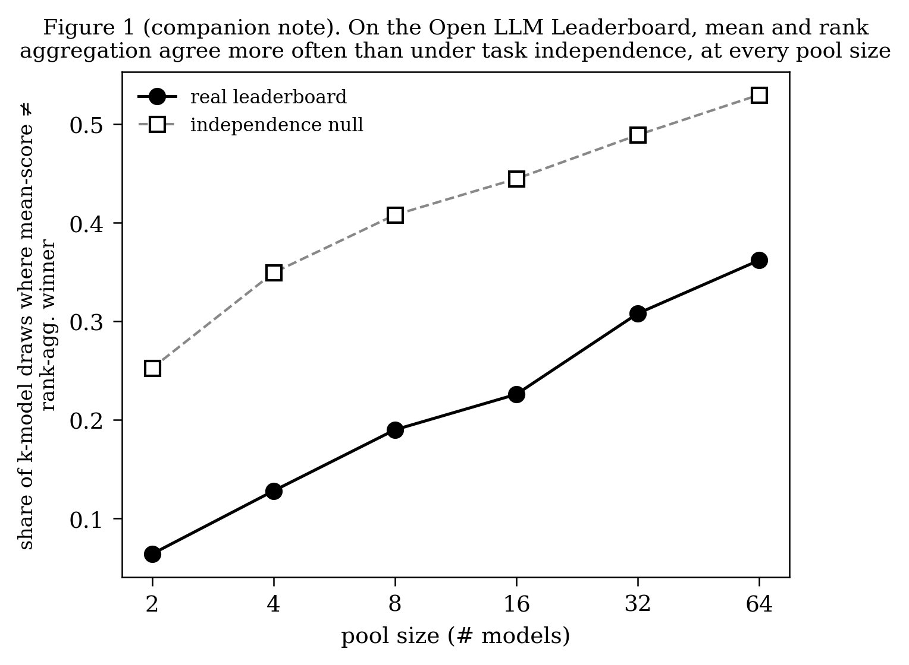

# One Task Flips the Top of a 4,497-Model Leaderboard: A Companion Note on the Decision Breakdown Point

**Sudhanshu Rai**
Independent Researcher · [ORCID 0009-0001-2447-0336](https://orcid.org/0009-0001-2447-0336) ·
me@sudhanshurai.org

*A companion note to "When the Best Forecasting Model Is a Tie: Pricing Model Choice Against Data Revision in the Extended Benefits Trigger" — self-contained; the paper is not required reading.*

## 1. The instrument, in one paragraph

The companion paper introduces the **decision breakdown point** (k\*): the fewest evaluation periods whose removal
flips a pooled winner declared over a panel of per-period scores, computed exactly by a greedy algorithm the paper
verifies against exhaustive search, and paired with a calibrated null that measures how much of an observed
bootstrap stability looks like genuine persistence versus what an arbitrary winner would produce by construction
alone. On the paper's own object — real-time U.S. official statistics — model selection is usually not statistically
identified at the available sample sizes. This note asks the same question of a very different object: a public,
actively updated 4,497-model machine-learning leaderboard.

## 2. The finding — which is not "leaderboards are chaotic"

The Open LLM Leaderboard v2 has 4,497 model entries scored on all six of its standard benchmark tasks (IFEval, BBH,
MATH Level 5, GPQA, MUSR, MMLU-PRO); each task's score is converted to a loss (100 minus the score) so that lower is
better throughout, as in the paper. The title's "4,497-model leaderboard" is the scale of the contest the #1 spot is
crowned out of, not the size of the panel k\* is computed on: k\* asks how many tasks it takes to flip the champion
against its *most dangerous rival*, and a model hundreds of ranks down the board — with a mean loss far from the
top's — has no realistic path to being that rival regardless of task deletion, so including it only adds
computation, not information. The instrument is applied to the top 30 entries by mean loss, with one setting
chosen for this object: the bootstrap's block length is one, because the six tasks have no serial order for a block
to preserve (Section 4). On that pool:

- **k\* = 1 of 6 tasks.** Deleting a single task (MUSR) flips the top-ranked model (MaziyarPanahi/calme-3.2-instruct-78b) to
  its binding rival (Qwen/Qwen2.5-72B-Instruct). A second contender also overtakes the top model at one deletion; the
  instrument names the first of the two in sort order, and k\* is the same either way.
- **The six tasks barely agree with each other among these top-30 contenders**: mean pairwise correlation of the six
  task-loss columns **-0.037** (individual task pairs range from -0.87 to +0.79) — essentially no shared signal at this
  end of the board. At face value this looks like it corroborates the k\*=1 reading; the range-restriction check later
  in this section shows why that reading does not hold up, and why this figure is better read as a consequence of the
  top-30 cut than as independent evidence.

A separate check, run on the **full 4,497-model board** rather than the top-30 pool (a crowding curve needs the real
population size to be informative, unlike k\* and the correlation figure, which are specifically about the contenders
for the top spot):

- **Mean-score and rank-aggregation winners agree more often than they would under task independence, at every scale tested.**
  For each pool size k=2, 4, 8, 16, 32, 64, we draw 500 random k-model pools from all 4,497 models and record the
  share of pools where the mean-loss winner differs from the rank-aggregation winner (the model with the lowest mean
  rank across the six tasks). The independence null repeats the identical procedure on a column-shuffled copy of the
  board — each task's loss column permuted independently across models, which keeps every task's marginal
  distribution and destroys only the cross-task linkage — averaged over 50 independent permutations; ties in either
  aggregate are resolved by the same deterministic rule on both sides. The real board's disagreement share (6.4%,
  12.8%, 19.0%, 22.6%, 30.8%, 36.2%) sits below the null's (25.3%, 34.9%, 40.8%, 44.5%, 48.9%, 53.0%) at every size
  (Monte Carlo SE of each real share is roughly 0.01–0.02 from 500 draws; the null's permutation sd is 0.02–0.03; the
  smallest gap, at k=64, is about eight real-share SE and five permutation sd). This is the expected consequence of
  the tasks' positive cross-task correlation on the full board — mean pairwise correlation **0.672**, which is what
  column-shuffling destroys — so the curve measures that the six tasks share signal across the whole board; it is not
  a measure of how separable the contenders at the top are.

*Real disagreement share (solid) sits below the column-shuffled independence null (dashed; the mean of 50
permutations — the permutation sd of 0.02–0.03 is not drawn) at every pool size k=2 through 64. The six tasks share
signal across the board, which is what this comparison measures.*

**Is the top-30's near-zero correlation independent evidence, or a range-restriction artifact?** We do not treat
the contrast between -0.037 and 0.672 as two independent illustrations of one pattern, and we check the alternative
explanation directly: selecting the top 30 models *by mean score* can mechanically suppress the correlation among
that pool's own task-level components even with no real "fragility at the top" at all, since a high combined score
is compatible with a strong showing on some tasks offset by a weak one on others (a form of range restriction). We
draw 2,000 **random** 30-model pools from the full board — not selected by mean score at all — and compute each
pool's own mean cross-task correlation: **0.670** on average (fifth-to-ninety-fifth-percentile band 0.551 to 0.773),
essentially equal to the board-wide **0.672** and nowhere near the real top-30's **-0.037**. This rules out pool
*size* as the cause: a random pool of thirty behaves like the whole board. It does not by itself test selection on
mean score, which is the mechanism range restriction names; we read the near-zero top-30 figure as consistent with
that mechanism, and not as independent evidence of fragility at the contended tip. The figure is reported as what
that specific pool shows, and carries no weight in this note beyond that.

The crowding-curve comparison is therefore the evidence this note leans on for "the board is comparatively
identified": it is computed on randomly drawn pools throughout, so the range-restriction concern does not reach it,
though what it establishes is shared task signal rather than separability at the top.

**A note on "identified," since this note stands alone.** This note never computes a Model Confidence Set for
the leaderboard, so "comparatively identified" here is grounded in the crowding-curve diagnostic above, not the
|MCS|-based classification the companion paper uses for its own headline counts (which is itself shorthand for a
specific test's outcome at a specific sample size, not a claim of population-level econometric non-identification
in Manski's (2003) sense — see the companion paper's own terminology note). The two are related in spirit, not
identical in construction; treat this note's "identified" language as its own, self-contained usage.

## 3. Reading k\* = 1 correctly: a count, never a bare fraction

k\* must always be read against its own T, not compared as a bare integer across settings with different T. Here
T = 6 (the six benchmark tasks), so k\* = 1 is **one sixth of the record** — a *large* fraction, not a small one.
Contrast the companion paper's own legacy neural exhibit: a 7-model, 38-year forecasting panel, where k\* = 3. Three
looks like a bigger number than one, but 3 of 38 years is about 8% of the record, while 1 of 6 tasks here is about
17% — *more than double* the fraction, despite the smaller raw count. Reporting either result as a fraction of a
different, unstated T — or comparing raw counts across settings with different T at all — is the single most likely
way to misread this class of result, and the count-versus-fraction discipline holds throughout both documents.
A related limitation is worth stating plainly: T = 6 gives k\* very coarse resolution. With only six tasks, k\* is an
integer count out of six, so once the answer is k\*=1 the instrument cannot distinguish a race that is barely
flippable from one that is comfortably flippable. The companion paper's home panels have T in the dozens, where
k\* has much finer resolution; this note's k\*=1 finding should be read with that coarseness in mind, not as a
precise measurement of how close the top of the board actually is.

## 4. Calibrating winner_stability: a number that turns out not to add much here

A bootstrap `winner_stability` of **0.672** (a numerical coincidence with Section 2's cross-task correlation —
unrelated quantities) measures how often the same model wins the top spot when periods (here, tasks) are resampled
with replacement. The bootstrap is i.i.d. — the six tasks are an exchangeable battery with no adjacency for a block
to preserve — and the statistic is averaged over 20 independent bootstrap seeds, the same treatment the null below
receives, because the statistic is only as reliable as its own bootstrap noise allows, and both sides of the
comparison should be averaged the same way. On its own, that number means nothing without a benchmark for what an
*arbitrary* winner — one selected from models that are, by construction, indistinguishable — would produce at this
leaderboard's own scale, under the same resampling scheme as the observed statistic. We computed that benchmark
directly: 20,000 synthetic panels (20 independent seeds × 1,000 panels each) of 30 exchangeable models over 6 tasks
— matching the dimensions (K=30, T=6) of the top-30 pool `winner_stability` is computed on — each with its own
i.i.d.-bootstrap `winner_stability`. The median and the 5th and 95th percentiles of that distribution, taken within
each seed's 1,000 panels and averaged across the 20 seeds, are 0.363 and 0.146–0.671.

The leaderboard's observed 0.672 sits almost exactly *at* that range's 95th percentile (0.671) — a hair above it
(the observed value's own seed-to-seed sd is 0.011; the null edge's is 0.018). By the one-sided threshold this
project uses elsewhere (a value *below* the null's 5th percentile is unusually fragile relative to chance), 0.672
does not flag the leaderboard as unusually fragile — and landing right at the boundary of the calibrated range,
rather than clearly inside or clearly above it, means this number does not provide clear evidence either way about
whether the top spot's persistence is distinguishable from what an arbitrary, exchangeable-model draw would produce
at K=30. `winner_stability` calibrated at this scale does not flag fragility and, if anything, sits at the stable
edge of what an arbitrary draw produces; it is the crowding comparison in Section 2 — not this one — that carries
the note's "comparatively identified" reading. We report the calibration anyway, because reporting only the
informative number and staying silent on the one that turned out not to help would be exactly the kind of
selective disclosure this note elsewhere argues against.

## 5. What this note is not

This is not a claim that the fragility signature the companion paper documents on real-time macroeconomic panels
"generalizes" to machine-learning leaderboards. It is the opposite kind of result: the same instrument, applied
here, shows a leaderboard that is *comparatively identified* by the crowding measure even while its own top rank is
flippable by a single task deletion (k\*=1 of 6). Computed as written, the companion paper's fixed Fragile rule —
`winner_stability` below 0.60, or a reversal (the pooled winner differing from the per-task plurality winner) with
k\*/T below 0.25 — fires on it, through the reversal leg: the stability leg does not fire (Section 4), but k\*/T is
1/6 and the pooled winner is not the plurality winner. That leg deserves one qualification and then stands. Under the
rule's strict-win plurality count, four entries are tied at one task win each, the pooled winner among them, and the
rule resolves that tie by a fixed alphabetical order, which lands on another entry. The tie exists only because the
pool contains one submission entered twice, under two names, with identical scores on all six tasks: that entry holds
the best score on two tasks yet records no strict win, since its two copies tie each other on both. Counted once, it
is the unique plurality winner, the pooled winner is outside the plurality set, and the reversal is unambiguous — so
the verdict does not rest on the tie-break. This is a differentiated verdict from applying the instrument itself,
distinct from the paper's own M4-competition control (Section 9). We are careful not to overstate that control: it
does run k\* and `winner_stability` directly on the real M4 panel, but never computes a Model Confidence Set there,
and never calibrates a chance null at that panel's scale, so it shows a domain where selection is unambiguous by
several partial criteria, not a full, general validation of the instrument. This note, by contrast, calibrates both
of its comparisons — the crowding curve against an independence null and `winner_stability` against an exchangeable
null at the pool's own dimensions — while, as Section 2 says, computing no Model Confidence Set either. This note
also does not compete with, or attempt to improve on, the Bradley-Terry / Chatbot-Arena ranking-instability
literature; Huang, Shen, Wei & Broderick (2025, arXiv:2508.11847) already give the sharpest known result there (an
adversarially chosen 0.003% of preference votes can flip a Bradley-Terry leaderboard's top rank), and this note's
loss/score-matrix instrument is a different, complementary tool applied to a different kind of leaderboard, not a
competing claim on the same one.

## 6. Reproducibility

Every number above is computed by the companion paper's own analysis pipeline — the same k\*/`winner_stability`
diagnostic and exchangeable-null calibration used throughout the paper, plus the crowding and range-restriction
checks described in Section 2 — applied to a public Hugging Face datasets-server snapshot of the Open LLM
Leaderboard v2, pinned at a point in time (2026-09-15) and archived with the paper's inputs for exact reproducibility (those inputs are not yet publicly deposited; see the paper's Section 12). The live
leaderboard continues to change, so a fresh pull would not return identical data (see the companion paper's
discussion of its own frozen inputs). The diagnostic and its calibration are released as the package
**`selection-fragility`**, archived at
[github.com/sudhanshurai360/selection-fragility](https://github.com/sudhanshurai360/selection-fragility) and
versioned on PyPI, with an archival release DOI [10.5281/zenodo.22699905](https://doi.org/10.5281/zenodo.22699905)
(v1.0.3, MIT license). For the full instrument, its calibrated null, and the real-time official-statistics
results this note is a companion to, see the paper: "When the Best Forecasting Model Is a Tie: Pricing Model Choice Against Data Revision in the Extended Benefits Trigger" (SSRN Abstract ID 7503218, https://papers.ssrn.com/sol3/papers.cfm?abstract_id=7503218).

## 7. Declaration of generative AI and AI-assisted technologies in the manuscript preparation process

During the preparation of this work, the author used Anthropic's Claude (via Claude Code) throughout the research
and writing process: to draft and iteratively revise this note's prose, to write, test, and review the analysis
code producing its numerical results, and to conduct repeated multi-pass adversarial review of both the code and
the text for correctness, consistency, and completeness. After using this tool, the author reviewed, independently
verified against the underlying data and computations, and edited all AI-assisted output, and takes full
responsibility for the content, analysis, and conclusions presented here.
